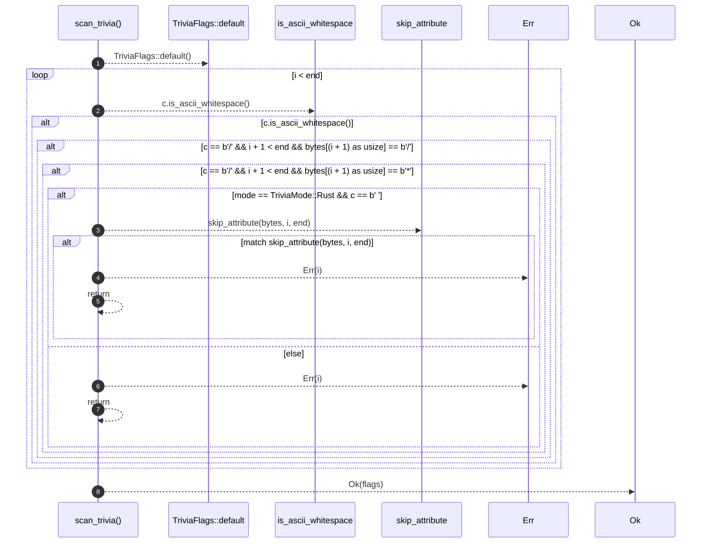

# `robby_ir::coverage::scan_trivia`

[Self-model](../../README.md) · [coverage](index.md)

| | |
|---|---|
| kind | `code.function` |
| signature | `fn scan_trivia(bytes: &[u8], start: u32, end: u32, mode: TriviaMode) -> Result<TriviaFlags, u32>` |
| location | [`crates/robby-ir/src/coverage.rs:316`](../../../../crates/robby-ir/src/coverage.rs#L316) |
| provenance | extractor · confidence 1.00 |

> Walk a byte range, accepting only whitespace, comments and (Rust) attributes.
> 
> Returns the byte offset of the first token that is none of those, which is
> what makes the gap report actionable: it points at the exact byte that is
> missing from the map.

```rust
/// Walk a byte range, accepting only whitespace, comments and (Rust) attributes.
///
/// Returns the byte offset of the first token that is none of those, which is
/// what makes the gap report actionable: it points at the exact byte that is
/// missing from the map.
fn scan_trivia(bytes: &[u8], start: u32, end: u32, mode: TriviaMode) -> Result<TriviaFlags, u32> {
    let mut flags = TriviaFlags::default();
    let mut i = start;
    // TypeScript shebang is trivia when it opens the file.
    if mode == TriviaMode::TypeScript && i == 0 && end >= 2 && bytes[0] == b'#' && bytes[1] == b'!'
    {
        flags.comment = true;
        while i < end && bytes[i as usize] != b'\n' {
            i += 1;
        }
    }
    while i < end {
        let c = bytes[i as usize];
        if c.is_ascii_whitespace() {
            flags.whitespace = true;
            i += 1;
        } else if c == b'/' && i + 1 < end && bytes[(i + 1) as usize] == b'/' {
            flags.comment = true;
            while i < end && bytes[i as usize] != b'\n' {
                i += 1;
            }
        } else if c == b'/' && i + 1 < end && bytes[(i + 1) as usize] == b'*' {
            flags.comment = true;
            let mut depth = 1u32;
            i += 2;
            while i < end && depth > 0 {
                if i + 1 < end && bytes[i as usize] == b'/' && bytes[(i + 1) as usize] == b'*' {
                    depth += 1;
                    i += 2;
                } else if i + 1 < end
                    && bytes[i as usize] == b'*'
                    && bytes[(i + 1) as usize] == b'/'
                {
                    depth -= 1;
                    i += 2;
                } else {
                    i += 1;
                }
            }
        } else if mode == TriviaMode::Rust && c == b'#' {
            match skip_attribute(bytes, i, end) {
                Some(next) => {
                    flags.attribute = true;
                    i = next;
                }
                None => return Err(i),
            }
        } else {
            return Err(i);
        }
    }
    Ok(flags)
}
```



8 steps · 0 observed · 8 possible only

**Edges**

- calls → [`robby_ir::process::impl Default for Process::default`](../process/index.md)
- calls → [`robby_ir::coverage::skip_attribute`](skip-attribute.md)

## References

- calls → [`robby_ir::coverage`](index.md) — skip_attribute
- calls → [`robby_ir::process`](../process/index.md) — default

## Referenced by

- calls ← [`robby_ir::coverage::make_gap`](make-gap.md)

