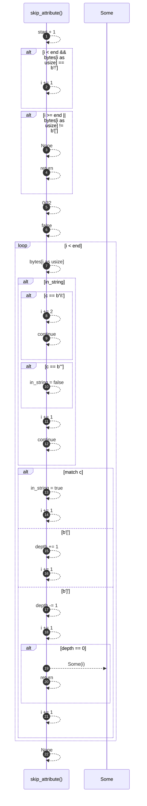

# `robby_ir::coverage::skip_attribute`

[Self-model](../../README.md) · [coverage](index.md)

| | |
|---|---|
| kind | `code.function` |
| signature | `fn skip_attribute(bytes: &[u8], start: u32, end: u32) -> Option<u32>` |
| location | [`crates/robby-ir/src/coverage.rs:344`](../../../../crates/robby-ir/src/coverage.rs#L344) |
| provenance | extractor · confidence 1.00 |

> Skip `#[...]` or `#![...]`, honouring nested brackets and string literals.

```rust
/// Skip `#[...]` or `#![...]`, honouring nested brackets and string literals.
fn skip_attribute(bytes: &[u8], start: u32, end: u32) -> Option<u32> {
    let mut i = start + 1;
    if i < end && bytes[i as usize] == b'!' {
        i += 1;
    }
    if i >= end || bytes[i as usize] != b'[' {
        return None;
    }
    let mut depth = 0i32;
    let mut in_string = false;
    while i < end {
        let c = bytes[i as usize];
        if in_string {
            if c == b'\\' {
                i += 2;
                continue;
            }
            if c == b'"' {
                in_string = false;
            }
            i += 1;
            continue;
        }
        match c {
            b'"' => {
                in_string = true;
                i += 1;
            }
            b'[' => {
                depth += 1;
                i += 1;
            }
            b']' => {
                depth -= 1;
                i += 1;
                if depth == 0 {
                    return Some(i);
                }
            }
            _ => i += 1,
        }
    }
    None
}
```



22 steps · 0 observed · 22 possible only

