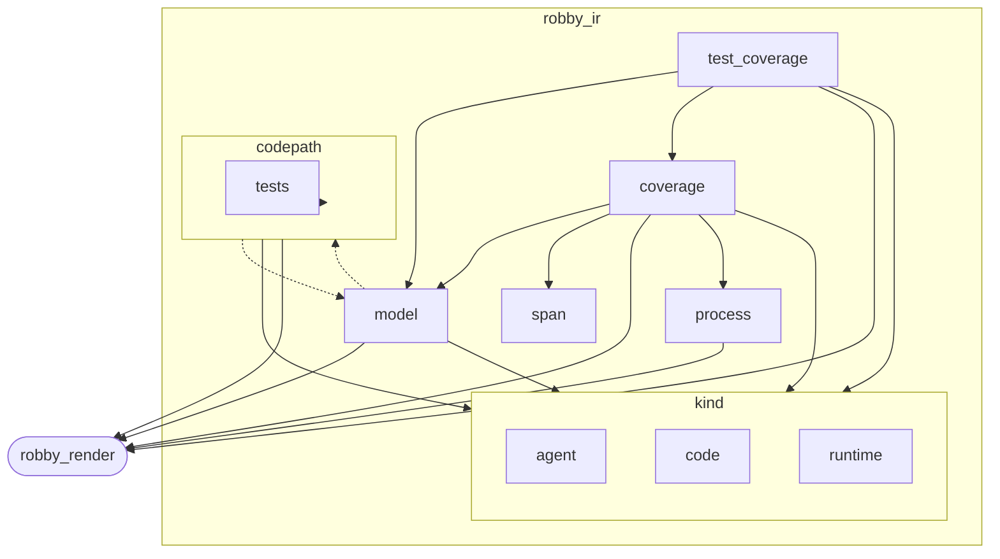

# `robby_ir`

[Self-model](../README.md)

| | |
|---|---|
| kind | `code.crate` |
| provenance | extractor · confidence 1.00 |
| nodes | 351 |

## Package diagram



## Module coupling

```mermaid
flowchart TB
    subgraph n_356bf2c23da68961["robby_ir"]
        direction TB
        subgraph n_c28bfd08cdfce4bf["codepath"]
            direction TB
            n_9f3013b2ce6a2db0["build_code_paths"]
            n_75a2e9a9dc77c1cf["builds_path_from_main"]
            n_310844e14983c9bc["find_entrypoints"]
            n_b2cbb53c41a04542["from_entry"]
            n_9810aa25daf31a47["respects_max_depth"]
            n_e9bb0634e2177808["sample_doc"]
        end
        subgraph n_965af55f4081b03f["coverage"]
            direction TB
            n_1539d79370dab438["all_spans"]
            n_fce5dec3b81efb91["classify"]
            n_12c676e91009217a["code_ratio"]
            n_e68b2f1462104869["document_coverage"]
            n_298b37ed3e660088["failures"]
            n_74e4ff10a7dfc268["file_coverage"]
            n_f23ddd4acf61487b["from_path"]
            n_1a9a05bb45ea296c["frontier_spans"]
            n_99b47e2d08834c4c["has_span_descendant"]
            n_fa28cd347d0d2d3f["is_complete"]
            n_fa11223399ba4180["is_failure"]
            n_55d765f1c3d46722["make_gap"]
            n_65587228358ccdc9["preview"]
            n_9181bfbdbc16c75c["scan_trivia"]
            n_9b74c92d5feaa2bb["skip_attribute"]
            n_5353b3e756462398["trivia_bytes"]
            n_0b8e21007960b596["uncovered_bytes"]
            n_4391b29df8f6f837["worst_first"]
        end
        subgraph n_611ba0cee1ac191f["kind"]
            direction TB
            n_46a6d3ecefce14cd["as_str"]
            n_ae0eeff51ed67edd["from"]
            n_e5fa024fa4386033["is_known"]
            n_9ad7a7d7cfd84f45["new"]
        end
        subgraph n_48c15551e2e91996["model"]
            direction TB
            n_e546d71fa4f69654["about"]
            n_ec2e46958b5dc892["default"]
            n_b3489a259ec30e17["error"]
            n_80b75adcd8002383["get"]
            n_8a5415d7daf6e60c["insert"]
            n_6311e7084b287418["leaf_name"]
            n_9655ec8c7f78876b["merge"]
            n_4d88a60cf9d4a01e["new"]
            n_ccd6dcdd0298397d["new"]
            n_d5fd1809d274d7a9["new"]
            n_523b5c88ab07476f["rebuild_code_paths"]
            n_e246ceacf9164349["subtree"]
            n_192ee09539008dbd["symbol"]
            n_ea6373866a29c8d4["validate"]
            n_3f94f0bb1c5a653c["walk"]
            n_ba675cd10b655ae1["warning"]
            n_0e9544ad390cedd5["with_lang"]
        end
        subgraph n_f5e61214f719e7ae["process"]
            direction TB
            n_043f1293c7ad8c3c["default"]
            n_9aae883b9b569ac9["new"]
        end
        subgraph n_9053aa1513b08ea5["span"]
            direction TB
            n_f96a2aa959c836db["at"]
            n_313d8a1618b10871["byte_range"]
            n_e5db91665baa2d8d["new"]
        end
        subgraph n_46b0c6f667b1fb40["test_coverage"]
            direction TB
            n_0b193972a1983a06["attributes_are_classified"]
            n_eee4ab9af74a2168["document_coverage_is_union_at_any_depth"]
            n_4d2a47f96135b80e["empty_file_is_trivially_complete"]
            n_6e5287b66b2ff142["frontier_spans_exclude_parents_that_have_span_children"]
            n_4065d207f8671e25["fully_covered_file_has_no_gaps"]
            n_c83f7c789f6b13f6["gap_preview_is_whitespace_collapsed"]
            n_cd050a460ec66c34["nested_spans_are_unioned_not_double_counted"]
            n_f916c261571f423f["report_orders_worst_files_first"]
            n_514c7e46850aa6a4["span"]
            n_7235be4ea824b149["spans_beyond_eof_are_clamped_not_panicking"]
            n_ddb2a12ff2308547["spans_from_other_files_are_ignored"]
            n_e47c1c1aa0db0c40["typescript_comments_and_shebang_are_trivia"]
            n_c3d3b0c6d7792dc9["typescript_hash_is_not_a_rust_attribute"]
            n_63a652301eb25a29["typescript_node_sets_lang"]
            n_80b1b25edb807166["unclaimed_code_fails_with_the_exact_byte"]
            n_d248e92311a4cff7["unreferenced_files_appear_fully_uncovered"]
            n_1e530833babc36c3["whitespace_and_comments_are_classified_not_failed"]
        end
        n_7f203267d92a1682["schema"]
        n_ca6f58cffa1dcfd5["schema_json"]
    end
    n_043f1293c7ad8c3c --> n_9aae883b9b569ac9
    n_0b193972a1983a06 --> n_514c7e46850aa6a4
    n_0b193972a1983a06 --> n_74e4ff10a7dfc268
    n_0b8e21007960b596 --> n_fa11223399ba4180
    n_0e9544ad390cedd5 -.->|"4 circular"| n_4d88a60cf9d4a01e
    n_0e9544ad390cedd5 --> n_6311e7084b287418
    n_0e9544ad390cedd5 --> n_ec2e46958b5dc892
    n_12c676e91009217a --> n_0b8e21007960b596
    n_1539d79370dab438 --> n_9ad7a7d7cfd84f45
    n_1a9a05bb45ea296c --> n_99b47e2d08834c4c
    n_1a9a05bb45ea296c --> n_9ad7a7d7cfd84f45
    n_1e530833babc36c3 --> n_514c7e46850aa6a4
    n_1e530833babc36c3 --> n_74e4ff10a7dfc268
    n_298b37ed3e660088 --> n_fa11223399ba4180
    n_310844e14983c9bc -->|"3"| n_46a6d3ecefce14cd
    n_3f94f0bb1c5a653c --> n_80b75adcd8002383
    n_4065d207f8671e25 --> n_514c7e46850aa6a4
    n_4065d207f8671e25 --> n_74e4ff10a7dfc268
    n_4391b29df8f6f837 -->|"2"| n_12c676e91009217a
    n_4d2a47f96135b80e --> n_74e4ff10a7dfc268
    n_4d88a60cf9d4a01e -.->|"1 circular"| n_0e9544ad390cedd5
    n_514c7e46850aa6a4 --> n_9ad7a7d7cfd84f45
    n_523b5c88ab07476f --> n_9f3013b2ce6a2db0
    n_5353b3e756462398 --> n_fa11223399ba4180
    n_55d765f1c3d46722 --> n_65587228358ccdc9
    n_55d765f1c3d46722 --> n_9181bfbdbc16c75c
    n_55d765f1c3d46722 --> n_9ad7a7d7cfd84f45
    n_55d765f1c3d46722 --> n_f23ddd4acf61487b
    n_55d765f1c3d46722 --> n_f96a2aa959c836db
    n_55d765f1c3d46722 --> n_fce5dec3b81efb91
    n_63a652301eb25a29 --> n_0e9544ad390cedd5
    n_63a652301eb25a29 --> n_192ee09539008dbd
    n_6e5287b66b2ff142 --> n_192ee09539008dbd
    n_6e5287b66b2ff142 --> n_1a9a05bb45ea296c
    n_6e5287b66b2ff142 --> n_80b75adcd8002383
    n_6e5287b66b2ff142 -->|"2"| n_8a5415d7daf6e60c
    n_6e5287b66b2ff142 -->|"5"| n_9ad7a7d7cfd84f45
    n_6e5287b66b2ff142 -->|"2"| n_ae0eeff51ed67edd
    n_7235be4ea824b149 --> n_514c7e46850aa6a4
    n_7235be4ea824b149 --> n_74e4ff10a7dfc268
    n_74e4ff10a7dfc268 --> n_313d8a1618b10871
    n_74e4ff10a7dfc268 -->|"2"| n_55d765f1c3d46722
    n_74e4ff10a7dfc268 --> n_9ad7a7d7cfd84f45
    n_75a2e9a9dc77c1cf --> n_9f3013b2ce6a2db0
    n_75a2e9a9dc77c1cf --> n_e9bb0634e2177808
    n_80b1b25edb807166 --> n_514c7e46850aa6a4
    n_80b1b25edb807166 --> n_74e4ff10a7dfc268
    n_80b1b25edb807166 --> n_fa11223399ba4180
    n_9181bfbdbc16c75c --> n_043f1293c7ad8c3c
    n_9181bfbdbc16c75c --> n_9b74c92d5feaa2bb
    n_9655ec8c7f78876b --> n_8a5415d7daf6e60c
    n_9810aa25daf31a47 --> n_192ee09539008dbd
    n_9810aa25daf31a47 --> n_b2cbb53c41a04542
    n_9810aa25daf31a47 --> n_e9bb0634e2177808
    n_99b47e2d08834c4c -->|"2"| n_80b75adcd8002383
    n_9f3013b2ce6a2db0 --> n_310844e14983c9bc
    n_9f3013b2ce6a2db0 --> n_b2cbb53c41a04542
    n_b2cbb53c41a04542 -->|"4"| n_46a6d3ecefce14cd
    n_b2cbb53c41a04542 -->|"5"| n_80b75adcd8002383
    n_b2cbb53c41a04542 -->|"2"| n_8a5415d7daf6e60c
    n_b2cbb53c41a04542 -->|"3"| n_9ad7a7d7cfd84f45
    n_c3d3b0c6d7792dc9 --> n_74e4ff10a7dfc268
    n_c83f7c789f6b13f6 --> n_514c7e46850aa6a4
    n_c83f7c789f6b13f6 --> n_74e4ff10a7dfc268
    n_c83f7c789f6b13f6 --> n_fa11223399ba4180
    n_ca6f58cffa1dcfd5 --> n_7f203267d92a1682
    n_cd050a460ec66c34 -->|"3"| n_514c7e46850aa6a4
    n_cd050a460ec66c34 --> n_74e4ff10a7dfc268
    n_d248e92311a4cff7 --> n_192ee09539008dbd
    n_d248e92311a4cff7 --> n_4391b29df8f6f837
    n_d248e92311a4cff7 -->|"3"| n_8a5415d7daf6e60c
    n_d248e92311a4cff7 -->|"4"| n_9ad7a7d7cfd84f45
    n_d248e92311a4cff7 --> n_e68b2f1462104869
    n_ddb2a12ff2308547 --> n_74e4ff10a7dfc268
    n_ddb2a12ff2308547 --> n_9ad7a7d7cfd84f45
    n_e246ceacf9164349 --> n_3f94f0bb1c5a653c
    n_e246ceacf9164349 --> n_ccd6dcdd0298397d
    n_e47c1c1aa0db0c40 --> n_74e4ff10a7dfc268
    n_e47c1c1aa0db0c40 --> n_9ad7a7d7cfd84f45
    n_e5db91665baa2d8d -->|"2"| n_f96a2aa959c836db
    n_e68b2f1462104869 --> n_1539d79370dab438
    n_e68b2f1462104869 --> n_46a6d3ecefce14cd
    n_e68b2f1462104869 --> n_74e4ff10a7dfc268
    n_e68b2f1462104869 --> n_80b75adcd8002383
    n_e68b2f1462104869 --> n_9ad7a7d7cfd84f45
    n_e9bb0634e2177808 -->|"5"| n_192ee09539008dbd
    n_e9bb0634e2177808 -->|"3"| n_8a5415d7daf6e60c
    n_e9bb0634e2177808 -->|"6"| n_9ad7a7d7cfd84f45
    n_ea6373866a29c8d4 -->|"7"| n_b3489a259ec30e17
    n_ea6373866a29c8d4 -->|"2"| n_ba675cd10b655ae1
    n_ea6373866a29c8d4 --> n_d5fd1809d274d7a9
    n_ea6373866a29c8d4 -->|"8"| n_e546d71fa4f69654
    n_ea6373866a29c8d4 --> n_e5fa024fa4386033
    n_ec2e46958b5dc892 --> n_d5fd1809d274d7a9
    n_eee4ab9af74a2168 -->|"2"| n_8a5415d7daf6e60c
    n_eee4ab9af74a2168 -->|"4"| n_9ad7a7d7cfd84f45
    n_eee4ab9af74a2168 --> n_ae0eeff51ed67edd
    n_eee4ab9af74a2168 --> n_e68b2f1462104869
    n_f916c261571f423f --> n_192ee09539008dbd
    n_f916c261571f423f --> n_4391b29df8f6f837
    n_f916c261571f423f --> n_46a6d3ecefce14cd
    n_f916c261571f423f -->|"3"| n_8a5415d7daf6e60c
    n_f916c261571f423f -->|"4"| n_9ad7a7d7cfd84f45
    n_f916c261571f423f --> n_e68b2f1462104869
    n_fa28cd347d0d2d3f --> n_fa11223399ba4180
```



## Dependency matrix

| | robby_ir | test_coverage | code | runtime | codepath | agent | tests | coverage | model | span | process | kind | robby_render |
|---|---:|---:|---:|---:|---:|---:|---:|---:|---:|---:|---:|---:|---:|
| **robby_ir** | · | | | | | | | | | | | | |
| **test_coverage** | | · | | | | | | 19 | 16 | | | 24 | 1 |
| **code** | | | · | | | | | | | | | | |
| **runtime** | | | | · | | | | | | | | | |
| **codepath** | | | | | · | | 2 | | 16⇄ | | | 16 | 7 |
| **agent** | | | | | | · | | | | | | | |
| **tests** | | | | | | | · | | | | | | |
| **coverage** | | | | | | | | · | 3 | 2 | 1 | 6 | 10 |
| **model** | | | | | 1⇄ | | | | · | | | 1 | 21 |
| **span** | | | | | | | | | | · | | | |
| **process** | | | | | | | | | | | · | | 4 |
| **kind** | | | | | | | | | | | | · | |
| **robby_render** | | | | | | | | | | | | | · |

Cycles: model ↔ codepath

## Comments

- `crates/robby-ir/src/codepath.rs:108:1` (docs, `robby_ir::codepath::find_entrypoints`): "Functions named `main` (MVP entrypoint set), sorted by FQN."
  ```
  /// Functions named `main` (MVP entrypoint set), sorted by FQN.
  pub fn find_entrypoints(doc: &Document) -> Vec<NodeId> {
      let mut entries: Vec<&crate::Node> = doc
          .nodes
          .values()
          .filter(|node| {
              node.name == "main" && node.kind.as_str() == kind::code::FUNCTION
          })
          .collect();
      entries.sort_by(|a, b| a.fqn.cmp(&b.fqn).then_with(|| a.id.as_str().cmp(b.id.as_str())));
      entries.into_iter().map(|n| n.id.clone()).collect()
  }
  ```
- `crates/robby-ir/src/codepath.rs:121:1` (docs, `robby_ir::codepath::build_code_paths`): "Build a [`CodePath`] for every discovered entrypoint."
  ```
  /// Build a [`CodePath`] for every discovered entrypoint.
  pub fn build_code_paths(doc: &Document, max_depth: u32) -> Vec<CodePath> {
      find_entrypoints(doc)
          .iter()
          .filter_map(|entry| CodePath::from_entry(doc, entry, max_depth))
          .collect()
  }
  ```
- `crates/robby-ir/src/codepath.rs:19:1` (docs, `robby_ir::codepath::CodePathEdge`): "One hop in an entrypoint call tree."
  ```
  /// One hop in an entrypoint call tree.
  #[derive(Debug, Clone, PartialEq, Serialize, Deserialize, JsonSchema)]
  pub struct CodePathEdge {
      pub from: NodeId,
      pub to: NodeId,
      /// Depth of [`Self::to`] from the path entry (entry itself is 0).
      pub depth: u32,
      #[serde(default = "default_confidence", skip_serializing_if = "is_one")]
      pub confidence: f32,
  }
  ```
- `crates/robby-ir/src/codepath.rs:38:1` (docs, `robby_ir::codepath::CodePath`): "Reachability tree rooted at one entrypoint function."
  ```
  /// Reachability tree rooted at one entrypoint function.
  #[derive(Debug, Clone, PartialEq, Serialize, Deserialize, JsonSchema)]
  pub struct CodePath {
      /// Entrypoint node (typically a `main`).
      pub entry: NodeId,
      /// BFS-ordered tree edges within this path. Shared callees may appear in
      /// multiple paths; consumers that need a single tree apply first-parent wins.
      pub edges: Vec<CodePathEdge>,
      pub max_depth: u32,
  }
  ```
- `crates/robby-ir/src/codepath.rs:50:5` (docs, `robby_ir::codepath::impl CodePath::from_entry`): "Build one path from `entry` over resolved `Calls` edges."
  ```
  /// Build one path from `entry` over resolved `Calls` edges.
      pub fn from_entry(doc: &Document, entry: &NodeId, max_depth: u32) -> Option<Self> {
          if doc.get(entry).is_none() {
              return None;
          }
  
          let mut edges = Vec::new();
          let mut placed = BTreeSet::new();
          placed.insert(entry.clone());
  
          let mut queue: VecDeque<(NodeId, u32)> = VecDeque::new();
          queue.push_back((entry.clone(), 0));
  
          while let Some((from_id, depth)) = queue.pop_front() {
              if depth >= max_depth {
                  continue;
              }
              let Some(from) = doc.get(&from_id) else {
                  continue;
              };
  
              let mut callees: Vec<(NodeId, f32)> = from
                  .edges
                  .iter()
                  .filter(|e| e.kind == EdgeKind::Calls && e.resolved)
                  .filter(|e| doc.get(&e.to).is_some())
                  .map(|e| (e.to.clone(), e.confidence))
                  .collect();
              callees.sort_by(|(a, _), (b, _)| {
                  let fa = doc.get(a).map(|n| n.fqn.as_str()).unwrap_or("");
                  let fb = doc.get(b).map(|n| n.fqn.as_str()).unwrap_or("");
                  fa.cmp(fb).then_with(|| a.as_str().cmp(b.as_str()))
              });
              callees.dedup_by(|(a, _), (b, _)| a == b);
  
              for (to, confidence) in callees {
                  if to == from_id || !placed.insert(to.clone()) {
                      continue;
                  }
                  let child_depth = depth + 1;
                  edges.push(CodePathEdge {
                      from: from_id.clone(),
                      to: to.clone(),
                      depth: child_depth,
                      confidence,
                  });
                  queue.push_back((to, child_depth));
              }
          }
  
          Some(Self {
              entry: entry.clone(),
              edges,
              max_depth,
          })
      }
  ```
- `crates/robby-ir/src/coverage.rs:103:5` (docs, `robby_ir::coverage::impl FileCoverage::trivia_bytes`): "Bytes classified as trivia rather than claimed by a node."
  ```
  /// Bytes classified as trivia rather than claimed by a node.
      pub fn trivia_bytes(&self) -> u32 {
          self.gaps
              .iter()
              .filter(|g| !g.reason.is_failure())
              .map(|g| g.span.end.byte.saturating_sub(g.span.start.byte))
              .sum()
      }
  ```
- `crates/robby-ir/src/coverage.rs:132:5` (docs, `robby_ir::coverage::impl CoverageReport::worst_first`): "Files sorted worst-first. This is the "where do I look?" ordering."
  ```
  /// Files sorted worst-first. This is the "where do I look?" ordering.
      pub fn worst_first(&self) -> Vec<&FileCoverage> {
          let mut files: Vec<&FileCoverage> = self.files.iter().collect();
          files.sort_by(|a, b| {
              a.code_ratio()
                  .partial_cmp(&b.code_ratio())
                  .unwrap_or(std::cmp::Ordering::Equal)
                  .then_with(|| a.file.cmp(&b.file))
          });
          files
      }
  ```
- `crates/robby-ir/src/coverage.rs:145:1` (docs, `robby_ir::coverage::file_coverage`): "Compute coverage for one file given the spans that claim it."
  ```
  /// Compute coverage for one file given the spans that claim it.
  pub fn file_coverage(file: &str, source: &str, spans: &[Span]) -> FileCoverage {
      let len = source.len() as u32;
      let bytes = source.as_bytes();
  
      let mut ranges: Vec<(u32, u32)> = spans
          .iter()
          .filter(|s| s.file == file)
          .map(|s| {
              let (a, b) = s.byte_range();
              (a.min(len), b.min(len))
          })
          .filter(|(a, b)| a < b)
          .collect();
      ranges.sort_unstable();
  
      let mut merged: Vec<(u32, u32)> = Vec::with_capacity(ranges.len());
      for (a, b) in ranges {
          match merged.last_mut() {
              Some(last) if a <= last.1 => last.1 = last.1.max(b),
              _ => merged.push((a, b)),
          }
      }
  
      let covered_bytes: u32 = merged.iter().map(|(a, b)| b - a).sum();
  
      let mut gaps = Vec::new();
      let mut cursor = 0u32;
      for (a, b) in &merged {
          if *a > cursor {
              gaps.push(make_gap(file, source, bytes, cursor, *a));
          }
          cursor = (*b).max(cursor);
      }
      if cursor < len {
          gaps.push(make_gap(file, source, bytes, cursor, len));
      }
  
      FileCoverage {
          file: file.to_owned(),
          total_bytes: len,
          covered_bytes,
          gaps,
      }
  }
  ```
- `crates/robby-ir/src/coverage.rs:191:1` (docs, `robby_ir::coverage::document_coverage`): "Compute coverage for every source file referenced by the document. Files present in `sources` but never referenced stil…"
  ```
  /// Compute coverage for every source file referenced by the document.
  ///
  /// Files present in `sources` but never referenced still appear in the report,
  /// fully uncovered. A file that exists and is invisible to the map is exactly
  /// the failure mode this tool exists to prevent.
  pub fn document_coverage(doc: &Document, sources: &BTreeMap<String, String>) -> CoverageReport {
      let spans_by_file = all_spans(doc);
  
      let mut files = Vec::new();
      for (path, source) in sources {
          let spans = spans_by_file.get(path.as_str()).cloned().unwrap_or_default();
          files.push(file_coverage(path, source, &spans));
      }
      files.sort_by(|a, b| a.file.cmp(&b.file));
  
      CoverageReport { files }
  }
  ```
- `crates/robby-ir/src/coverage.rs:209:1` (docs, `robby_ir::coverage::all_spans`): "Every span in the document, per file. This is the default claim set: a byte is represented when *some* node owns it, at…"
  ```
  /// Every span in the document, per file.
  ///
  /// This is the default claim set: a byte is represented when *some* node owns
  /// it, at any nesting level. It catches missing items, missing files, and code
  /// outside any item. It deliberately does **not** try to catch shallow nesting —
  /// a function span covers its own body, and proving that every statement got a
  /// node needs the AST. That check lives in the extractor.
  pub fn all_spans(doc: &Document) -> BTreeMap<String, Vec<Span>> {
      let mut out: BTreeMap<String, Vec<Span>> = BTreeMap::new();
      for node in doc.nodes.values() {
          if let Some(span) = &node.span {
              out.entry(span.file.clone()).or_default().push(span.clone());
          }
      }
      out
  }
  ```
- `crates/robby-ir/src/coverage.rs:226:1` (docs, `robby_ir::coverage::frontier_spans`): "The spans that actually claim source, per file. A node is a **frontier** node when no descendant carries a span. Only f…"
  ```
  /// The spans that actually claim source, per file.
  ///
  /// A node is a **frontier** node when no descendant carries a span. Only
  /// frontier spans count towards coverage: a parent's span is structural, and
  /// including it would make coverage trivially 100% for any file with a
  /// top-level item. The finest claim is the claim.
  pub fn frontier_spans(doc: &Document) -> BTreeMap<String, Vec<Span>> {
      let mut out: BTreeMap<String, Vec<Span>> = BTreeMap::new();
      for (id, node) in &doc.nodes {
          let Some(span) = &node.span else { continue };
          if has_span_descendant(doc, id) {
              continue;
          }
          out.entry(span.file.clone()).or_default().push(span.clone());
      }
      out
  }
  ```
- `crates/robby-ir/src/coverage.rs:322:1` (docs, `robby_ir::coverage::scan_trivia`): "Walk a byte range, accepting only whitespace, comments and (Rust) attributes. Returns the byte offset of the first toke…"
  ```
  /// Walk a byte range, accepting only whitespace, comments and (Rust) attributes.
  ///
  /// Returns the byte offset of the first token that is none of those, which is
  /// what makes the gap report actionable: it points at the exact byte that is
  /// missing from the map.
  fn scan_trivia(
      bytes: &[u8],
      start: u32,
      end: u32,
      mode: TriviaMode,
  ) -> Result<TriviaFlags, u32> {
      let mut flags = TriviaFlags::default();
      let mut i = start;
      // TypeScript shebang is trivia when it opens the file.
      if mode == TriviaMode::TypeScript && i == 0 && end >= 2 && bytes[0] == b'#' && bytes[1] == b'!' {
          flags.comment = true;
          while i < end && bytes[i as usize] != b'\n' {
              i += 1;
          }
      }
      while i < end {
          let c = bytes[i as usize];
          if c.is_ascii_whitespace() {
              flags.whitespace = true;
              i += 1;
          } else if c == b'/' && i + 1 < end && bytes[(i + 1) as usize] == b'/' {
              flags.comment = true;
              while i < end && bytes[i as usize] != b'\n' {
                  i += 1;
              }
          } else if c == b'/' && i + 1 < end && bytes[(i + 1) as usize] == b'*' {
              flags.comment = true;
              let mut depth = 1u32;
              i += 2;
              while i < end && depth > 0 {
                  if i + 1 < end && bytes[i as usize] == b'/' && bytes[(i + 1) as usize] == b'*' {
                      depth += 1;
                      i += 2;
                  } else if i + 1 < end && bytes[i as usize] == b'*' && bytes[(i + 1) as usize] == b'/' {
                      depth -= 1;
                      i += 2;
                  } else {
                      i += 1;
                  }
              }
          } else if mode == TriviaMode::Rust && c == b'#' {
              match skip_attribute(bytes, i, end) {
                  Some(next) => {
                      flags.attribute = true;
                      i = next;
                  }
                  None => return Err(i),
              }
          } else {
              return Err(i);
          }
      }
      Ok(flags)
  }
  ```
- `crates/robby-ir/src/coverage.rs:382:1` (docs, `robby_ir::coverage::skip_attribute`): "Skip `#[...]` or `#![...]`, honouring nested brackets and string literals."
  ```
  /// Skip `#[...]` or `#![...]`, honouring nested brackets and string literals.
  fn skip_attribute(bytes: &[u8], start: u32, end: u32) -> Option<u32> {
      let mut i = start + 1;
      if i < end && bytes[i as usize] == b'!' {
          i += 1;
      }
      if i >= end || bytes[i as usize] != b'[' {
          return None;
      }
      let mut depth = 0i32;
      let mut in_string = false;
      while i < end {
          let c = bytes[i as usize];
          if in_string {
              if c == b'\\' {
                  i += 2;
                  continue;
              }
              if c == b'"' {
                  in_string = false;
              }
              i += 1;
              continue;
          }
          match c {
              b'"' => {
                  in_string = true;
                  i += 1;
              }
              b'[' => {
                  depth += 1;
                  i += 1;
              }
              b']' => {
                  depth -= 1;
                  i += 1;
                  if depth == 0 {
                      return Some(i);
                  }
              }
              _ => i += 1,
          }
      }
      None
  }
  ```
- `crates/robby-ir/src/coverage.rs:41:5` (docs, `robby_ir::coverage::impl GapReason::is_failure`): "Only `Unknown` is a failure."
  ```
  /// Only `Unknown` is a failure.
      pub fn is_failure(&self) -> bool {
          matches!(self, GapReason::Unknown { .. })
      }
  ```
- `crates/robby-ir/src/coverage.rs:69:5` (docs, `robby_ir::coverage::impl FileCoverage::uncovered_bytes`): "Bytes in gaps that fail the gate."
  ```
  /// Bytes in gaps that fail the gate.
      pub fn uncovered_bytes(&self) -> u32 {
          self.gaps
              .iter()
              .filter(|g| g.reason.is_failure())
              .map(|g| g.span.end.byte.saturating_sub(g.span.start.byte))
              .sum()
      }
  ```
- `crates/robby-ir/src/coverage.rs:78:5` (docs, `robby_ir::coverage::impl FileCoverage::ratio`): "Fraction of the file owned by nodes, in `0.0..=1.0`. This counts comments and blank lines against the file, which is ho…"
  ```
  /// Fraction of the file owned by nodes, in `0.0..=1.0`.
      ///
      /// This counts comments and blank lines against the file, which is honest
      /// but reads badly. Prefer [`FileCoverage::code_ratio`] for a headline.
      pub fn ratio(&self) -> f32 {
          if self.total_bytes == 0 {
              1.0
          } else {
              self.covered_bytes as f32 / self.total_bytes as f32
          }
      }
  ```
- `crates/robby-ir/src/coverage.rs:90:5` (docs, `robby_ir::coverage::impl FileCoverage::code_ratio`): "Fraction of *code* bytes owned by nodes, excluding classified trivia. This is the number that should be 100%: every byt…"
  ```
  /// Fraction of *code* bytes owned by nodes, excluding classified trivia.
      ///
      /// This is the number that should be 100%: every byte that is not
      /// whitespace, comment, or attribute must belong to something.
      pub fn code_ratio(&self) -> f32 {
          let code = self.covered_bytes + self.uncovered_bytes();
          if code == 0 {
              1.0
          } else {
              self.covered_bytes as f32 / code as f32
          }
      }
  ```
- `crates/robby-ir/src/kind.rs:104:1` (docs, `robby_ir::kind::is_known`): "True when `kind` is understood by the current version of the tool. Unknown kinds are never an error — they are rendered…"
  ```
  /// True when `kind` is understood by the current version of the tool.
  ///
  /// Unknown kinds are never an error — they are rendered generically and
  /// reported as a soft gap, so an older viewer can still display a newer graph.
  pub fn is_known(kind: &Kind) -> bool {
      matches!(kind.namespace(), "code" | "runtime" | "agent")
  }
  ```
- `crates/robby-ir/src/kind.rs:17:1` (docs, `robby_ir::kind::Kind`): "A namespaced, open-ended kind tag."
  ```
  /// A namespaced, open-ended kind tag.
  #[derive(Debug, Clone, PartialEq, Eq, PartialOrd, Ord, Hash, Serialize, Deserialize, JsonSchema)]
  #[serde(transparent)]
  pub struct Kind(String);
  ```
- `crates/robby-ir/src/kind.rs:31:5` (docs, `robby_ir::kind::impl Kind::namespace`): "The namespace prefix, e.g. `code` in `code.function`."
  ```
  /// The namespace prefix, e.g. `code` in `code.function`.
      pub fn namespace(&self) -> &str {
          self.0.split('.').next().unwrap_or(&self.0)
      }
  ```
- `crates/robby-ir/src/lib.rs:39:1` (docs, `robby_ir::schema`): "The JSON Schema for [`Document`], derived from the Rust types. This is the single source of truth for the contract. Typ…"
  ```
  /// The JSON Schema for [`Document`], derived from the Rust types.
  ///
  /// This is the single source of truth for the contract. TypeScript types are
  /// generated from this later rather than maintained by hand.
  pub fn schema() -> schemars::Schema {
      schemars::schema_for!(Document)
  }
  ```
- `crates/robby-ir/src/lib.rs:47:1` (docs, `robby_ir::schema_json`): "Pretty-printed JSON Schema."
  ```
  /// Pretty-printed JSON Schema.
  pub fn schema_json() -> String {
      serde_json::to_string_pretty(&schema()).expect("schema is always serializable")
  }
  ```
- `crates/robby-ir/src/model.rs:135:1` (docs, `robby_ir::model::Edge`): "A directed relationship between nodes."
  ```
  /// A directed relationship between nodes.
  #[derive(Debug, Clone, PartialEq, Serialize, Deserialize, JsonSchema)]
  pub struct Edge {
      pub to: NodeId,
      pub kind: EdgeKind,
      #[serde(default, skip_serializing_if = "Option::is_none")]
      pub span: Option<Span>,
      #[serde(default, skip_serializing_if = "is_one")]
      pub confidence: f32,
      /// `false` when the target could not be resolved to a node in this graph.
      ///
      /// Unresolved edges are kept, never dropped. Losing edges silently is how
      /// a map stops being trustworthy.
      #[serde(default = "default_true")]
      pub resolved: bool,
  }
  ```
- `crates/robby-ir/src/model.rs:16:1` (docs, `robby_ir::model::NodeId`): "A stable, content-addressed node identifier. Symbols use `lang://fqn`, e.g. `rust://robby_ir::model::Node`. Statements …"
  ```
  /// A stable, content-addressed node identifier.
  ///
  /// Symbols use `lang://fqn`, e.g. `rust://robby_ir::model::Node`. Statements
  /// use `parent#ordinal`. Ordinal-based ids are stable within a run but shift
  /// when earlier siblings change; that is documented and accepted, because
  /// byte-offset ids would shift on every edit above them instead.
  #[derive(Debug, Clone, PartialEq, Eq, PartialOrd, Ord, Hash, Serialize, Deserialize, JsonSchema)]
  #[serde(transparent)]
  pub struct NodeId(String);
  ```
- `crates/robby-ir/src/model.rs:186:1` (docs, `robby_ir::model::Node`): "A single described thing: a crate, a function, a statement, an observation."
  ```
  /// A single described thing: a crate, a function, a statement, an observation.
  #[derive(Debug, Clone, PartialEq, Serialize, Deserialize, JsonSchema)]
  pub struct Node {
      pub id: NodeId,
      pub kind: Kind,
      pub name: String,
      /// Fully-qualified, language-native path where one exists.
      pub fqn: String,
      pub lang: Lang,
      #[serde(default, skip_serializing_if = "Option::is_none")]
      pub span: Option<Span>,
      #[serde(default, skip_serializing_if = "Option::is_none")]
      pub signature: Option<String>,
      #[serde(default, skip_serializing_if = "Option::is_none")]
      pub docs: Option<String>,
      pub provenance: Provenance,
      #[serde(default, skip_serializing_if = "Option::is_none")]
      pub parent: Option<NodeId>,
      #[serde(default, skip_serializing_if = "Vec::is_empty")]
      pub children: Vec<NodeId>,
      #[serde(default, skip_serializing_if = "Vec::is_empty")]
      pub edges: Vec<Edge>,
      #[serde(default, skip_serializing_if = "Option::is_none")]
      pub process: Option<Process>,
      #[serde(default, skip_serializing_if = "BTreeMap::is_empty")]
      pub annotations: BTreeMap<String, String>,
      #[serde(default, skip_serializing_if = "Vec::is_empty")]
      pub tags: Vec<String>,
  }
  ```
- `crates/robby-ir/src/model.rs:221:5` (docs, `robby_ir::model::impl Node::with_lang`): "Like [`Node::new`], with an explicit language tag."
  ```
  /// Like [`Node::new`], with an explicit language tag.
      pub fn with_lang(
          id: impl Into<NodeId>,
          kind: impl Into<Kind>,
          fqn: impl Into<String>,
          lang: Lang,
      ) -> Self {
          let fqn = fqn.into();
          let name = leaf_name(&fqn);
          Self {
              id: id.into(),
              kind: kind.into(),
              name,
              fqn,
              lang,
              span: None,
              signature: None,
              docs: None,
              provenance: Provenance::default(),
              parent: None,
              children: Vec::new(),
              edges: Vec::new(),
              process: None,
              annotations: BTreeMap::new(),
              tags: Vec::new(),
          }
      }
  ```
- `crates/robby-ir/src/model.rs:280:1` (docs, `robby_ir::model::leaf_name`): "Leaf segment of an FQN across Rust (`::`), path (`/`), and dotted TS forms."
  ```
  /// Leaf segment of an FQN across Rust (`::`), path (`/`), and dotted TS forms.
  pub fn leaf_name(fqn: &str) -> String {
      let after_colon = fqn.rsplit("::").next().unwrap_or(fqn);
      let after_slash = after_colon.rsplit('/').next().unwrap_or(after_colon);
      after_slash
          .rsplit('.')
          .next()
          .unwrap_or(after_slash)
          .to_owned()
  }
  ```
- `crates/robby-ir/src/model.rs:291:1` (docs, `robby_ir::model::Document`): "The whole graph for one workspace snapshot."
  ```
  /// The whole graph for one workspace snapshot.
  #[derive(Debug, Clone, PartialEq, Serialize, Deserialize, JsonSchema)]
  pub struct Document {
      pub schema_version: u32,
      /// Tool name and version that produced this document.
      pub generator: String,
      pub nodes: BTreeMap<NodeId, Node>,
      /// Node ids with no parent.
      pub roots: Vec<NodeId>,
      /// Every source file this document claims to describe.
      ///
      /// This is what makes "no file is invisible" checkable: the coverage gate
      /// reads this list, so a file that was never parsed is a failure rather
      /// than an absence.
      #[serde(default, skip_serializing_if = "Vec::is_empty")]
      pub files: Vec<String>,
      /// Entrypoint-rooted call trees derived from resolved `Calls` edges.
      #[serde(default, skip_serializing_if = "Vec::is_empty")]
      pub code_paths: Vec<CodePath>,
  }
  ```
- `crates/robby-ir/src/model.rs:324:5` (docs, `robby_ir::model::impl Document::rebuild_code_paths`): "Rebuild [`Self::code_paths`] from current `Calls` edges and `main` entries."
  ```
  /// Rebuild [`Self::code_paths`] from current `Calls` edges and `main` entries.
      pub fn rebuild_code_paths(&mut self) {
          self.code_paths = build_code_paths(self, DEFAULT_MAX_DEPTH);
      }
  ```
- `crates/robby-ir/src/model.rs:329:5` (docs, `robby_ir::model::impl Document::declare_file`): "Record a source file as part of the map."
  ```
  /// Record a source file as part of the map.
      pub fn declare_file(&mut self, path: impl Into<String>) {
          let path = path.into();
          if !self.files.contains(&path) {
              self.files.push(path);
              self.files.sort();
          }
      }
  ```
- `crates/robby-ir/src/model.rs:352:5` (docs, `robby_ir::model::impl Document::merge`): "Insert, or merge into an existing node with the same id. Merging matters for modules: a `mod foo;` declaration and the …"
  ```
  /// Insert, or merge into an existing node with the same id.
      ///
      /// Merging matters for modules: a `mod foo;` declaration and the file
      /// `foo.rs` both describe `crate::foo`. The declaration carries the span,
      /// the file carries the contents, and they must not overwrite each other.
      pub fn merge(&mut self, node: Node) {
          let id = node.id.clone();
          if let Some(existing) = self.nodes.get_mut(&id) {
              if existing.span.is_none() {
                  existing.span = node.span;
              }
              for child in node.children {
                  if !existing.children.contains(&child) {
                      existing.children.push(child);
                  }
              }
              for edge in node.edges {
                  if !existing.edges.contains(&edge) {
                      existing.edges.push(edge);
                  }
              }
              for (key, value) in node.annotations {
                  existing.annotations.entry(key).or_insert(value);
              }
              for tag in node.tags {
                  if !existing.tags.contains(&tag) {
                      existing.tags.push(tag);
                  }
              }
              return;
          }
          self.insert(node);
      }
  ```
- `crates/robby-ir/src/model.rs:390:5` (docs, `robby_ir::model::impl Document::subtree`): "All nodes under `root`, depth-first, deterministic order."
  ```
  /// All nodes under `root`, depth-first, deterministic order.
      pub fn subtree(&self, root: &NodeId) -> Vec<&Node> {
          let mut out = Vec::new();
          self.walk(root, &mut out);
          out
      }
  ```
- `crates/robby-ir/src/model.rs:450:1` (docs, `robby_ir::model::validate`): "Structural checks that do not depend on source text. Returns diagnostics rather than a `Result`: a graph with warnings …"
  ```
  /// Structural checks that do not depend on source text.
  ///
  /// Returns diagnostics rather than a `Result`: a graph with warnings is still
  /// renderable, and hiding soft problems behind a hard error is how they rot.
  pub fn validate(doc: &Document) -> Vec<Diagnostic> {
      let mut out = Vec::new();
  
      if doc.schema_version != SCHEMA_VERSION {
          out.push(Diagnostic::error(
              "schema/version",
              format!(
                  "document schema_version {} does not match tool {}",
                  doc.schema_version, SCHEMA_VERSION
              ),
          ));
      }
  
      for (id, node) in &doc.nodes {
          if let Some(parent) = &node.parent {
              if !doc.nodes.contains_key(parent) {
                  out.push(
                      Diagnostic::error(
                          "node/parent-missing",
                          format!("parent {parent} is not in the document"),
                      )
                      .about(id.clone()),
                  );
              }
          }
          for child in &node.children {
              if !doc.nodes.contains_key(child) {
                  out.push(
                      Diagnostic::error(
                          "node/child-missing",
                          format!("child {child} is not in the document"),
                      )
                      .about(id.clone()),
                  );
              }
          }
          for edge in &node.edges {
              if edge.resolved && !doc.nodes.contains_key(&edge.to) {
                  out.push(
                      Diagnostic::error(
                          "edge/target-missing",
                          format!("resolved edge points at missing node {}", edge.to),
                      )
                      .about(id.clone()),
                  );
              }
              if !edge.resolved {
                  out.push(
                      Diagnostic::warning(
                          "edge/unresolved",
                          format!("edge to {} was never resolved", edge.to),
                      )
                      .about(id.clone()),
                  );
              }
          }
          if !crate::kind::is_known(&node.kind) {
              out.push(
                  Diagnostic::warning(
                      "kind/unknown-namespace",
                      format!("kind `{}` has an unknown namespace", node.kind),
                  )
                  .about(id.clone()),
              );
          }
      }
  
      for path in &doc.code_paths {
          if !doc.nodes.contains_key(&path.entry) {
              out.push(
                  Diagnostic::error(
                      "codepath/entry-missing",
                      format!("code path entry {} is not in the document", path.entry),
                  )
                  .about(path.entry.clone()),
              );
          }
          for edge in &path.edges {
              if !doc.nodes.contains_key(&edge.from) {
                  out.push(
                      Diagnostic::error(
                          "codepath/from-missing",
                          format!("code path edge from missing node {}", edge.from),
                      )
                      .about(edge.from.clone()),
                  );
              }
              if !doc.nodes.contains_key(&edge.to) {
                  out.push(
                      Diagnostic::error(
                          "codepath/to-missing",
                          format!("code path edge to missing node {}", edge.to),
                      )
                      .about(edge.to.clone()),
                  );
              }
          }
      }
  
      out
  }
  ```
- `crates/robby-ir/src/model.rs:62:1` (docs, `robby_ir::model::Source`): "Which producer contributed a fact."
  ```
  /// Which producer contributed a fact.
  #[derive(Debug, Clone, Copy, PartialEq, Eq, Serialize, Deserialize, JsonSchema)]
  #[serde(rename_all = "snake_case")]
  pub enum Source {
      /// Parsed from source without annotations.
      Extractor,
      /// Contributed by an explicit macro annotation.
      Macro,
      /// Recorded while the code ran.
      Trace,
      /// Emitted by an agent describing its own process.
      Agent,
      /// Authored by hand (fixtures, bootstrap data).
      Hand,
  }
  ```
- `crates/robby-ir/src/model.rs:79:5` (docs, `robby_ir::model::impl Source::precedence`): "Lower numbers win when two producers disagree about the same fact. Runtime beats static because observation is ground t…"
  ```
  /// Lower numbers win when two producers disagree about the same fact.
      ///
      /// Runtime beats static because observation is ground truth; explicit
      /// annotation beats parsing because it carries intent.
      pub fn precedence(self) -> u8 {
          match self {
              Source::Trace => 0,
              Source::Agent => 1,
              Source::Macro => 2,
              Source::Extractor => 3,
              Source::Hand => 4,
          }
      }
  ```
- `crates/robby-ir/src/model.rs:94:1` (docs, `robby_ir::model::Provenance`): "Where a fact came from and how much to trust it."
  ```
  /// Where a fact came from and how much to trust it.
  #[derive(Debug, Clone, PartialEq, Serialize, Deserialize, JsonSchema)]
  pub struct Provenance {
      pub source: Source,
      /// Unix milliseconds. `None` means the fact is timeless (static analysis).
      #[serde(default, skip_serializing_if = "Option::is_none")]
      pub observed_at: Option<i64>,
      /// `0.0..=1.0`. Static resolution that could not disambiguate a path
      /// records its uncertainty here rather than dropping the edge.
      pub confidence: f32,
  }
  ```
- `crates/robby-ir/src/process.rs:100:5` (docs, `robby_ir::process::impl Process::participant`): "Add a participant, returning its index. Duplicate ids are ignored."
  ```
  /// Add a participant, returning its index. Duplicate ids are ignored.
      pub fn participant(&mut self, id: impl Into<String>, label: impl Into<String>, kind: Kind) -> usize {
          let id = id.into();
          if let Some(idx) = self.participants.iter().position(|p| p.id == id) {
              return idx;
          }
          self.participants.push(Participant {
              id,
              label: label.into(),
              kind,
          });
          self.participants.len() - 1
      }
  ```
- `crates/robby-ir/src/process.rs:118:5` (docs, `robby_ir::process::impl Process::absorb`): "Merge an observed process into this (static) one. Matching is by `(from, to, label)`. Steps seen at runtime are marked …"
  ```
  /// Merge an observed process into this (static) one.
      ///
      /// Matching is by `(from, to, label)`. Steps seen at runtime are marked
      /// observed; steps known statically but never seen stay dashed. Observed
      /// steps not present statically are appended, because runtime is the
      /// ground truth for what actually happened.
      pub fn absorb(&mut self, observed: &Process) {
          for p in &observed.participants {
              if !self.participants.iter().any(|q| q.id == p.id) {
                  self.participants.push(p.clone());
              }
          }
  
          let mut matched = vec![false; observed.steps.len()];
          for step in &mut self.steps {
              if let Some(idx) = observed.steps.iter().position(|o| {
                  o.from == step.from && o.to == step.to && o.label == step.label
              }) {
                  step.observed = true;
                  matched[idx] = true;
              }
          }
          for (idx, step) in observed.steps.iter().enumerate() {
              if !matched[idx] {
                  self.steps.push(step.clone());
              }
          }
      }
  ```
- `crates/robby-ir/src/process.rs:18:1` (docs, `robby_ir::process::Participant`): "One lifeline in a sequence diagram. Today a participant is a module, scope, or type. The field set is deliberately acto…"
  ```
  /// One lifeline in a sequence diagram.
  ///
  /// Today a participant is a module, scope, or type. The field set is
  /// deliberately actor-neutral so that `agent.*` participants can be added
  /// later without touching the renderer.
  #[derive(Debug, Clone, PartialEq, Eq, Serialize, Deserialize, JsonSchema)]
  pub struct Participant {
      /// Local identifier, referenced by [`Step::from`] and [`Step::to`].
      pub id: String,
      /// Human-facing label, e.g. `io::load` or `planner`.
      pub label: String,
      pub kind: Kind,
  }
  ```
- `crates/robby-ir/src/process.rs:42:1` (docs, `robby_ir::process::Block`): "A control-flow frame enclosing a step. Frames form a stack per step. The renderer diffs consecutive stacks and emits `a…"
  ```
  /// A control-flow frame enclosing a step.
  ///
  /// Frames form a stack per step. The renderer diffs consecutive stacks and
  /// emits `alt` / `else` / `opt` / `loop` / `end` accordingly, which keeps the
  /// IR flat and diff-friendly while still expressing nesting.
  #[derive(Debug, Clone, PartialEq, Eq, Serialize, Deserialize, JsonSchema)]
  pub struct Block {
      pub kind: BlockKind,
      pub label: String,
      /// For `alt`: which branch this step belongs to. Rendered as `else`.
      #[serde(default, skip_serializing_if = "Option::is_none")]
      pub branch: Option<String>,
  }
  ```
- `crates/robby-ir/src/process.rs:66:1` (docs, `robby_ir::process::Step`): "A single ordered interaction."
  ```
  /// A single ordered interaction.
  #[derive(Debug, Clone, PartialEq, Eq, Serialize, Deserialize, JsonSchema)]
  pub struct Step {
      pub from: String,
      pub to: String,
      pub label: String,
      pub kind: StepKind,
      /// `true` when a runtime trace observed this step.
      ///
      /// `false` means "possible per static analysis". The renderer draws
      /// observed steps solid and possible steps dashed, which is how the
      /// static/runtime merge is expressed visually.
      pub observed: bool,
      #[serde(default, skip_serializing_if = "Option::is_none")]
      pub span: Option<Span>,
      #[serde(default, skip_serializing_if = "Vec::is_empty")]
      pub blocks: Vec<Block>,
  }
  ```
- `crates/robby-ir/src/process.rs:85:1` (docs, `robby_ir::process::Process`): "The process a node performs, or the process a trace recorded."
  ```
  /// The process a node performs, or the process a trace recorded.
  #[derive(Debug, Clone, PartialEq, Eq, Serialize, Deserialize, JsonSchema)]
  pub struct Process {
      pub participants: Vec<Participant>,
      pub steps: Vec<Step>,
  }
  ```
- `crates/robby-ir/src/span.rs:10:1` (docs, `robby_ir::span::Position`): "A single point in a source file."
  ```
  /// A single point in a source file.
  #[derive(Debug, Clone, Copy, PartialEq, Eq, PartialOrd, Ord, Serialize, Deserialize, JsonSchema)]
  pub struct Position {
      /// 1-based line number.
      pub line: u32,
      /// 1-based column, counted in characters.
      pub column: u32,
      /// 0-based byte offset into the file.
      pub byte: u32,
  }
  ```
- `crates/robby-ir/src/span.rs:26:5` (docs, `robby_ir::span::impl Position::at`): "Resolve a byte offset to a line/column position. Out-of-range offsets clamp to the end of the source rather than panick…"
  ```
  /// Resolve a byte offset to a line/column position.
      ///
      /// Out-of-range offsets clamp to the end of the source rather than panicking:
      /// a slightly wrong span must never take down the whole render.
      pub fn at(source: &str, byte: u32) -> Self {
          let byte = byte.min(source.len() as u32);
          let prefix = &source[..byte as usize];
          let line = prefix.matches('\n').count() as u32 + 1;
          let line_start = prefix.rfind('\n').map(|i| i + 1).unwrap_or(0);
          let column = prefix[line_start..].chars().count() as u32 + 1;
          Self { line, column, byte }
      }
  ```
- `crates/robby-ir/src/span.rs:40:1` (docs, `robby_ir::span::Span`): "A half-open byte range within one file."
  ```
  /// A half-open byte range within one file.
  #[derive(Debug, Clone, PartialEq, Eq, Serialize, Deserialize, JsonSchema)]
  pub struct Span {
      /// Repository-relative path, always with forward slashes.
      pub file: String,
      pub start: Position,
      pub end: Position,
  }
  ```
- `crates/robby-ir/src/span.rs:67:5` (docs, `robby_ir::span::impl Span::location`): "`file:line:column`, suitable for editor links."
  ```
  /// `file:line:column`, suitable for editor links.
      pub fn location(&self) -> String {
          format!("{}:{}:{}", self.file, self.start.line, self.start.column)
      }
  ```
## References

- calls → [`robby_render::report`](../robby_render/report/index.md) — push
- calls → [`robby_render::view::scene`](../robby_render/view/scene/index.md) — contains
- calls → [`robby_render::view::select`](../robby_render/view/select/index.md) — collect

## Referenced by

- calls ← [`robby_agent::context::collect_comment_contexts`](../robby_agent/context/collect-comment-contexts.md)
- calls ← [`robby_agent::context::file_location`](../robby_agent/context/file-location.md)
- calls ← [`robby_agent::context::has_decision_child`](../robby_agent/context/has-decision-child.md)
- calls ← [`robby_agent::context::line_window`](../robby_agent/context/line-window.md)
- calls ← [`robby_agent::context::nearest_following_item`](../robby_agent/context/nearest-following-item.md)
- calls ← [`robby_agent::context::parent_has_comment_with_text`](../robby_agent/context/parent-has-comment-with-text.md)
- calls ← [`robby_agent::context::slice_node`](../robby_agent/context/slice-node.md)
- calls ← [`robby_agent::enrich::impl ChatClient for FakeClient::chat`](../robby_agent/enrich/tests/index.md)
- calls ← [`robby_agent::enrich::insert_decision`](../robby_agent/enrich/insert-decision.md)
- calls ← [`robby_agent::enrich::mini_doc`](../robby_agent/enrich/tests/mini-doc.md)
- calls ← [`robby_agent::model::parse_decision`](../robby_agent/model/parse-decision.md)
- calls ← [`robby_agent::model::parse_note`](../robby_agent/model/parse-note.md)
- calls ← [`robby_agent::openrouter::impl OpenRouterClient::from_env`](../robby_agent/openrouter/index.md)
- calls ← [`robby_cli::build::main`](../robby_cli/build/main.md)
- calls ← [`robby_cli::default_ir`](../robby_cli/default-ir.md)
- calls ← [`robby_cli::enrich_comments`](../robby_cli/enrich-comments.md)
- calls ← [`robby_cli::example_self_model::run`](../robby_cli/example_self_model/run.md)
- calls ← [`robby_cli::print_human`](../robby_cli/print-human.md)
- calls ← [`robby_cli::resolve`](../robby_cli/resolve.md)
- calls ← [`robby_cli::run`](../robby_cli/run.md)
- calls ← [`robby_cli::workspace`](../robby_cli/workspace.md)
- calls ← [`robby_extract::merge_documents`](../robby_extract/merge-documents.md)
- calls ← [`robby_extract::rust::build_process_sig`](../robby_extract/rust/build-process-sig.md)
- calls ← [`robby_extract::rust::docs_of`](../robby_extract/rust/docs-of.md)
- calls ← [`robby_extract::rust::extract`](../robby_extract/rust/extract.md)
- calls ← [`robby_extract::rust::extract_file`](../robby_extract/rust/extract-file.md)
- calls ← [`robby_extract::rust::id_fqn`](../robby_extract/rust/id-fqn.md)
- calls ← [`robby_extract::rust::impl ProcBuilder<'_, '_>::emit`](../robby_extract/rust/index.md)
- calls ← [`robby_extract::rust::item_node`](../robby_extract/rust/item-node.md)
- calls ← [`robby_extract::rust::resolve_calls`](../robby_extract/rust/resolve-calls.md)
- calls ← [`robby_extract::rust::sanitize`](../robby_extract/rust/sanitize.md)
- calls ← [`robby_extract::rust::slice`](../robby_extract/rust/slice.md)
- calls ← [`robby_extract::rust::span_of`](../robby_extract/rust/span-of.md)
- calls ← [`robby_extract::rust::walk_expr`](../robby_extract/rust/walk-expr.md)
- calls ← [`robby_extract::rust::walk_items`](../robby_extract/rust/walk-items.md)
- calls ← [`robby_extract::test_extract::root`](../robby_extract/test_extract/root.md)
- calls ← [`robby_extract::test_extract::the_workspace_is_fully_covered`](../robby_extract/test_extract/the-workspace-is-fully-covered.md)
- calls ← [`robby_extract::test_typescript::bare_import_creates_external_npm_stub`](../robby_extract/test_typescript/bare-import-creates-external-npm-stub.md)
- calls ← [`robby_extract::test_typescript::emits_comment_nodes_and_attaches_docs`](../robby_extract/test_typescript/emits-comment-nodes-and-attaches-docs.md)
- calls ← [`robby_extract::test_typescript::extracts_typescript_package_with_lang_tag`](../robby_extract/test_typescript/extracts-typescript-package-with-lang-tag.md)
- calls ← [`robby_extract::test_typescript::fixture`](../robby_extract/test_typescript/fixture.md)
- calls ← [`robby_extract::test_typescript::resolves_calls_and_imports`](../robby_extract/test_typescript/resolves-calls-and-imports.md)
- calls ← [`robby_extract::test_typescript::typescript_fixture_is_fully_covered`](../robby_extract/test_typescript/typescript-fixture-is-fully-covered.md)
- calls ← [`robby_extract::typescript::attach_leading_docs`](../robby_extract/typescript/attach-leading-docs.md)
- calls ← [`robby_extract::typescript::build_function_process`](../robby_extract/typescript/build-function-process.md)
- calls ← [`robby_extract::typescript::callee_name`](../robby_extract/typescript/callee-name.md)
- calls ← [`robby_extract::typescript::emit_class`](../robby_extract/typescript/emit-class.md)
- calls ← [`robby_extract::typescript::emit_comments`](../robby_extract/typescript/emit-comments.md)
- calls ← [`robby_extract::typescript::emit_function`](../robby_extract/typescript/emit-function.md)
- calls ← [`robby_extract::typescript::emit_import`](../robby_extract/typescript/emit-import.md)
- calls ← [`robby_extract::typescript::emit_interface`](../robby_extract/typescript/emit-interface.md)
- calls ← [`robby_extract::typescript::emit_method`](../robby_extract/typescript/emit-method.md)
- calls ← [`robby_extract::typescript::emit_variable`](../robby_extract/typescript/emit-variable.md)
- calls ← [`robby_extract::typescript::ensure_participant`](../robby_extract/typescript/ensure-participant.md)
- calls ← [`robby_extract::typescript::extract`](../robby_extract/typescript/extract.md)
- calls ← [`robby_extract::typescript::extract_file`](../robby_extract/typescript/extract-file.md)
- calls ← [`robby_extract::typescript::gap_is_attachable`](../robby_extract/typescript/gap-is-attachable.md)
- calls ← [`robby_extract::typescript::is_bare_specifier`](../robby_extract/typescript/is-bare-specifier.md)
- calls ← [`robby_extract::typescript::item_node`](../robby_extract/typescript/item-node.md)
- calls ← [`robby_extract::typescript::js_str`](../robby_extract/typescript/js-str.md)
- calls ← [`robby_extract::typescript::package_at`](../robby_extract/typescript/package-at.md)
- calls ← [`robby_extract::typescript::property_key_name`](../robby_extract/typescript/property-key-name.md)
- calls ← [`robby_extract::typescript::read_package_name`](../robby_extract/typescript/read-package-name.md)
- calls ← [`robby_extract::typescript::resolve_calls`](../robby_extract/typescript/resolve-calls.md)
- calls ← [`robby_extract::typescript::resolve_relative_import`](../robby_extract/typescript/resolve-relative-import.md)
- calls ← [`robby_extract::typescript::sanitize`](../robby_extract/typescript/sanitize.md)
- calls ← [`robby_extract::typescript::type_name`](../robby_extract/typescript/type-name.md)
- calls ← [`robby_extract::typescript::type_name_expr`](../robby_extract/typescript/type-name-expr.md)
- calls ← [`robby_extract::typescript::walk_declaration`](../robby_extract/typescript/walk-declaration.md)
- calls ← [`robby_extract::typescript::walk_statements`](../robby_extract/typescript/walk-statements.md)
- calls ← [`robby_render::class_diagram`](../robby_render/class-diagram.md)
- calls ← [`robby_render::coupling`](../robby_render/coupling.md)
- calls ← [`robby_render::dependencies`](../robby_render/dependencies.md)
- calls ← [`robby_render::markdown::coverage_section`](../robby_render/markdown/coverage-section.md)
- calls ← [`robby_render::markdown::heading_depth`](../robby_render/markdown/heading-depth.md)
- calls ← [`robby_render::markdown::index`](../robby_render/markdown/index-n_fadae9.md)
- calls ← [`robby_render::markdown::node_section`](../robby_render/markdown/node-section.md)
- calls ← [`robby_render::markdown::report`](../robby_render/markdown/report.md)
- calls ← [`robby_render::pipeline::from_document`](../robby_render/pipeline/from-document.md)
- calls ← [`robby_render::pipeline::impl Loaded::is_ok`](../robby_render/pipeline/index.md)
- calls ← [`robby_render::pipeline::impl Loaded::summary`](../robby_render/pipeline/index.md)
- calls ← [`robby_render::pipeline::load_sources`](../robby_render/pipeline/load-sources.md)
- calls ← [`robby_render::render::markdown::impl MarkdownRenderer::fence`](../robby_render/render/markdown/index.md)
- calls ← [`robby_render::render::markdown::impl Renderer for MarkdownRenderer::source`](../robby_render/render/markdown/index.md)
- calls ← [`robby_render::render::mermaid::dsm_markdown_table`](../robby_render/render/mermaid/dsm-markdown-table.md)
- calls ← [`robby_render::render::mermaid::emit_coupling_subgraph`](../robby_render/render/mermaid/emit-coupling-subgraph.md)
- calls ← [`robby_render::render::mermaid::impl Renderer for MermaidRenderer::coupling_deps`](../robby_render/render/mermaid/index.md)
- calls ← [`robby_render::render::mermaid::impl Renderer for MermaidRenderer::package_deps`](../robby_render/render/mermaid/index.md)
- calls ← [`robby_render::render::mermaid::impl Renderer for MermaidRenderer::process`](../robby_render/render/mermaid/index.md)
- calls ← [`robby_render::render::mermaid::impl Renderer for MermaidRenderer::sibling_graph`](../robby_render/render/mermaid/index.md)
- calls ← [`robby_render::render::mermaid::impl Renderer for MermaidRenderer::types`](../robby_render/render/mermaid/index.md)
- calls ← [`robby_render::render::tui::ascii_coupling`](../robby_render/render/tui/ascii-coupling.md)
- calls ← [`robby_render::render::tui::ascii_package_structure`](../robby_render/render/tui/ascii-package-structure.md)
- calls ← [`robby_render::render::tui::impl Renderer for TuiRenderer::process`](../robby_render/render/tui/index.md)
- calls ← [`robby_render::render::tui::impl Renderer for TuiRenderer::sibling_graph`](../robby_render/render/tui/index.md)
- calls ← [`robby_render::test_markdown::fixture`](../robby_render/test_markdown/fixture.md)
- calls ← [`robby_render::test_markdown::unused_participant_import_is_referenced`](../robby_render/test_markdown/unused-participant-import-is-referenced.md)
- calls ← [`robby_render::test_render::class_diagram_marks_traits_as_interfaces`](../robby_render/test_render/class-diagram-marks-traits-as-interfaces.md)
- calls ← [`robby_render::test_render::dependencies_emits_package_weighted_and_dsm`](../robby_render/test_render/dependencies-emits-package-weighted-and-dsm.md)
- calls ← [`robby_render::test_render::externals_and_comments_sections_render`](../robby_render/test_render/externals-and-comments-sections-render.md)
- calls ← [`robby_render::test_render::flowchart_clusters_modules`](../robby_render/test_render/flowchart-clusters-modules.md)
- calls ← [`robby_render::test_render::process`](../robby_render/test_render/process.md)
- calls ← [`robby_render::test_tree::modules_link_out_and_back`](../robby_render/test_tree/modules-link-out-and-back.md)
- calls ← [`robby_render::test_tree::workspace`](../robby_render/test_tree/workspace.md)
- calls ← [`robby_render::test_web::demo_doc`](../robby_render/test_web/demo-doc.md)
- calls ← [`robby_render::test_web::entrypoints_demo_doc`](../robby_render/test_web/entrypoints-demo-doc.md)
- calls ← [`robby_render::test_web::entrypoints_scene_roots_mains_and_nests_callees`](../robby_render/test_web/entrypoints-scene-roots-mains-and-nests-callees.md)
- calls ← [`robby_render::test_web::frame_detail_includes_execution_mermaid_for_call_path`](../robby_render/test_web/frame-detail-includes-execution-mermaid-for-call-path.md)
- calls ← [`robby_render::test_web::leaf_payload_includes_source_and_process`](../robby_render/test_web/leaf-payload-includes-source-and-process.md)
- calls ← [`robby_render::tree::count_modules`](../robby_render/tree/count-modules.md)
- calls ← [`robby_render::tree::crate_index_path`](../robby_render/tree/crate-index-path.md)
- calls ← [`robby_render::tree::global_index`](../robby_render/tree/global-index.md)
- calls ← [`robby_render::tree::item_children`](../robby_render/tree/item-children.md)
- calls ← [`robby_render::tree::item_slug`](../robby_render/tree/item-slug.md)
- calls ← [`robby_render::tree::item_slugs`](../robby_render/tree/item-slugs.md)
- calls ← [`robby_render::tree::module_index_path`](../robby_render/tree/module-index-path.md)
- calls ← [`robby_render::tree::module_page`](../robby_render/tree/module-page.md)
- calls ← [`robby_render::tree::module_pages`](../robby_render/tree/module-pages.md)
- calls ← [`robby_render::tree::module_tree_line`](../robby_render/tree/module-tree-line.md)
- calls ← [`robby_render::tree::nav`](../robby_render/tree/nav.md)
- calls ← [`robby_render::tree::page_of_node`](../robby_render/tree/page-of-node.md)
- calls ← [`robby_render::tree::render_links`](../robby_render/tree/render-links.md)
- calls ← [`robby_render::tree::render_node`](../robby_render/tree/render-node.md)
- calls ← [`robby_render::tree::resolve_use_path`](../robby_render/tree/resolve-use-path.md)
- calls ← [`robby_render::tree::slice`](../robby_render/tree/slice.md)
- calls ← [`robby_render::tree::tree`](../robby_render/tree/tree.md)
- calls ← [`robby_render::util::alias`](../robby_render/util/alias.md)
- calls ← [`robby_render::util::stable_id`](../robby_render/util/stable-id.md)
- calls ← [`robby_render::view::comments::decision_child`](../robby_render/view/comments/decision-child.md)
- calls ← [`robby_render::view::comments::enrichment_fields`](../robby_render/view/comments/enrichment-fields.md)
- calls ← [`robby_render::view::comments::impl CommentsView::from_root`](../robby_render/view/comments/index.md)
- calls ← [`robby_render::view::comments::line_window`](../robby_render/view/comments/line-window.md)
- calls ← [`robby_render::view::comments::nearest_following_item`](../robby_render/view/comments/nearest-following-item.md)
- calls ← [`robby_render::view::comments::parse_verdict`](../robby_render/view/comments/parse-verdict.md)
- calls ← [`robby_render::view::comments::slice_node`](../robby_render/view/comments/slice-node.md)
- calls ← [`robby_render::view::deps::best_scope_prefix`](../robby_render/view/deps/best-scope-prefix.md)
- calls ← [`robby_render::view::deps::container_of`](../robby_render/view/deps/container-of.md)
- calls ← [`robby_render::view::deps::crate_of`](../robby_render/view/deps/crate-of.md)
- calls ← [`robby_render::view::deps::finalize_edges`](../robby_render/view/deps/finalize-edges.md)
- calls ← [`robby_render::view::deps::impl CouplingGraph::empty`](../robby_render/view/deps/index.md)
- calls ← [`robby_render::view::deps::impl CouplingGraph::from_root`](../robby_render/view/deps/index.md)
- calls ← [`robby_render::view::deps::impl CouplingGraph::workspace`](../robby_render/view/deps/index.md)
- calls ← [`robby_render::view::deps::impl PackageStructure::empty`](../robby_render/view/deps/index.md)
- calls ← [`robby_render::view::deps::impl PackageStructure::from_root`](../robby_render/view/deps/index.md)
- calls ← [`robby_render::view::deps::impl PackageStructure::workspace`](../robby_render/view/deps/index.md)
- calls ← [`robby_render::view::deps::insert_module`](../robby_render/view/deps/insert-module.md)
- calls ← [`robby_render::view::deps::lift_to_scope`](../robby_render/view/deps/lift-to-scope.md)
- calls ← [`robby_render::view::deps::owning_in_scope`](../robby_render/view/deps/owning-in-scope.md)
- calls ← [`robby_render::view::deps::package_edges`](../robby_render/view/deps/package-edges.md)
- calls ← [`robby_render::view::deps::topological_layers`](../robby_render/view/deps/topological-layers.md)
- calls ← [`robby_render::view::entrypoints::collect_cross_edges`](../robby_render/view/entrypoints/collect-cross-edges.md)
- calls ← [`robby_render::view::entrypoints::doc_with_mains`](../robby_render/view/entrypoints/tests/doc-with-mains.md)
- calls ← [`robby_render::view::entrypoints::impl CallTree::children_of`](../robby_render/view/entrypoints/index.md)
- calls ← [`robby_render::view::entrypoints::impl CallTree::from_code_paths`](../robby_render/view/entrypoints/index.md)
- calls ← [`robby_render::view::entrypoints::impl CallTree::from_document`](../robby_render/view/entrypoints/index.md)
- calls ← [`robby_render::view::entrypoints::impl CallTree::from_entries`](../robby_render/view/entrypoints/index.md)
- calls ← [`robby_render::view::execution::add_callable`](../robby_render/view/execution/add-callable.md)
- calls ← [`robby_render::view::execution::execution_process`](../robby_render/view/execution/execution-process.md)
- calls ← [`robby_render::view::execution::from_code_path`](../robby_render/view/execution/from-code-path.md)
- calls ← [`robby_render::view::execution::owning_type_label`](../robby_render/view/execution/owning-type-label.md)
- calls ← [`robby_render::view::execution::sample`](../robby_render/view/execution/tests/sample.md)
- calls ← [`robby_render::view::execution::sequence_includes_call_and_type_lifeline`](../robby_render/view/execution/tests/sequence-includes-call-and-type-lifeline.md)
- calls ← [`robby_render::view::externals::impl ExternalsView::from_root`](../robby_render/view/externals/index.md)
- calls ← [`robby_render::view::externals::is_external_package`](../robby_render/view/externals/is-external-package.md)
- calls ← [`robby_render::view::externals::owning_container_fqn`](../robby_render/view/externals/owning-container-fqn.md)
- calls ← [`robby_render::view::hierarchy::build`](../robby_render/view/hierarchy/build.md)
- calls ← [`robby_render::view::hierarchy::impl HierarchyView::from_node`](../robby_render/view/hierarchy/index.md)
- calls ← [`robby_render::view::links::inbound`](../robby_render/view/links/inbound.md)
- calls ← [`robby_render::view::links::outbound`](../robby_render/view/links/outbound.md)
- calls ← [`robby_render::view::links::owning_module`](../robby_render/view/links/owning-module.md)
- calls ← [`robby_render::view::links::subtree_ids`](../robby_render/view/links/subtree-ids.md)
- calls ← [`robby_render::view::scene::attach_call_portals`](../robby_render/view/scene/attach-call-portals.md)
- calls ← [`robby_render::view::scene::build_call_frame`](../robby_render/view/scene/build-call-frame.md)
- calls ← [`robby_render::view::scene::build_frame`](../robby_render/view/scene/build-frame.md)
- calls ← [`robby_render::view::scene::crate_roots`](../robby_render/view/scene/crate-roots.md)
- calls ← [`robby_render::view::scene::impl Scene::from_document`](../robby_render/view/scene/index.md)
- calls ← [`robby_render::view::scene::impl Scene::from_entrypoints`](../robby_render/view/scene/index.md)
- calls ← [`robby_render::view::scene::portals_for`](../robby_render/view/scene/portals-for.md)
- calls ← [`robby_render::view::select::collect`](../robby_render/view/select/collect.md)
- calls ← [`robby_render::view::select::is_binary_module`](../robby_render/view/select/is-binary-module.md)
- calls ← [`robby_render::view::select::main_process`](../robby_render/view/select/main-process.md)
- calls ← [`robby_render::view::sibling::impl SiblingGraph::from_root`](../robby_render/view/sibling/index.md)
- calls ← [`robby_render::view::source::impl SourceSlice::from_node`](../robby_render/view/source/index.md)
- calls ← [`robby_render::view::types::class_from_node`](../robby_render/view/types/class-from-node.md)
- calls ← [`robby_render::view::types::impl TypeModel::from_module`](../robby_render/view/types/index.md)
- calls ← [`robby_render::view::types::impl_methods`](../robby_render/view/types/impl-methods.md)
- calls ← [`robby_render::web::impl FrameDetail::from_node_in_doc`](../robby_render/web/index.md)
- calls ← [`robby_render::web::write_site`](../robby_render/web/write-site.md)

## Modules

- [`codepath`](codepath/index.md) — 28 nodes
- [`coverage`](coverage/index.md) — 55 nodes
- [`kind`](kind/index.md) — 54 nodes
- [`model`](model/index.md) — 118 nodes
- [`process`](process/index.md) — 43 nodes
- [`span`](span/index.md) — 19 nodes
- [`test_coverage`](test_coverage/index.md) — 25 nodes

## Items

| Item | Kind | Steps | Location |
|---|---|---:|---|
| [`schema`](schema.md) | `code.function` | 1 | `crates/robby-ir/src/lib.rs:39:1` |
| [`schema_json`](schema-json.md) | `code.function` | 3 | `crates/robby-ir/src/lib.rs:47:1` |

## Imports

- `pub use codepath::{`
- `pub use coverage::{`
- `pub use kind::Kind;`
- `pub use model::{`
- `pub use process::{Block, BlockKind, Participant, Process, Step, StepKind};`
- `pub use span::{Position, Span};`

