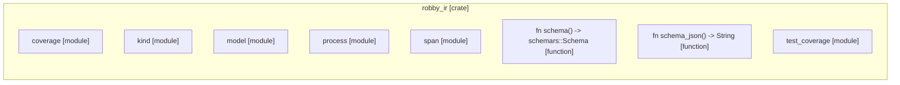

# `robby_ir`

[Self-model](../README.md)

| | |
|---|---|
| kind | `code.crate` |
| provenance | extractor · confidence 1.00 |
| nodes | 303 |

## Modules

- [`coverage`](coverage/index.md) — 50 nodes
- [`kind`](kind/index.md) — 50 nodes
- [`model`](model/index.md) — 112 nodes
- [`process`](process/index.md) — 43 nodes
- [`span`](span/index.md) — 19 nodes
- [`test_coverage`](test_coverage/index.md) — 21 nodes

## Items

| Item | Kind | Steps | Location |
|---|---|---:|---|
| [`schema`](schema.md) | `code.function` | 1 | `crates/robby-ir/src/lib.rs:34:1` |
| [`schema_json`](schema-json.md) | `code.function` | 1 | `crates/robby-ir/src/lib.rs:42:1` |

## Imports

- `pub use coverage::{`
- `pub use kind::Kind;`
- `pub use model::{`
- `pub use process::{Block, BlockKind, Participant, Process, Step, StepKind};`
- `pub use span::{Position, Span};`

