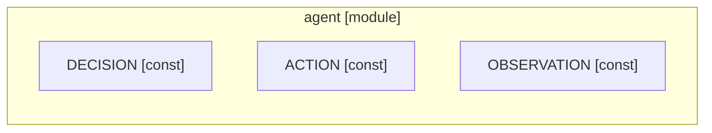

# `robby_ir::kind::agent`

[Self-model](../../../README.md) · [kind](../index.md)

| | |
|---|---|
| kind | `code.module` |
| declared at | [`crates/robby-ir/src/kind.rs:92`](../../../../../crates/robby-ir/src/kind.rs#L92) |
| provenance | extractor · confidence 1.00 |
| nodes | 4 |

## Items

| Item | Kind | Steps | Location |
|---|---|---:|---|
| [`DECISION`](decision.md) | `code.const` | — | `crates/robby-ir/src/kind.rs:94:5` |
| [`ACTION`](action.md) | `code.const` | — | `crates/robby-ir/src/kind.rs:95:5` |
| [`OBSERVATION`](observation.md) | `code.const` | — | `crates/robby-ir/src/kind.rs:96:5` |

