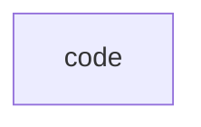

# `robby_ir::kind::code`

[Self-model](../../../README.md) · [kind](../index.md)

| | |
|---|---|
| kind | `code.module` |
| declared at | [`crates/robby-ir/src/kind.rs:57`](../../../../../crates/robby-ir/src/kind.rs#L57) |
| provenance | extractor · confidence 1.00 |
| nodes | 31 |

## Package diagram

## Dependency matrix

| | code |
|---|---:|
| **code** | · |
## Items

| Item | Kind | Steps | Location |
|---|---|---:|---|
| [`WORKSPACE`](workspace.md) | `code.const` | — | `crates/robby-ir/src/kind.rs:59:5` |
| [`CRATE`](crate.md) | `code.const` | — | `crates/robby-ir/src/kind.rs:60:5` |
| [`PACKAGE`](package.md) | `code.const` | — | `crates/robby-ir/src/kind.rs:61:5` |
| [`MODULE`](module.md) | `code.const` | — | `crates/robby-ir/src/kind.rs:63:5` |
| [`FILE`](file.md) | `code.const` | — | `crates/robby-ir/src/kind.rs:64:5` |
| [`STRUCT`](struct.md) | `code.const` | — | `crates/robby-ir/src/kind.rs:65:5` |
| [`CLASS`](class.md) | `code.const` | — | `crates/robby-ir/src/kind.rs:66:5` |
| [`ENUM`](enum.md) | `code.const` | — | `crates/robby-ir/src/kind.rs:67:5` |
| [`UNION`](union.md) | `code.const` | — | `crates/robby-ir/src/kind.rs:68:5` |
| [`TRAIT`](trait.md) | `code.const` | — | `crates/robby-ir/src/kind.rs:69:5` |
| [`INTERFACE`](interface.md) | `code.const` | — | `crates/robby-ir/src/kind.rs:70:5` |
| [`IMPL`](impl.md) | `code.const` | — | `crates/robby-ir/src/kind.rs:71:5` |
| [`FUNCTION`](function.md) | `code.const` | — | `crates/robby-ir/src/kind.rs:72:5` |
| [`METHOD`](method.md) | `code.const` | — | `crates/robby-ir/src/kind.rs:73:5` |
| [`CONST`](const.md) | `code.const` | — | `crates/robby-ir/src/kind.rs:74:5` |
| [`STATIC`](static.md) | `code.const` | — | `crates/robby-ir/src/kind.rs:75:5` |
| [`TYPE_ALIAS`](type-alias.md) | `code.const` | — | `crates/robby-ir/src/kind.rs:76:5` |
| [`MACRO`](macro.md) | `code.const` | — | `crates/robby-ir/src/kind.rs:77:5` |
| [`FIELD`](field.md) | `code.const` | — | `crates/robby-ir/src/kind.rs:78:5` |
| [`VARIANT`](variant.md) | `code.const` | — | `crates/robby-ir/src/kind.rs:79:5` |
| [`BLOCK`](block.md) | `code.const` | — | `crates/robby-ir/src/kind.rs:80:5` |
| [`STATEMENT`](statement.md) | `code.const` | — | `crates/robby-ir/src/kind.rs:81:5` |
| [`EXPRESSION`](expression.md) | `code.const` | — | `crates/robby-ir/src/kind.rs:82:5` |
| [`IMPORT`](import.md) | `code.const` | — | `crates/robby-ir/src/kind.rs:83:5` |
| [`COMMENT`](comment.md) | `code.const` | — | `crates/robby-ir/src/kind.rs:84:5` |
| [`EXTERN_CRATE`](extern-crate.md) | `code.const` | — | `crates/robby-ir/src/kind.rs:85:5` |
| [`FOREIGN_MOD`](foreign-mod.md) | `code.const` | — | `crates/robby-ir/src/kind.rs:86:5` |
| [`TRAIT_ALIAS`](trait-alias.md) | `code.const` | — | `crates/robby-ir/src/kind.rs:87:5` |
| [`VERBATIM`](verbatim.md) | `code.const` | — | `crates/robby-ir/src/kind.rs:88:5` |
| [`UNKNOWN`](unknown.md) | `code.const` | — | `crates/robby-ir/src/kind.rs:89:5` |

