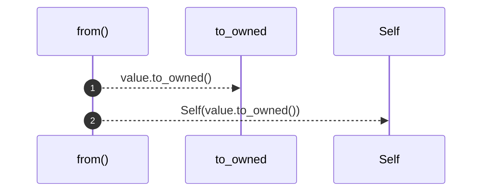

# `robby_ir::kind::impl From<&str> for Kind`

[Self-model](../../README.md) · [kind](index.md)

| | |
|---|---|
| kind | `code.impl` |
| location | [`crates/robby-ir/src/kind.rs:43`](../../../../crates/robby-ir/src/kind.rs#L43) |
| provenance | extractor · confidence 1.00 |

```rust
impl From<&str> for Kind {
    fn from(value: &str) -> Self {
        Self(value.to_owned())
    }
}
```

## Referenced by

- calls ← [`robby_cli::build::main`](../../robby_cli/build/main.md)
- calls ← [`robby_cli::default_ir`](../../robby_cli/default-ir.md)
- calls ← [`robby_cli::run`](../../robby_cli/run.md)
- calls ← [`robby_extract::rust::build_process_sig`](../../robby_extract/rust/build-process-sig.md)
- calls ← [`robby_extract::rust::impl ProcBuilder<'_, '_>::emit`](../../robby_extract/rust/index.md)
- calls ← [`robby_extract::rust::item_node`](../../robby_extract/rust/item-node.md)
- calls ← [`robby_extract::test_extract::root`](../../robby_extract/test_extract/root.md)
- calls ← [`robby_extract::test_typescript::fixture`](../../robby_extract/test_typescript/fixture.md)
- calls ← [`robby_extract::typescript::build_function_process`](../../robby_extract/typescript/build-function-process.md)
- calls ← [`robby_extract::typescript::emit_variable`](../../robby_extract/typescript/emit-variable.md)
- calls ← [`robby_extract::typescript::ensure_participant`](../../robby_extract/typescript/ensure-participant.md)
- calls ← [`robby_ir::test_coverage::document_coverage_is_union_at_any_depth`](../test_coverage/document-coverage-is-union-at-any-depth.md)
- calls ← [`robby_ir::test_coverage::frontier_spans_exclude_parents_that_have_span_children`](../test_coverage/frontier-spans-exclude-parents-that-have-span-children.md)
- calls ← [`robby_render::class_diagram`](../../robby_render/class-diagram.md)
- calls ← [`robby_render::coupling`](../../robby_render/coupling.md)
- calls ← [`robby_render::dependencies`](../../robby_render/dependencies.md)
- calls ← [`robby_render::markdown::index`](../../robby_render/markdown/index-n_fadae9.md)
- calls ← [`robby_render::markdown::report`](../../robby_render/markdown/report.md)
- calls ← [`robby_render::render::markdown::impl MarkdownRenderer::fence`](../../robby_render/render/markdown/index.md)
- calls ← [`robby_render::render::markdown::impl Renderer for MarkdownRenderer::source`](../../robby_render/render/markdown/index.md)
- calls ← [`robby_render::render::mermaid::impl Renderer for MermaidRenderer::coupling_deps`](../../robby_render/render/mermaid/index.md)
- calls ← [`robby_render::render::mermaid::impl Renderer for MermaidRenderer::package_deps`](../../robby_render/render/mermaid/index.md)
- calls ← [`robby_render::render::mermaid::impl Renderer for MermaidRenderer::process`](../../robby_render/render/mermaid/index.md)
- calls ← [`robby_render::render::mermaid::impl Renderer for MermaidRenderer::sibling_graph`](../../robby_render/render/mermaid/index.md)
- calls ← [`robby_render::render::mermaid::impl Renderer for MermaidRenderer::types`](../../robby_render/render/mermaid/index.md)
- calls ← [`robby_render::render::tui::ascii_coupling`](../../robby_render/render/tui/ascii-coupling.md)
- calls ← [`robby_render::render::tui::ascii_package_structure`](../../robby_render/render/tui/ascii-package-structure.md)
- calls ← [`robby_render::render::tui::impl Renderer for TuiRenderer::process`](../../robby_render/render/tui/index.md)
- calls ← [`robby_render::render::tui::impl Renderer for TuiRenderer::sibling_graph`](../../robby_render/render/tui/index.md)
- calls ← [`robby_render::test_markdown::fixture`](../../robby_render/test_markdown/fixture.md)
- calls ← [`robby_render::test_markdown::unused_participant_import_is_referenced`](../../robby_render/test_markdown/unused-participant-import-is-referenced.md)
- calls ← [`robby_render::test_render::class_diagram_marks_traits_as_interfaces`](../../robby_render/test_render/class-diagram-marks-traits-as-interfaces.md)
- calls ← [`robby_render::test_render::dependencies_emits_package_weighted_and_dsm`](../../robby_render/test_render/dependencies-emits-package-weighted-and-dsm.md)
- calls ← [`robby_render::test_render::flowchart_clusters_modules`](../../robby_render/test_render/flowchart-clusters-modules.md)
- calls ← [`robby_render::test_render::process`](../../robby_render/test_render/process.md)
- calls ← [`robby_render::test_tree::workspace`](../../robby_render/test_tree/workspace.md)
- calls ← [`robby_render::test_web::demo_doc`](../../robby_render/test_web/demo-doc.md)
- calls ← [`robby_render::tree::crate_index_path`](../../robby_render/tree/crate-index-path.md)
- calls ← [`robby_render::tree::module_index_path`](../../robby_render/tree/module-index-path.md)
- calls ← [`robby_render::tree::module_page`](../../robby_render/tree/module-page.md)
- calls ← [`robby_render::tree::tree`](../../robby_render/tree/tree.md)
- calls ← [`robby_render::util::stable_id`](../../robby_render/util/stable-id.md)
- calls ← [`robby_render::view::deps::impl CouplingGraph::empty`](../../robby_render/view/deps/index.md)
- calls ← [`robby_render::view::deps::impl CouplingGraph::workspace`](../../robby_render/view/deps/index.md)
- calls ← [`robby_render::view::deps::impl PackageStructure::empty`](../../robby_render/view/deps/index.md)
- calls ← [`robby_render::view::deps::impl PackageStructure::workspace`](../../robby_render/view/deps/index.md)
- calls ← [`robby_render::view::execution::from_code_path`](../../robby_render/view/execution/from-code-path.md)
- calls ← [`robby_render::view::hierarchy::build`](../../robby_render/view/hierarchy/build.md)
- calls ← [`robby_render::web::write_site`](../../robby_render/web/write-site.md)

### `from`

| | |
|---|---|
| kind | `code.method` |
| signature | `fn from(1)` |
| location | [`crates/robby-ir/src/kind.rs:44`](../../../../crates/robby-ir/src/kind.rs#L44) |
| provenance | extractor · confidence 1.00 |

```rust
fn from(value: &str) -> Self {
        Self(value.to_owned())
    }
```



2 steps · 0 observed · 2 possible only

