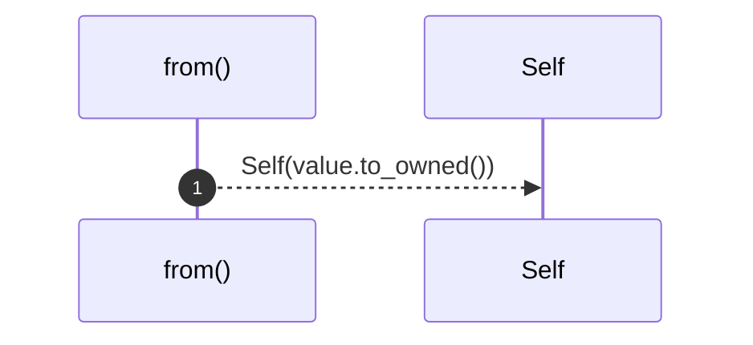

# `robby_ir::kind::impl From<&str> for Kind`

[Self-model](../../README.md) · [kind](index.md)

| | |
|---|---|
| kind | `code.impl` |
| location | [`crates/robby-ir/src/kind.rs:43`](../../../../crates/robby-ir/src/kind.rs#L43) |
| provenance | extractor · confidence 1.00 |

```rust
impl From<&str> for Kind {
    fn from(value: &str) -> Self {
        Self(value.to_owned())
    }
}
```

### `from`

| | |
|---|---|
| kind | `code.method` |
| signature | `fn from(1)` |
| location | [`crates/robby-ir/src/kind.rs:44`](../../../../crates/robby-ir/src/kind.rs#L44) |
| provenance | extractor · confidence 1.00 |

```rust
fn from(value: &str) -> Self {
        Self(value.to_owned())
    }
```



1 steps · 0 observed · 1 possible only

