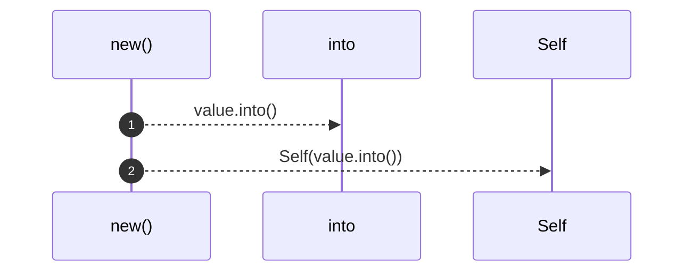
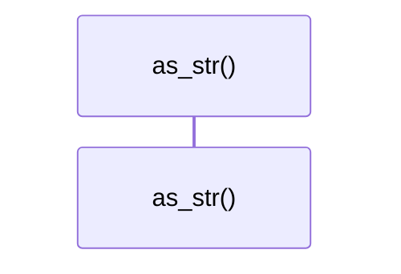
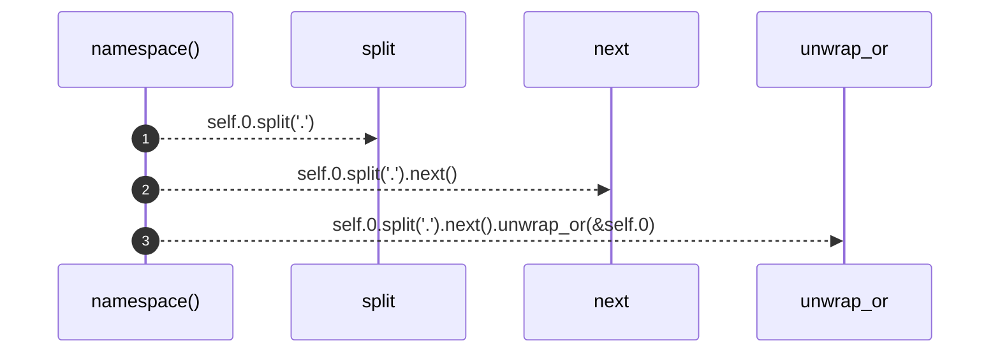

# `robby_ir::kind::impl Kind`

[Self-model](../../README.md) · [kind](index.md)

| | |
|---|---|
| kind | `code.impl` |
| location | [`crates/robby-ir/src/kind.rs:22`](../../../../crates/robby-ir/src/kind.rs#L22) |
| provenance | extractor · confidence 1.00 |

```rust
impl Kind {
    pub fn new(value: impl Into<String>) -> Self {
        Self(value.into())
    }

    pub fn as_str(&self) -> &str {
        &self.0
    }

    /// The namespace prefix, e.g. `code` in `code.function`.
    pub fn namespace(&self) -> &str {
        self.0.split('.').next().unwrap_or(&self.0)
    }
}
```

## Referenced by

- calls ← [`robby_cli::resolve`](../../robby_cli/resolve.md)
- calls ← [`robby_cli::workspace`](../../robby_cli/workspace.md)
- calls ← [`robby_extract::rust::id_fqn`](../../robby_extract/rust/id-fqn.md)
- calls ← [`robby_extract::rust::resolve_calls`](../../robby_extract/rust/resolve-calls.md)
- calls ← [`robby_extract::test_typescript::bare_import_creates_external_npm_stub`](../../robby_extract/test_typescript/bare-import-creates-external-npm-stub.md)
- calls ← [`robby_extract::test_typescript::emits_comment_nodes_and_attaches_docs`](../../robby_extract/test_typescript/emits-comment-nodes-and-attaches-docs.md)
- calls ← [`robby_extract::test_typescript::extracts_typescript_package_with_lang_tag`](../../robby_extract/test_typescript/extracts-typescript-package-with-lang-tag.md)
- calls ← [`robby_extract::test_typescript::resolves_calls_and_imports`](../../robby_extract/test_typescript/resolves-calls-and-imports.md)
- calls ← [`robby_extract::typescript::build_function_process`](../../robby_extract/typescript/build-function-process.md)
- calls ← [`robby_extract::typescript::callee_name`](../../robby_extract/typescript/callee-name.md)
- calls ← [`robby_extract::typescript::emit_class`](../../robby_extract/typescript/emit-class.md)
- calls ← [`robby_extract::typescript::emit_function`](../../robby_extract/typescript/emit-function.md)
- calls ← [`robby_extract::typescript::emit_interface`](../../robby_extract/typescript/emit-interface.md)
- calls ← [`robby_extract::typescript::emit_variable`](../../robby_extract/typescript/emit-variable.md)
- calls ← [`robby_extract::typescript::js_str`](../../robby_extract/typescript/js-str.md)
- calls ← [`robby_extract::typescript::property_key_name`](../../robby_extract/typescript/property-key-name.md)
- calls ← [`robby_extract::typescript::read_package_name`](../../robby_extract/typescript/read-package-name.md)
- calls ← [`robby_extract::typescript::type_name`](../../robby_extract/typescript/type-name.md)
- calls ← [`robby_extract::typescript::type_name_expr`](../../robby_extract/typescript/type-name-expr.md)
- calls ← [`robby_extract::typescript::walk_declaration`](../../robby_extract/typescript/walk-declaration.md)
- calls ← [`robby_extract::typescript::walk_statements`](../../robby_extract/typescript/walk-statements.md)
- calls ← [`robby_ir::codepath::find_entrypoints`](../codepath/find-entrypoints.md)
- calls ← [`robby_ir::codepath::impl CodePath::from_entry`](../codepath/index.md)
- calls ← [`robby_ir::codepath::sample_doc`](../codepath/tests/sample-doc.md)
- calls ← [`robby_ir::coverage::all_spans`](../coverage/all-spans.md)
- calls ← [`robby_ir::coverage::document_coverage`](../coverage/document-coverage.md)
- calls ← [`robby_ir::coverage::file_coverage`](../coverage/file-coverage.md)
- calls ← [`robby_ir::coverage::frontier_spans`](../coverage/frontier-spans.md)
- calls ← [`robby_ir::coverage::make_gap`](../coverage/make-gap.md)
- calls ← [`robby_ir::test_coverage::document_coverage_is_union_at_any_depth`](../test_coverage/document-coverage-is-union-at-any-depth.md)
- calls ← [`robby_ir::test_coverage::frontier_spans_exclude_parents_that_have_span_children`](../test_coverage/frontier-spans-exclude-parents-that-have-span-children.md)
- calls ← [`robby_ir::test_coverage::report_orders_worst_files_first`](../test_coverage/report-orders-worst-files-first.md)
- calls ← [`robby_ir::test_coverage::span`](../test_coverage/span.md)
- calls ← [`robby_ir::test_coverage::spans_from_other_files_are_ignored`](../test_coverage/spans-from-other-files-are-ignored.md)
- calls ← [`robby_ir::test_coverage::typescript_comments_and_shebang_are_trivia`](../test_coverage/typescript-comments-and-shebang-are-trivia.md)
- calls ← [`robby_ir::test_coverage::unreferenced_files_appear_fully_uncovered`](../test_coverage/unreferenced-files-appear-fully-uncovered.md)

### `new`

| | |
|---|---|
| kind | `code.method` |
| signature | `fn new(1)` |
| location | [`crates/robby-ir/src/kind.rs:23`](../../../../crates/robby-ir/src/kind.rs#L23) |
| provenance | extractor · confidence 1.00 |

```rust
pub fn new(value: impl Into<String>) -> Self {
        Self(value.into())
    }
```



2 steps · 0 observed · 2 possible only

### `as_str`

| | |
|---|---|
| kind | `code.method` |
| signature | `fn as_str(1)` |
| location | [`crates/robby-ir/src/kind.rs:27`](../../../../crates/robby-ir/src/kind.rs#L27) |
| provenance | extractor · confidence 1.00 |

```rust
pub fn as_str(&self) -> &str {
        &self.0
    }
```



0 steps · 0 observed · 0 possible only

### `namespace`

| | |
|---|---|
| kind | `code.method` |
| signature | `fn namespace(1)` |
| location | [`crates/robby-ir/src/kind.rs:31`](../../../../crates/robby-ir/src/kind.rs#L31) |
| provenance | extractor · confidence 1.00 |

> The namespace prefix, e.g. `code` in `code.function`.

```rust
/// The namespace prefix, e.g. `code` in `code.function`.
    pub fn namespace(&self) -> &str {
        self.0.split('.').next().unwrap_or(&self.0)
    }
```



3 steps · 0 observed · 3 possible only

