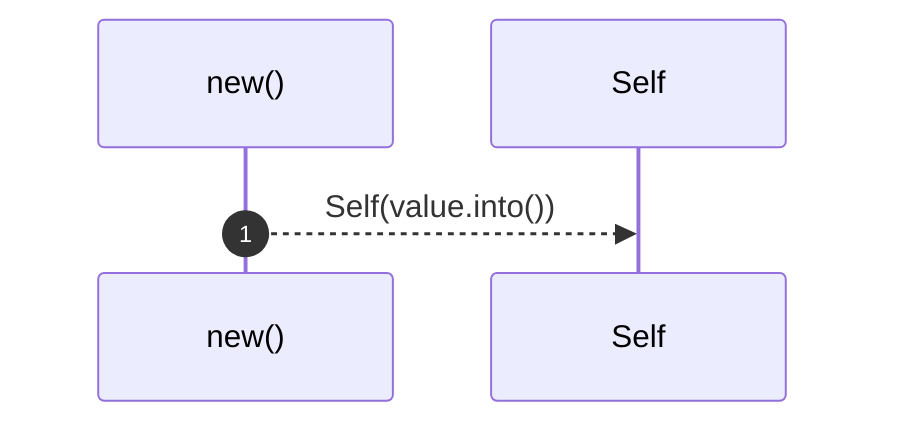
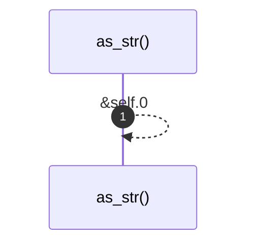
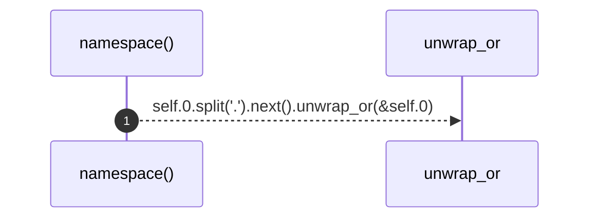

# `robby_ir::kind::impl Kind`

[Self-model](../../README.md) · [kind](index.md)

| | |
|---|---|
| kind | `code.impl` |
| location | [`crates/robby-ir/src/kind.rs:22`](../../../../crates/robby-ir/src/kind.rs#L22) |
| provenance | extractor · confidence 1.00 |

```rust
impl Kind {
    pub fn new(value: impl Into<String>) -> Self {
        Self(value.into())
    }

    pub fn as_str(&self) -> &str {
        &self.0
    }

    /// The namespace prefix, e.g. `code` in `code.function`.
    pub fn namespace(&self) -> &str {
        self.0.split('.').next().unwrap_or(&self.0)
    }
}
```

### `new`

| | |
|---|---|
| kind | `code.method` |
| signature | `fn new(1)` |
| location | [`crates/robby-ir/src/kind.rs:23`](../../../../crates/robby-ir/src/kind.rs#L23) |
| provenance | extractor · confidence 1.00 |

```rust
pub fn new(value: impl Into<String>) -> Self {
        Self(value.into())
    }
```



1 steps · 0 observed · 1 possible only

### `as_str`

| | |
|---|---|
| kind | `code.method` |
| signature | `fn as_str(1)` |
| location | [`crates/robby-ir/src/kind.rs:27`](../../../../crates/robby-ir/src/kind.rs#L27) |
| provenance | extractor · confidence 1.00 |

```rust
pub fn as_str(&self) -> &str {
        &self.0
    }
```



1 steps · 0 observed · 1 possible only

### `namespace`

| | |
|---|---|
| kind | `code.method` |
| signature | `fn namespace(1)` |
| location | [`crates/robby-ir/src/kind.rs:31`](../../../../crates/robby-ir/src/kind.rs#L31) |
| provenance | extractor · confidence 1.00 |

> The namespace prefix, e.g. `code` in `code.function`.

```rust
/// The namespace prefix, e.g. `code` in `code.function`.
    pub fn namespace(&self) -> &str {
        self.0.split('.').next().unwrap_or(&self.0)
    }
```



1 steps · 0 observed · 1 possible only

