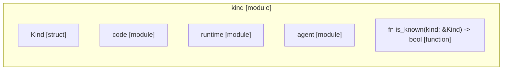

# `robby_ir::kind`

[Self-model](../../README.md) · [robby_ir](../index.md)

| | |
|---|---|
| kind | `code.module` |
| declared at | [`crates/robby-ir/src/lib.rs:18`](../../../../crates/robby-ir/src/lib.rs#L18) |
| provenance | extractor · confidence 1.00 |
| nodes | 50 |

## Modules

- [`kind::code`](code/index.md) — 27 nodes
- [`kind::runtime`](runtime/index.md) — 4 nodes
- [`kind::agent`](agent/index.md) — 4 nodes

## Items

| Item | Kind | Steps | Location |
|---|---|---:|---|
| [`Kind`](kind.md) | `code.struct` | — | `crates/robby-ir/src/kind.rs:17:1` |
| [`impl Kind`](impl-kind.md) | `code.impl` | — | `crates/robby-ir/src/kind.rs:22:1` |
| [`Display for Kind`](display-for-kind.md) | `code.impl` | — | `crates/robby-ir/src/kind.rs:37:1` |
| [`impl From<&str> for Kind`](impl-from-str-for-kind.md) | `code.impl` | — | `crates/robby-ir/src/kind.rs:43:1` |
| [`impl From<String> for Kind`](impl-from-string-for-kind.md) | `code.impl` | — | `crates/robby-ir/src/kind.rs:49:1` |
| [`is_known`](is-known.md) | `code.function` | 1 | `crates/robby-ir/src/kind.rs:99:1` |

## Imports

- `use schemars::JsonSchema;`
- `use serde::{Deserialize, Serialize};`

