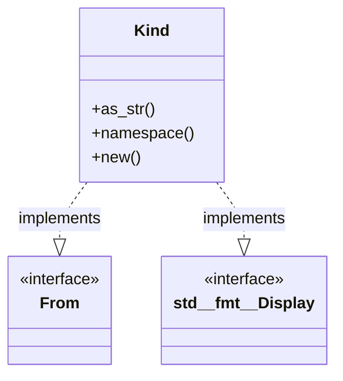
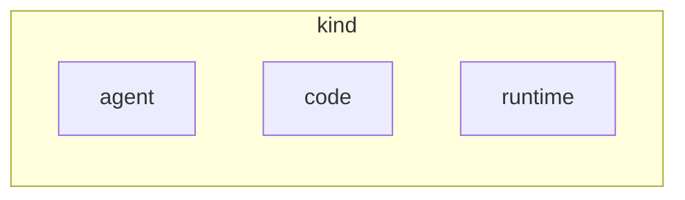

# `robby_ir::kind`

[Self-model](../../README.md) · [robby_ir](../index.md)

| | |
|---|---|
| kind | `code.module` |
| declared at | [`crates/robby-ir/src/lib.rs:20`](../../../../crates/robby-ir/src/lib.rs#L20) |
| provenance | extractor · confidence 1.00 |
| nodes | 54 |

## Types



## Package diagram



## Dependency matrix

| | kind | code | runtime | agent |
|---|---:|---:|---:|---:|
| **kind** | · | | | |
| **code** | | · | | |
| **runtime** | | | · | |
| **agent** | | | | · |

## Comments

- `crates/robby-ir/src/kind.rs:104:1` (docs, `robby_ir::kind::is_known`): "True when `kind` is understood by the current version of the tool. Unknown kinds are never an error — they are rendered…"
  ```
  /// True when `kind` is understood by the current version of the tool.
  ///
  /// Unknown kinds are never an error — they are rendered generically and
  /// reported as a soft gap, so an older viewer can still display a newer graph.
  pub fn is_known(kind: &Kind) -> bool {
      matches!(kind.namespace(), "code" | "runtime" | "agent")
  }
  ```
- `crates/robby-ir/src/kind.rs:17:1` (docs, `robby_ir::kind::Kind`): "A namespaced, open-ended kind tag."
  ```
  /// A namespaced, open-ended kind tag.
  #[derive(Debug, Clone, PartialEq, Eq, PartialOrd, Ord, Hash, Serialize, Deserialize, JsonSchema)]
  #[serde(transparent)]
  pub struct Kind(String);
  ```
- `crates/robby-ir/src/kind.rs:31:5` (docs, `robby_ir::kind::impl Kind::namespace`): "The namespace prefix, e.g. `code` in `code.function`."
  ```
  /// The namespace prefix, e.g. `code` in `code.function`.
      pub fn namespace(&self) -> &str {
          self.0.split('.').next().unwrap_or(&self.0)
      }
  ```
## Referenced by

- calls ← [`robby_cli::build::main`](../../robby_cli/build/main.md)
- calls ← [`robby_cli::default_ir`](../../robby_cli/default-ir.md)
- calls ← [`robby_cli::resolve`](../../robby_cli/resolve.md)
- calls ← [`robby_cli::run`](../../robby_cli/run.md)
- calls ← [`robby_cli::workspace`](../../robby_cli/workspace.md)
- calls ← [`robby_extract::rust::build_process_sig`](../../robby_extract/rust/build-process-sig.md)
- calls ← [`robby_extract::rust::id_fqn`](../../robby_extract/rust/id-fqn.md)
- calls ← [`robby_extract::rust::impl ProcBuilder<'_, '_>::emit`](../../robby_extract/rust/index.md)
- calls ← [`robby_extract::rust::item_node`](../../robby_extract/rust/item-node.md)
- calls ← [`robby_extract::rust::resolve_calls`](../../robby_extract/rust/resolve-calls.md)
- calls ← [`robby_extract::test_extract::root`](../../robby_extract/test_extract/root.md)
- calls ← [`robby_extract::test_typescript::bare_import_creates_external_npm_stub`](../../robby_extract/test_typescript/bare-import-creates-external-npm-stub.md)
- calls ← [`robby_extract::test_typescript::emits_comment_nodes_and_attaches_docs`](../../robby_extract/test_typescript/emits-comment-nodes-and-attaches-docs.md)
- calls ← [`robby_extract::test_typescript::extracts_typescript_package_with_lang_tag`](../../robby_extract/test_typescript/extracts-typescript-package-with-lang-tag.md)
- calls ← [`robby_extract::test_typescript::fixture`](../../robby_extract/test_typescript/fixture.md)
- calls ← [`robby_extract::test_typescript::resolves_calls_and_imports`](../../robby_extract/test_typescript/resolves-calls-and-imports.md)
- calls ← [`robby_extract::typescript::build_function_process`](../../robby_extract/typescript/build-function-process.md)
- calls ← [`robby_extract::typescript::callee_name`](../../robby_extract/typescript/callee-name.md)
- calls ← [`robby_extract::typescript::emit_class`](../../robby_extract/typescript/emit-class.md)
- calls ← [`robby_extract::typescript::emit_function`](../../robby_extract/typescript/emit-function.md)
- calls ← [`robby_extract::typescript::emit_interface`](../../robby_extract/typescript/emit-interface.md)
- calls ← [`robby_extract::typescript::emit_variable`](../../robby_extract/typescript/emit-variable.md)
- calls ← [`robby_extract::typescript::ensure_participant`](../../robby_extract/typescript/ensure-participant.md)
- calls ← [`robby_extract::typescript::js_str`](../../robby_extract/typescript/js-str.md)
- calls ← [`robby_extract::typescript::property_key_name`](../../robby_extract/typescript/property-key-name.md)
- calls ← [`robby_extract::typescript::read_package_name`](../../robby_extract/typescript/read-package-name.md)
- calls ← [`robby_extract::typescript::type_name`](../../robby_extract/typescript/type-name.md)
- calls ← [`robby_extract::typescript::type_name_expr`](../../robby_extract/typescript/type-name-expr.md)
- calls ← [`robby_extract::typescript::walk_declaration`](../../robby_extract/typescript/walk-declaration.md)
- calls ← [`robby_extract::typescript::walk_statements`](../../robby_extract/typescript/walk-statements.md)
- calls ← [`robby_ir::codepath::find_entrypoints`](../codepath/find-entrypoints.md)
- calls ← [`robby_ir::codepath::impl CodePath::from_entry`](../codepath/index.md)
- calls ← [`robby_ir::codepath::sample_doc`](../codepath/tests/sample-doc.md)
- calls ← [`robby_ir::coverage::all_spans`](../coverage/all-spans.md)
- calls ← [`robby_ir::coverage::document_coverage`](../coverage/document-coverage.md)
- calls ← [`robby_ir::coverage::file_coverage`](../coverage/file-coverage.md)
- calls ← [`robby_ir::coverage::frontier_spans`](../coverage/frontier-spans.md)
- calls ← [`robby_ir::coverage::make_gap`](../coverage/make-gap.md)
- calls ← [`robby_ir::model::validate`](../model/validate.md)
- calls ← [`robby_ir::test_coverage::document_coverage_is_union_at_any_depth`](../test_coverage/document-coverage-is-union-at-any-depth.md)
- calls ← [`robby_ir::test_coverage::frontier_spans_exclude_parents_that_have_span_children`](../test_coverage/frontier-spans-exclude-parents-that-have-span-children.md)
- calls ← [`robby_ir::test_coverage::report_orders_worst_files_first`](../test_coverage/report-orders-worst-files-first.md)
- calls ← [`robby_ir::test_coverage::span`](../test_coverage/span.md)
- calls ← [`robby_ir::test_coverage::spans_from_other_files_are_ignored`](../test_coverage/spans-from-other-files-are-ignored.md)
- calls ← [`robby_ir::test_coverage::typescript_comments_and_shebang_are_trivia`](../test_coverage/typescript-comments-and-shebang-are-trivia.md)
- calls ← [`robby_ir::test_coverage::unreferenced_files_appear_fully_uncovered`](../test_coverage/unreferenced-files-appear-fully-uncovered.md)
- calls ← [`robby_render::class_diagram`](../../robby_render/class-diagram.md)
- calls ← [`robby_render::coupling`](../../robby_render/coupling.md)
- calls ← [`robby_render::dependencies`](../../robby_render/dependencies.md)
- calls ← [`robby_render::markdown::index`](../../robby_render/markdown/index-n_fadae9.md)
- calls ← [`robby_render::markdown::report`](../../robby_render/markdown/report.md)
- calls ← [`robby_render::render::markdown::impl MarkdownRenderer::fence`](../../robby_render/render/markdown/index.md)
- calls ← [`robby_render::render::markdown::impl Renderer for MarkdownRenderer::source`](../../robby_render/render/markdown/index.md)
- calls ← [`robby_render::render::mermaid::impl Renderer for MermaidRenderer::coupling_deps`](../../robby_render/render/mermaid/index.md)
- calls ← [`robby_render::render::mermaid::impl Renderer for MermaidRenderer::package_deps`](../../robby_render/render/mermaid/index.md)
- calls ← [`robby_render::render::mermaid::impl Renderer for MermaidRenderer::process`](../../robby_render/render/mermaid/index.md)
- calls ← [`robby_render::render::mermaid::impl Renderer for MermaidRenderer::sibling_graph`](../../robby_render/render/mermaid/index.md)
- calls ← [`robby_render::render::mermaid::impl Renderer for MermaidRenderer::types`](../../robby_render/render/mermaid/index.md)
- calls ← [`robby_render::render::tui::ascii_coupling`](../../robby_render/render/tui/ascii-coupling.md)
- calls ← [`robby_render::render::tui::ascii_package_structure`](../../robby_render/render/tui/ascii-package-structure.md)
- calls ← [`robby_render::render::tui::impl Renderer for TuiRenderer::process`](../../robby_render/render/tui/index.md)
- calls ← [`robby_render::render::tui::impl Renderer for TuiRenderer::sibling_graph`](../../robby_render/render/tui/index.md)
- calls ← [`robby_render::test_markdown::fixture`](../../robby_render/test_markdown/fixture.md)
- calls ← [`robby_render::test_markdown::unused_participant_import_is_referenced`](../../robby_render/test_markdown/unused-participant-import-is-referenced.md)
- calls ← [`robby_render::test_render::class_diagram_marks_traits_as_interfaces`](../../robby_render/test_render/class-diagram-marks-traits-as-interfaces.md)
- calls ← [`robby_render::test_render::dependencies_emits_package_weighted_and_dsm`](../../robby_render/test_render/dependencies-emits-package-weighted-and-dsm.md)
- calls ← [`robby_render::test_render::flowchart_clusters_modules`](../../robby_render/test_render/flowchart-clusters-modules.md)
- calls ← [`robby_render::test_render::process`](../../robby_render/test_render/process.md)
- calls ← [`robby_render::test_tree::workspace`](../../robby_render/test_tree/workspace.md)
- calls ← [`robby_render::test_web::demo_doc`](../../robby_render/test_web/demo-doc.md)
- calls ← [`robby_render::tree::crate_index_path`](../../robby_render/tree/crate-index-path.md)
- calls ← [`robby_render::tree::module_index_path`](../../robby_render/tree/module-index-path.md)
- calls ← [`robby_render::tree::module_page`](../../robby_render/tree/module-page.md)
- calls ← [`robby_render::tree::tree`](../../robby_render/tree/tree.md)
- calls ← [`robby_render::util::stable_id`](../../robby_render/util/stable-id.md)
- calls ← [`robby_render::view::deps::impl CouplingGraph::empty`](../../robby_render/view/deps/index.md)
- calls ← [`robby_render::view::deps::impl CouplingGraph::workspace`](../../robby_render/view/deps/index.md)
- calls ← [`robby_render::view::deps::impl PackageStructure::empty`](../../robby_render/view/deps/index.md)
- calls ← [`robby_render::view::deps::impl PackageStructure::workspace`](../../robby_render/view/deps/index.md)
- calls ← [`robby_render::view::execution::from_code_path`](../../robby_render/view/execution/from-code-path.md)
- calls ← [`robby_render::view::hierarchy::build`](../../robby_render/view/hierarchy/build.md)
- calls ← [`robby_render::web::write_site`](../../robby_render/web/write-site.md)

## Modules

- [`kind::code`](code/index.md) — 31 nodes
- [`kind::runtime`](runtime/index.md) — 4 nodes
- [`kind::agent`](agent/index.md) — 4 nodes

## Items

| Item | Kind | Steps | Location |
|---|---|---:|---|
| [`Kind`](kind.md) | `code.struct` | — | `crates/robby-ir/src/kind.rs:17:1` |
| [`impl Kind`](impl-kind.md) | `code.impl` | — | `crates/robby-ir/src/kind.rs:22:1` |
| [`Display for Kind`](display-for-kind.md) | `code.impl` | — | `crates/robby-ir/src/kind.rs:37:1` |
| [`impl From<&str> for Kind`](impl-from-str-for-kind.md) | `code.impl` | — | `crates/robby-ir/src/kind.rs:43:1` |
| [`impl From<String> for Kind`](impl-from-string-for-kind.md) | `code.impl` | — | `crates/robby-ir/src/kind.rs:49:1` |
| [`is_known`](is-known.md) | `code.function` | 1 | `crates/robby-ir/src/kind.rs:104:1` |

## Imports

- `use schemars::JsonSchema;`
- `use serde::{Deserialize, Serialize};`

