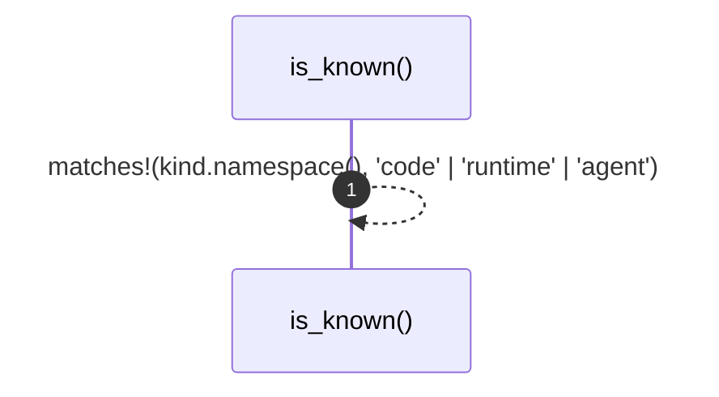

# `robby_ir::kind::is_known`

[Self-model](../../README.md) · [kind](index.md)

| | |
|---|---|
| kind | `code.function` |
| signature | `fn is_known(kind: &Kind) -> bool` |
| location | [`crates/robby-ir/src/kind.rs:104`](../../../../crates/robby-ir/src/kind.rs#L104) |
| provenance | extractor · confidence 1.00 |

> True when `kind` is understood by the current version of the tool.
> 
> Unknown kinds are never an error — they are rendered generically and
> reported as a soft gap, so an older viewer can still display a newer graph.

```rust
/// True when `kind` is understood by the current version of the tool.
///
/// Unknown kinds are never an error — they are rendered generically and
/// reported as a soft gap, so an older viewer can still display a newer graph.
pub fn is_known(kind: &Kind) -> bool {
    matches!(kind.namespace(), "code" | "runtime" | "agent")
}
```



1 steps · 0 observed · 1 possible only

## Referenced by

- calls ← [`robby_ir::model::validate`](../model/validate.md)

