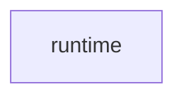

# `robby_ir::kind::runtime`

[Self-model](../../../README.md) · [kind](../index.md)

| | |
|---|---|
| kind | `code.module` |
| declared at | [`crates/robby-ir/src/kind.rs:90`](../../../../../crates/robby-ir/src/kind.rs#L90) |
| provenance | extractor · confidence 1.00 |
| nodes | 4 |

## Package diagram

## Dependency matrix

| | runtime |
|---|---:|
| **runtime** | · |
## Items

| Item | Kind | Steps | Location |
|---|---|---:|---|
| [`TRACE`](trace.md) | `code.const` | — | `crates/robby-ir/src/kind.rs:92:5` |
| [`SPAN`](span.md) | `code.const` | — | `crates/robby-ir/src/kind.rs:93:5` |
| [`EVENT`](event.md) | `code.const` | — | `crates/robby-ir/src/kind.rs:94:5` |

