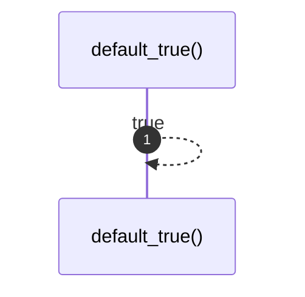

# `robby_ir::model::default_true`

[Self-model](../../README.md) · [model](index.md)

| | |
|---|---|
| kind | `code.function` |
| signature | `fn default_true() -> bool` |
| location | [`crates/robby-ir/src/model.rs:155`](../../../../crates/robby-ir/src/model.rs#L155) |
| provenance | extractor · confidence 1.00 |

```rust
fn default_true() -> bool {
    true
}
```



1 steps · 0 observed · 1 possible only

