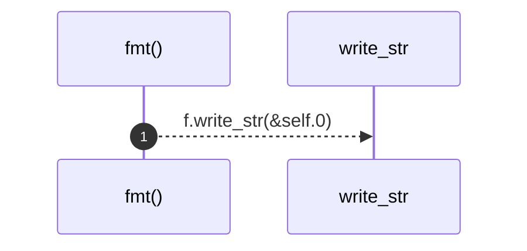

# `robby_ir::model::impl std::fmt::Display for NodeId`

[Self-model](../../README.md) · [model](index.md)

| | |
|---|---|
| kind | `code.impl` |
| location | [`crates/robby-ir/src/model.rs:44`](../../../../crates/robby-ir/src/model.rs#L44) |
| provenance | extractor · confidence 1.00 |

```rust
impl std::fmt::Display for NodeId {
    fn fmt(&self, f: &mut std::fmt::Formatter<'_>) -> std::fmt::Result {
        f.write_str(&self.0)
    }
}
```

### `fmt`

| | |
|---|---|
| kind | `code.method` |
| signature | `fn fmt(2)` |
| location | [`crates/robby-ir/src/model.rs:45`](../../../../crates/robby-ir/src/model.rs#L45) |
| provenance | extractor · confidence 1.00 |

```rust
fn fmt(&self, f: &mut std::fmt::Formatter<'_>) -> std::fmt::Result {
        f.write_str(&self.0)
    }
```



1 steps · 0 observed · 1 possible only

