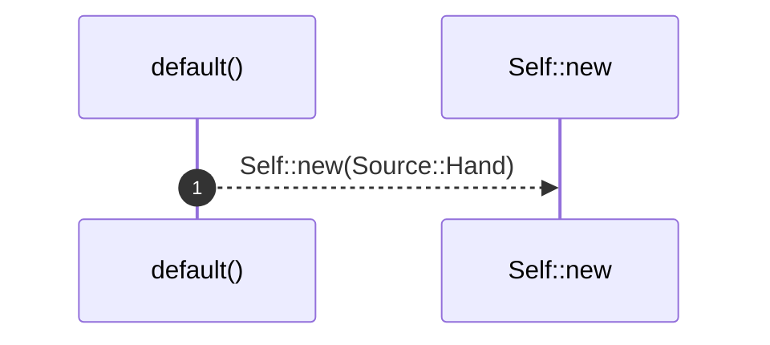

# `robby_ir::model::impl Default for Provenance`

[Self-model](../../README.md) · [model](index.md)

| | |
|---|---|
| kind | `code.impl` |
| location | [`crates/robby-ir/src/model.rs:121`](../../../../crates/robby-ir/src/model.rs#L121) |
| provenance | extractor · confidence 1.00 |

```rust
impl Default for Provenance {
    fn default() -> Self {
        Self::new(Source::Hand)
    }
}
```

## References

- calls → [`robby_ir::model`](index.md) — new

## Referenced by

- calls ← [`robby_ir::model::impl Node::with_lang`](index.md)

### `default`

| | |
|---|---|
| kind | `code.method` |
| signature | `fn default(0)` |
| location | [`crates/robby-ir/src/model.rs:122`](../../../../crates/robby-ir/src/model.rs#L122) |
| provenance | extractor · confidence 1.00 |

```rust
fn default() -> Self {
        Self::new(Source::Hand)
    }
```



1 steps · 0 observed · 1 possible only

**Edges**

- calls → [`robby_ir::model::impl Edge::new`](index.md)

