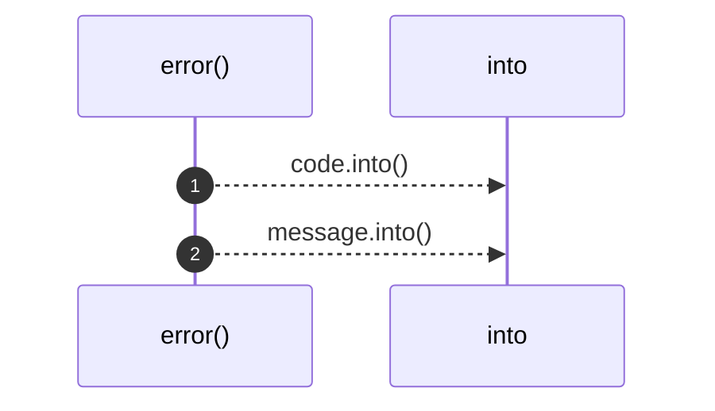
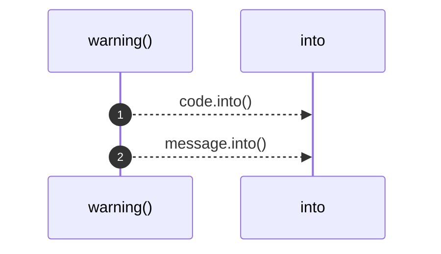
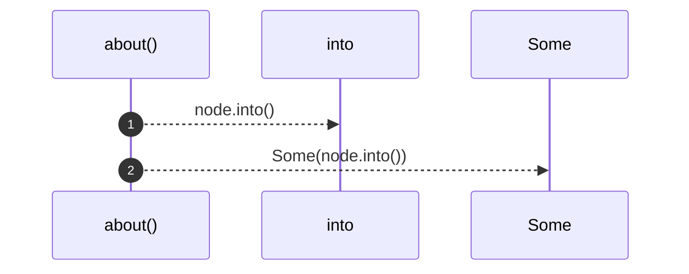

# `robby_ir::model::impl Diagnostic`

[Self-model](../../README.md) · [model](index.md)

| | |
|---|---|
| kind | `code.impl` |
| location | [`crates/robby-ir/src/model.rs:546`](../../../../crates/robby-ir/src/model.rs#L546) |
| provenance | extractor · confidence 1.00 |

```rust
impl Diagnostic {
    pub fn error(code: impl Into<String>, message: impl Into<String>) -> Self {
        Self {
            severity: Severity::Error,
            code: code.into(),
            message: message.into(),
            node: None,
        }
    }

    pub fn warning(code: impl Into<String>, message: impl Into<String>) -> Self {
        Self {
            severity: Severity::Warning,
            code: code.into(),
            message: message.into(),
            node: None,
        }
    }

    pub fn about(mut self, node: impl Into<NodeId>) -> Self {
        self.node = Some(node.into());
        self
    }
}
```

## Referenced by

- calls ← [`robby_ir::model::validate`](validate.md)

### `error`

| | |
|---|---|
| kind | `code.method` |
| signature | `fn error(2)` |
| location | [`crates/robby-ir/src/model.rs:547`](../../../../crates/robby-ir/src/model.rs#L547) |
| provenance | extractor · confidence 1.00 |

```rust
pub fn error(code: impl Into<String>, message: impl Into<String>) -> Self {
        Self {
            severity: Severity::Error,
            code: code.into(),
            message: message.into(),
            node: None,
        }
    }
```



2 steps · 0 observed · 2 possible only

### `warning`

| | |
|---|---|
| kind | `code.method` |
| signature | `fn warning(2)` |
| location | [`crates/robby-ir/src/model.rs:556`](../../../../crates/robby-ir/src/model.rs#L556) |
| provenance | extractor · confidence 1.00 |

```rust
pub fn warning(code: impl Into<String>, message: impl Into<String>) -> Self {
        Self {
            severity: Severity::Warning,
            code: code.into(),
            message: message.into(),
            node: None,
        }
    }
```



2 steps · 0 observed · 2 possible only

### `about`

| | |
|---|---|
| kind | `code.method` |
| signature | `fn about(2)` |
| location | [`crates/robby-ir/src/model.rs:565`](../../../../crates/robby-ir/src/model.rs#L565) |
| provenance | extractor · confidence 1.00 |

```rust
pub fn about(mut self, node: impl Into<NodeId>) -> Self {
        self.node = Some(node.into());
        self
    }
```



2 steps · 0 observed · 2 possible only

