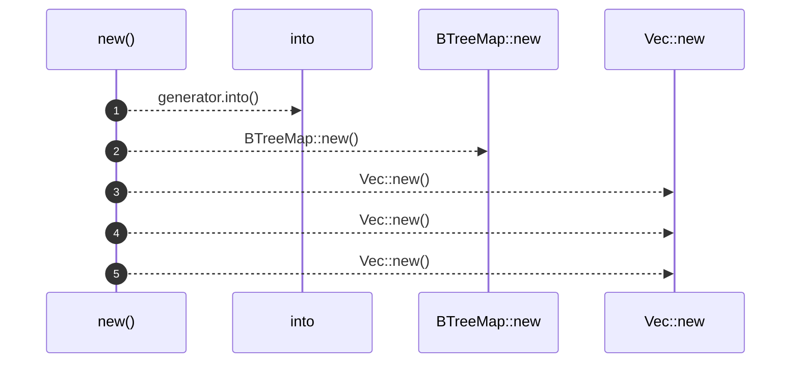
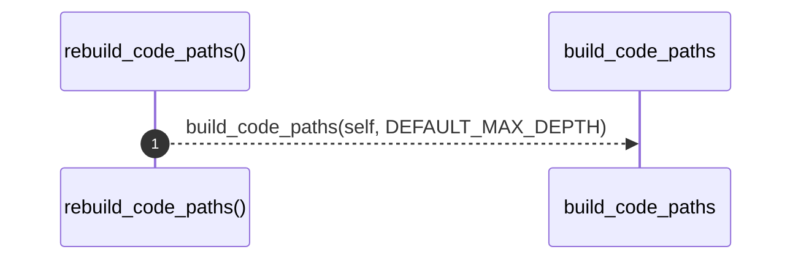
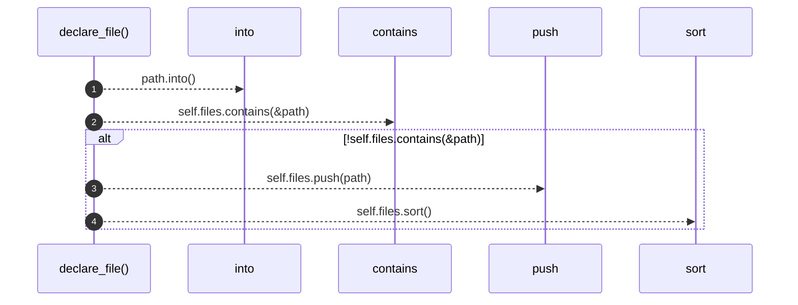
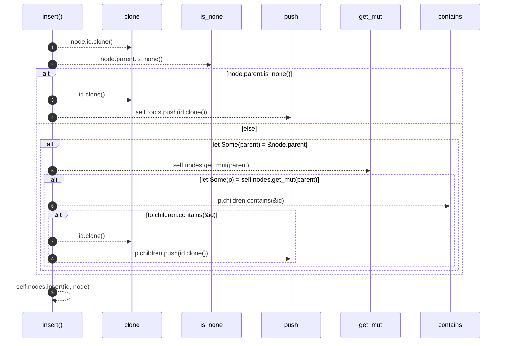
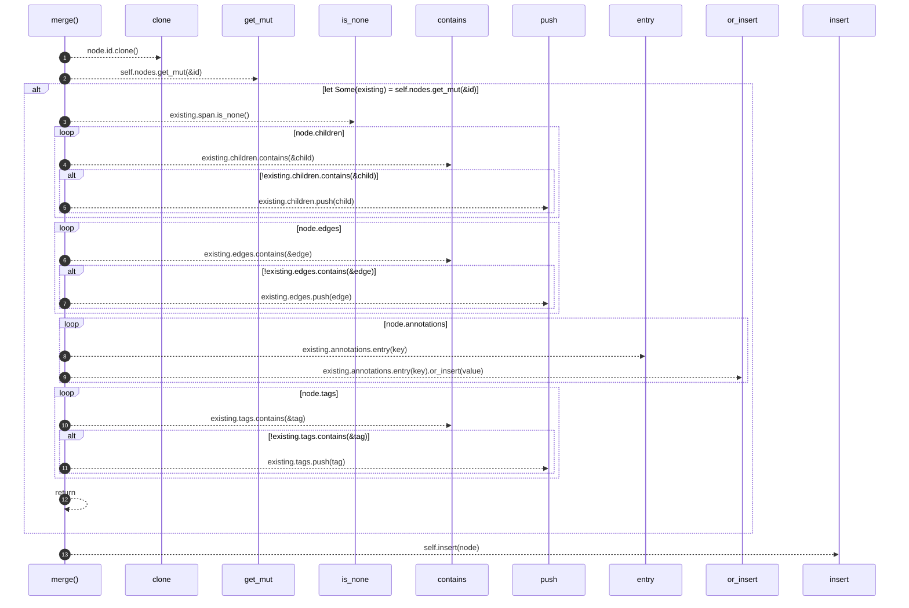
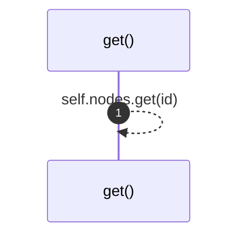
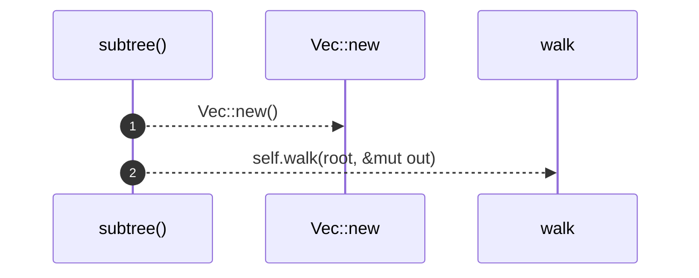
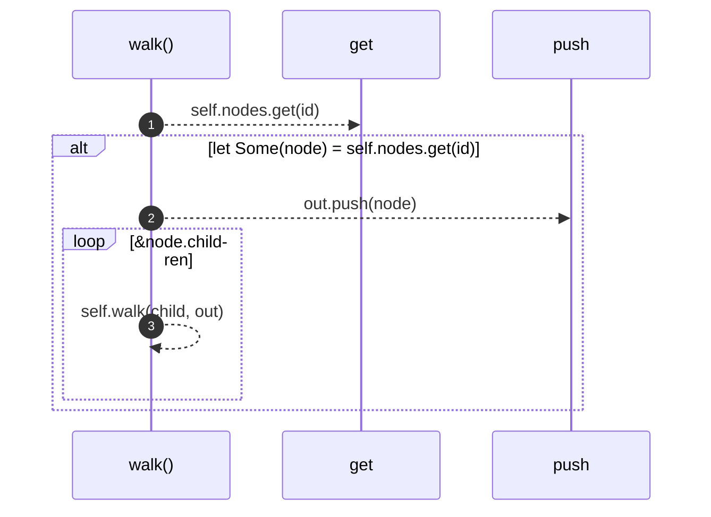

# `robby_ir::model::impl Document`

[Self-model](../../README.md) · [model](index.md)

| | |
|---|---|
| kind | `code.impl` |
| location | [`crates/robby-ir/src/model.rs:312`](../../../../crates/robby-ir/src/model.rs#L312) |
| provenance | extractor · confidence 1.00 |

```rust
impl Document {
    pub fn new(generator: impl Into<String>) -> Self {
        Self {
            schema_version: SCHEMA_VERSION,
            generator: generator.into(),
            nodes: BTreeMap::new(),
            roots: Vec::new(),
            files: Vec::new(),
            code_paths: Vec::new(),
        }
    }

    /// Rebuild [`Self::code_paths`] from current `Calls` edges and `main` entries.
    pub fn rebuild_code_paths(&mut self) {
        self.code_paths = build_code_paths(self, DEFAULT_MAX_DEPTH);
    }

    /// Record a source file as part of the map.
    pub fn declare_file(&mut self, path: impl Into<String>) {
        let path = path.into();
        if !self.files.contains(&path) {
            self.files.push(path);
            self.files.sort();
        }
    }

    pub fn insert(&mut self, node: Node) {
        let id = node.id.clone();
        if node.parent.is_none() {
            self.roots.push(id.clone());
        } else if let Some(parent) = &node.parent {
            if let Some(p) = self.nodes.get_mut(parent) {
                if !p.children.contains(&id) {
                    p.children.push(id.clone());
                }
            }
        }
        self.nodes.insert(id, node);
    }

    /// Insert, or merge into an existing node with the same id.
    ///
    /// Merging matters for modules: a `mod foo;` declaration and the file
    /// `foo.rs` both describe `crate::foo`. The declaration carries the span,
    /// the file carries the contents, and they must not overwrite each other.
    pub fn merge(&mut self, node: Node) {
        let id = node.id.clone();
        if let Some(existing) = self.nodes.get_mut(&id) {
            if existing.span.is_none() {
                existing.span = node.span;
            }
            for child in node.children {
                if !existing.children.contains(&child) {
                    existing.children.push(child);
                }
            }
            for edge in node.edges {
                if !existing.edges.contains(&edge) {
                    existing.edges.push(edge);
                }
            }
            for (key, value) in node.annotations {
                existing.annotations.entry(key).or_insert(value);
            }
            for tag in node.tags {
                if !existing.tags.contains(&tag) {
                    existing.tags.push(tag);
                }
            }
            return;
        }
        self.insert(node);
    }

    pub fn get(&self, id: &NodeId) -> Option<&Node> {
        self.nodes.get(id)
    }

    /// All nodes under `root`, depth-first, deterministic order.
    pub fn subtree(&self, root: &NodeId) -> Vec<&Node> {
        let mut out = Vec::new();
        self.walk(root, &mut out);
        out
    }

    fn walk<'a>(&'a self, id: &NodeId, out: &mut Vec<&'a Node>) {
        if let Some(node) = self.nodes.get(id) {
            out.push(node);
            for child in &node.children {
                self.walk(child, out);
            }
        }
    }
}
```

## References

- calls → [`robby_ir::codepath`](../codepath/index.md) — build_code_paths
- calls → [`robby_render::report`](../../robby_render/report/index.md) — push
- calls → [`robby_render::view::scene`](../../robby_render/view/scene/index.md) — contains

## Referenced by

- calls ← [`robby_agent::context::has_decision_child`](../../robby_agent/context/has-decision-child.md)
- calls ← [`robby_agent::context::line_window`](../../robby_agent/context/line-window.md)
- calls ← [`robby_agent::context::nearest_following_item`](../../robby_agent/context/nearest-following-item.md)
- calls ← [`robby_agent::context::parent_has_comment_with_text`](../../robby_agent/context/parent-has-comment-with-text.md)
- calls ← [`robby_agent::context::slice_node`](../../robby_agent/context/slice-node.md)
- calls ← [`robby_agent::enrich::insert_decision`](../../robby_agent/enrich/insert-decision.md)
- calls ← [`robby_agent::enrich::mini_doc`](../../robby_agent/enrich/tests/mini-doc.md)
- calls ← [`robby_agent::model::parse_decision`](../../robby_agent/model/parse-decision.md)
- calls ← [`robby_agent::model::parse_note`](../../robby_agent/model/parse-note.md)
- calls ← [`robby_extract::merge_documents`](../../robby_extract/merge-documents.md)
- calls ← [`robby_extract::rust::extract`](../../robby_extract/rust/extract.md)
- calls ← [`robby_extract::rust::extract_file`](../../robby_extract/rust/extract-file.md)
- calls ← [`robby_extract::rust::resolve_calls`](../../robby_extract/rust/resolve-calls.md)
- calls ← [`robby_extract::rust::sanitize`](../../robby_extract/rust/sanitize.md)
- calls ← [`robby_extract::rust::slice`](../../robby_extract/rust/slice.md)
- calls ← [`robby_extract::rust::walk_items`](../../robby_extract/rust/walk-items.md)
- calls ← [`robby_extract::test_extract::the_workspace_is_fully_covered`](../../robby_extract/test_extract/the-workspace-is-fully-covered.md)
- calls ← [`robby_extract::test_typescript::typescript_fixture_is_fully_covered`](../../robby_extract/test_typescript/typescript-fixture-is-fully-covered.md)
- calls ← [`robby_extract::typescript::attach_leading_docs`](../../robby_extract/typescript/attach-leading-docs.md)
- calls ← [`robby_extract::typescript::emit_class`](../../robby_extract/typescript/emit-class.md)
- calls ← [`robby_extract::typescript::emit_comments`](../../robby_extract/typescript/emit-comments.md)
- calls ← [`robby_extract::typescript::emit_function`](../../robby_extract/typescript/emit-function.md)
- calls ← [`robby_extract::typescript::emit_import`](../../robby_extract/typescript/emit-import.md)
- calls ← [`robby_extract::typescript::emit_interface`](../../robby_extract/typescript/emit-interface.md)
- calls ← [`robby_extract::typescript::emit_method`](../../robby_extract/typescript/emit-method.md)
- calls ← [`robby_extract::typescript::emit_variable`](../../robby_extract/typescript/emit-variable.md)
- calls ← [`robby_extract::typescript::extract`](../../robby_extract/typescript/extract.md)
- calls ← [`robby_extract::typescript::extract_file`](../../robby_extract/typescript/extract-file.md)
- calls ← [`robby_extract::typescript::gap_is_attachable`](../../robby_extract/typescript/gap-is-attachable.md)
- calls ← [`robby_extract::typescript::read_package_name`](../../robby_extract/typescript/read-package-name.md)
- calls ← [`robby_extract::typescript::resolve_calls`](../../robby_extract/typescript/resolve-calls.md)
- calls ← [`robby_extract::typescript::sanitize`](../../robby_extract/typescript/sanitize.md)
- calls ← [`robby_extract::typescript::walk_declaration`](../../robby_extract/typescript/walk-declaration.md)
- calls ← [`robby_extract::typescript::walk_statements`](../../robby_extract/typescript/walk-statements.md)
- calls ← [`robby_ir::codepath::impl CodePath::from_entry`](../codepath/index.md)
- calls ← [`robby_ir::codepath::sample_doc`](../codepath/tests/sample-doc.md)
- calls ← [`robby_ir::coverage::document_coverage`](../coverage/document-coverage.md)
- calls ← [`robby_ir::coverage::has_span_descendant`](../coverage/has-span-descendant.md)
- calls ← [`robby_ir::test_coverage::document_coverage_is_union_at_any_depth`](../test_coverage/document-coverage-is-union-at-any-depth.md)
- calls ← [`robby_ir::test_coverage::frontier_spans_exclude_parents_that_have_span_children`](../test_coverage/frontier-spans-exclude-parents-that-have-span-children.md)
- calls ← [`robby_ir::test_coverage::report_orders_worst_files_first`](../test_coverage/report-orders-worst-files-first.md)
- calls ← [`robby_ir::test_coverage::unreferenced_files_appear_fully_uncovered`](../test_coverage/unreferenced-files-appear-fully-uncovered.md)
- calls ← [`robby_render::markdown::heading_depth`](../../robby_render/markdown/heading-depth.md)
- calls ← [`robby_render::markdown::node_section`](../../robby_render/markdown/node-section.md)
- calls ← [`robby_render::markdown::report`](../../robby_render/markdown/report.md)
- calls ← [`robby_render::pipeline::from_document`](../../robby_render/pipeline/from-document.md)
- calls ← [`robby_render::pipeline::load_sources`](../../robby_render/pipeline/load-sources.md)
- calls ← [`robby_render::render::mermaid::dsm_markdown_table`](../../robby_render/render/mermaid/dsm-markdown-table.md)
- calls ← [`robby_render::render::mermaid::emit_coupling_subgraph`](../../robby_render/render/mermaid/emit-coupling-subgraph.md)
- calls ← [`robby_render::render::tui::ascii_coupling`](../../robby_render/render/tui/ascii-coupling.md)
- calls ← [`robby_render::render::tui::ascii_package_structure`](../../robby_render/render/tui/ascii-package-structure.md)
- calls ← [`robby_render::render::tui::impl Renderer for TuiRenderer::process`](../../robby_render/render/tui/index.md)
- calls ← [`robby_render::render::tui::impl Renderer for TuiRenderer::sibling_graph`](../../robby_render/render/tui/index.md)
- calls ← [`robby_render::runs::synthetic_extract_run`](../../robby_render/runs/synthetic-extract-run.md)
- calls ← [`robby_render::runs::web_build_run`](../../robby_render/runs/web-build-run.md)
- calls ← [`robby_render::test_markdown::fixture`](../../robby_render/test_markdown/fixture.md)
- calls ← [`robby_render::test_render::class_diagram_marks_traits_as_interfaces`](../../robby_render/test_render/class-diagram-marks-traits-as-interfaces.md)
- calls ← [`robby_render::test_render::dependencies_emits_package_weighted_and_dsm`](../../robby_render/test_render/dependencies-emits-package-weighted-and-dsm.md)
- calls ← [`robby_render::test_render::externals_and_comments_sections_render`](../../robby_render/test_render/externals-and-comments-sections-render.md)
- calls ← [`robby_render::test_render::flowchart_clusters_modules`](../../robby_render/test_render/flowchart-clusters-modules.md)
- calls ← [`robby_render::test_tree::modules_link_out_and_back`](../../robby_render/test_tree/modules-link-out-and-back.md)
- calls ← [`robby_render::test_web::demo_doc`](../../robby_render/test_web/demo-doc.md)
- calls ← [`robby_render::test_web::entrypoints_demo_doc`](../../robby_render/test_web/entrypoints-demo-doc.md)
- calls ← [`robby_render::test_web::entrypoints_scene_roots_mains_and_nests_callees`](../../robby_render/test_web/entrypoints-scene-roots-mains-and-nests-callees.md)
- calls ← [`robby_render::test_web::frame_detail_includes_execution_mermaid_for_call_path`](../../robby_render/test_web/frame-detail-includes-execution-mermaid-for-call-path.md)
- calls ← [`robby_render::test_web::leaf_payload_includes_source_and_process`](../../robby_render/test_web/leaf-payload-includes-source-and-process.md)
- calls ← [`robby_render::tree::count_modules`](../../robby_render/tree/count-modules.md)
- calls ← [`robby_render::tree::global_index`](../../robby_render/tree/global-index.md)
- calls ← [`robby_render::tree::item_children`](../../robby_render/tree/item-children.md)
- calls ← [`robby_render::tree::item_slug`](../../robby_render/tree/item-slug.md)
- calls ← [`robby_render::tree::item_slugs`](../../robby_render/tree/item-slugs.md)
- calls ← [`robby_render::tree::module_page`](../../robby_render/tree/module-page.md)
- calls ← [`robby_render::tree::module_pages`](../../robby_render/tree/module-pages.md)
- calls ← [`robby_render::tree::module_tree_line`](../../robby_render/tree/module-tree-line.md)
- calls ← [`robby_render::tree::nav`](../../robby_render/tree/nav.md)
- calls ← [`robby_render::tree::page_of_node`](../../robby_render/tree/page-of-node.md)
- calls ← [`robby_render::tree::render_links`](../../robby_render/tree/render-links.md)
- calls ← [`robby_render::tree::render_node`](../../robby_render/tree/render-node.md)
- calls ← [`robby_render::tree::resolve_use_path`](../../robby_render/tree/resolve-use-path.md)
- calls ← [`robby_render::tree::slice`](../../robby_render/tree/slice.md)
- calls ← [`robby_render::util::alias`](../../robby_render/util/alias.md)
- calls ← [`robby_render::view::comments::decision_child`](../../robby_render/view/comments/decision-child.md)
- calls ← [`robby_render::view::comments::enrichment_fields`](../../robby_render/view/comments/enrichment-fields.md)
- calls ← [`robby_render::view::comments::impl CommentsView::from_root`](../../robby_render/view/comments/index.md)
- calls ← [`robby_render::view::comments::line_window`](../../robby_render/view/comments/line-window.md)
- calls ← [`robby_render::view::comments::nearest_following_item`](../../robby_render/view/comments/nearest-following-item.md)
- calls ← [`robby_render::view::comments::parse_verdict`](../../robby_render/view/comments/parse-verdict.md)
- calls ← [`robby_render::view::comments::slice_node`](../../robby_render/view/comments/slice-node.md)
- calls ← [`robby_render::view::deps::best_scope_prefix`](../../robby_render/view/deps/best-scope-prefix.md)
- calls ← [`robby_render::view::deps::container_of`](../../robby_render/view/deps/container-of.md)
- calls ← [`robby_render::view::deps::crate_of`](../../robby_render/view/deps/crate-of.md)
- calls ← [`robby_render::view::deps::finalize_edges`](../../robby_render/view/deps/finalize-edges.md)
- calls ← [`robby_render::view::deps::impl CouplingGraph::from_root`](../../robby_render/view/deps/index.md)
- calls ← [`robby_render::view::deps::impl CouplingGraph::workspace`](../../robby_render/view/deps/index.md)
- calls ← [`robby_render::view::deps::impl PackageStructure::from_root`](../../robby_render/view/deps/index.md)
- calls ← [`robby_render::view::deps::insert_module`](../../robby_render/view/deps/insert-module.md)
- calls ← [`robby_render::view::deps::lift_to_scope`](../../robby_render/view/deps/lift-to-scope.md)
- calls ← [`robby_render::view::deps::owning_in_scope`](../../robby_render/view/deps/owning-in-scope.md)
- calls ← [`robby_render::view::deps::package_edges`](../../robby_render/view/deps/package-edges.md)
- calls ← [`robby_render::view::deps::topological_layers`](../../robby_render/view/deps/topological-layers.md)
- calls ← [`robby_render::view::entrypoints::collect_cross_edges`](../../robby_render/view/entrypoints/collect-cross-edges.md)
- calls ← [`robby_render::view::entrypoints::doc_with_mains`](../../robby_render/view/entrypoints/tests/doc-with-mains.md)
- calls ← [`robby_render::view::entrypoints::impl CallTree::children_of`](../../robby_render/view/entrypoints/index.md)
- calls ← [`robby_render::view::entrypoints::impl CallTree::from_code_paths`](../../robby_render/view/entrypoints/index.md)
- calls ← [`robby_render::view::execution::from_code_path`](../../robby_render/view/execution/from-code-path.md)
- calls ← [`robby_render::view::execution::owning_type_label`](../../robby_render/view/execution/owning-type-label.md)
- calls ← [`robby_render::view::execution::sample`](../../robby_render/view/execution/tests/sample.md)
- calls ← [`robby_render::view::externals::impl ExternalsView::from_root`](../../robby_render/view/externals/index.md)
- calls ← [`robby_render::view::externals::is_external_package`](../../robby_render/view/externals/is-external-package.md)
- calls ← [`robby_render::view::externals::owning_container_fqn`](../../robby_render/view/externals/owning-container-fqn.md)
- calls ← [`robby_render::view::hierarchy::build`](../../robby_render/view/hierarchy/build.md)
- calls ← [`robby_render::view::hierarchy::impl HierarchyView::from_node`](../../robby_render/view/hierarchy/index.md)
- calls ← [`robby_render::view::links::inbound`](../../robby_render/view/links/inbound.md)
- calls ← [`robby_render::view::links::outbound`](../../robby_render/view/links/outbound.md)
- calls ← [`robby_render::view::links::owning_module`](../../robby_render/view/links/owning-module.md)
- calls ← [`robby_render::view::links::subtree_ids`](../../robby_render/view/links/subtree-ids.md)
- calls ← [`robby_render::view::scene::attach_call_portals`](../../robby_render/view/scene/attach-call-portals.md)
- calls ← [`robby_render::view::scene::build_call_frame`](../../robby_render/view/scene/build-call-frame.md)
- calls ← [`robby_render::view::scene::build_frame`](../../robby_render/view/scene/build-frame.md)
- calls ← [`robby_render::view::scene::crate_roots`](../../robby_render/view/scene/crate-roots.md)
- calls ← [`robby_render::view::scene::impl Scene::from_document`](../../robby_render/view/scene/index.md)
- calls ← [`robby_render::view::scene::impl Scene::from_entrypoints`](../../robby_render/view/scene/index.md)
- calls ← [`robby_render::view::scene::portals_for`](../../robby_render/view/scene/portals-for.md)
- calls ← [`robby_render::view::select::collect`](../../robby_render/view/select/collect.md)
- calls ← [`robby_render::view::select::is_binary_module`](../../robby_render/view/select/is-binary-module.md)
- calls ← [`robby_render::view::select::main_process`](../../robby_render/view/select/main-process.md)
- calls ← [`robby_render::view::sibling::impl SiblingGraph::from_root`](../../robby_render/view/sibling/index.md)
- calls ← [`robby_render::view::source::impl SourceSlice::from_node`](../../robby_render/view/source/index.md)
- calls ← [`robby_render::view::types::class_from_node`](../../robby_render/view/types/class-from-node.md)
- calls ← [`robby_render::view::types::impl TypeModel::from_module`](../../robby_render/view/types/index.md)
- calls ← [`robby_render::view::types::impl_methods`](../../robby_render/view/types/impl-methods.md)
- calls ← [`robby_render::web::write_site`](../../robby_render/web/write-site.md)

### `new`

| | |
|---|---|
| kind | `code.method` |
| signature | `fn new(1)` |
| location | [`crates/robby-ir/src/model.rs:313`](../../../../crates/robby-ir/src/model.rs#L313) |
| provenance | extractor · confidence 1.00 |

```rust
pub fn new(generator: impl Into<String>) -> Self {
        Self {
            schema_version: SCHEMA_VERSION,
            generator: generator.into(),
            nodes: BTreeMap::new(),
            roots: Vec::new(),
            files: Vec::new(),
            code_paths: Vec::new(),
        }
    }
```



5 steps · 0 observed · 5 possible only

**Edges**

- calls → [`robby_ir::model::impl Document::new`](index.md)
- calls → [`robby_ir::model::impl Document::new`](index.md)
- calls → [`robby_ir::model::impl Document::new`](index.md)
- calls → [`robby_ir::model::impl Document::new`](index.md)

### `rebuild_code_paths`

| | |
|---|---|
| kind | `code.method` |
| signature | `fn rebuild_code_paths(1)` |
| location | [`crates/robby-ir/src/model.rs:324`](../../../../crates/robby-ir/src/model.rs#L324) |
| provenance | extractor · confidence 1.00 |

> Rebuild [`Self::code_paths`] from current `Calls` edges and `main` entries.

```rust
/// Rebuild [`Self::code_paths`] from current `Calls` edges and `main` entries.
    pub fn rebuild_code_paths(&mut self) {
        self.code_paths = build_code_paths(self, DEFAULT_MAX_DEPTH);
    }
```



1 steps · 0 observed · 1 possible only

**Edges**

- calls → [`robby_ir::codepath::build_code_paths`](../codepath/build-code-paths.md)

### `declare_file`

| | |
|---|---|
| kind | `code.method` |
| signature | `fn declare_file(2)` |
| location | [`crates/robby-ir/src/model.rs:329`](../../../../crates/robby-ir/src/model.rs#L329) |
| provenance | extractor · confidence 1.00 |

> Record a source file as part of the map.

```rust
/// Record a source file as part of the map.
    pub fn declare_file(&mut self, path: impl Into<String>) {
        let path = path.into();
        if !self.files.contains(&path) {
            self.files.push(path);
            self.files.sort();
        }
    }
```



4 steps · 0 observed · 4 possible only

**Edges**

- calls → [`robby_render::view::scene::impl WorldRect::contains`](../../robby_render/view/scene/index.md)
- calls → [`robby_render::report::impl Report::push`](../../robby_render/report/index.md)

### `insert`

| | |
|---|---|
| kind | `code.method` |
| signature | `fn insert(2)` |
| location | [`crates/robby-ir/src/model.rs:338`](../../../../crates/robby-ir/src/model.rs#L338) |
| provenance | extractor · confidence 1.00 |

```rust
pub fn insert(&mut self, node: Node) {
        let id = node.id.clone();
        if node.parent.is_none() {
            self.roots.push(id.clone());
        } else if let Some(parent) = &node.parent {
            if let Some(p) = self.nodes.get_mut(parent) {
                if !p.children.contains(&id) {
                    p.children.push(id.clone());
                }
            }
        }
        self.nodes.insert(id, node);
    }
```



9 steps · 0 observed · 9 possible only

**Edges**

- calls → [`robby_render::report::impl Report::push`](../../robby_render/report/index.md)
- calls → [`robby_render::view::scene::impl WorldRect::contains`](../../robby_render/view/scene/index.md)
- calls → [`robby_render::report::impl Report::push`](../../robby_render/report/index.md)
- calls → [`robby_ir::model::impl Document::insert`](index.md)

### `merge`

| | |
|---|---|
| kind | `code.method` |
| signature | `fn merge(2)` |
| location | [`crates/robby-ir/src/model.rs:352`](../../../../crates/robby-ir/src/model.rs#L352) |
| provenance | extractor · confidence 1.00 |

> Insert, or merge into an existing node with the same id.
> 
> Merging matters for modules: a `mod foo;` declaration and the file
> `foo.rs` both describe `crate::foo`. The declaration carries the span,
> the file carries the contents, and they must not overwrite each other.

```rust
/// Insert, or merge into an existing node with the same id.
    ///
    /// Merging matters for modules: a `mod foo;` declaration and the file
    /// `foo.rs` both describe `crate::foo`. The declaration carries the span,
    /// the file carries the contents, and they must not overwrite each other.
    pub fn merge(&mut self, node: Node) {
        let id = node.id.clone();
        if let Some(existing) = self.nodes.get_mut(&id) {
            if existing.span.is_none() {
                existing.span = node.span;
            }
            for child in node.children {
                if !existing.children.contains(&child) {
                    existing.children.push(child);
                }
            }
            for edge in node.edges {
                if !existing.edges.contains(&edge) {
                    existing.edges.push(edge);
                }
            }
            for (key, value) in node.annotations {
                existing.annotations.entry(key).or_insert(value);
            }
            for tag in node.tags {
                if !existing.tags.contains(&tag) {
                    existing.tags.push(tag);
                }
            }
            return;
        }
        self.insert(node);
    }
```



13 steps · 0 observed · 13 possible only

**Edges**

- calls → [`robby_render::view::scene::impl WorldRect::contains`](../../robby_render/view/scene/index.md)
- calls → [`robby_render::report::impl Report::push`](../../robby_render/report/index.md)
- calls → [`robby_render::view::scene::impl WorldRect::contains`](../../robby_render/view/scene/index.md)
- calls → [`robby_render::report::impl Report::push`](../../robby_render/report/index.md)
- calls → [`robby_render::view::scene::impl WorldRect::contains`](../../robby_render/view/scene/index.md)
- calls → [`robby_render::report::impl Report::push`](../../robby_render/report/index.md)
- calls → [`robby_ir::model::impl Document::insert`](index.md)

### `get`

| | |
|---|---|
| kind | `code.method` |
| signature | `fn get(2)` |
| location | [`crates/robby-ir/src/model.rs:386`](../../../../crates/robby-ir/src/model.rs#L386) |
| provenance | extractor · confidence 1.00 |

```rust
pub fn get(&self, id: &NodeId) -> Option<&Node> {
        self.nodes.get(id)
    }
```



1 steps · 0 observed · 1 possible only

**Edges**

- calls → [`robby_ir::model::impl Document::get`](index.md)

### `subtree`

| | |
|---|---|
| kind | `code.method` |
| signature | `fn subtree(2)` |
| location | [`crates/robby-ir/src/model.rs:390`](../../../../crates/robby-ir/src/model.rs#L390) |
| provenance | extractor · confidence 1.00 |

> All nodes under `root`, depth-first, deterministic order.

```rust
/// All nodes under `root`, depth-first, deterministic order.
    pub fn subtree(&self, root: &NodeId) -> Vec<&Node> {
        let mut out = Vec::new();
        self.walk(root, &mut out);
        out
    }
```



2 steps · 0 observed · 2 possible only

**Edges**

- calls → [`robby_ir::model::impl Document::new`](index.md)
- calls → [`robby_ir::model::impl Document::walk`](index.md)

### `walk`

| | |
|---|---|
| kind | `code.method` |
| signature | `fn walk(3)` |
| location | [`crates/robby-ir/src/model.rs:397`](../../../../crates/robby-ir/src/model.rs#L397) |
| provenance | extractor · confidence 1.00 |

```rust
fn walk<'a>(&'a self, id: &NodeId, out: &mut Vec<&'a Node>) {
        if let Some(node) = self.nodes.get(id) {
            out.push(node);
            for child in &node.children {
                self.walk(child, out);
            }
        }
    }
```



3 steps · 0 observed · 3 possible only

**Edges**

- calls → [`robby_ir::model::impl Document::get`](index.md)
- calls → [`robby_render::report::impl Report::push`](../../robby_render/report/index.md)
- calls → [`robby_ir::model::impl Document::walk`](index.md)

