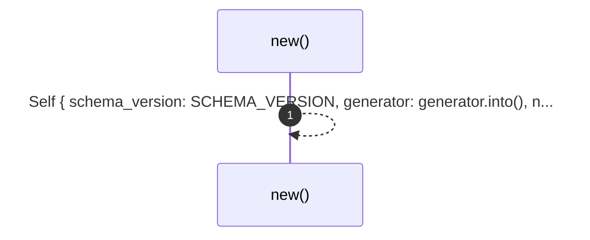
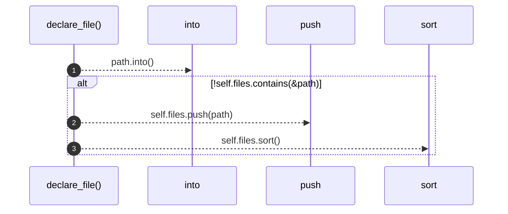
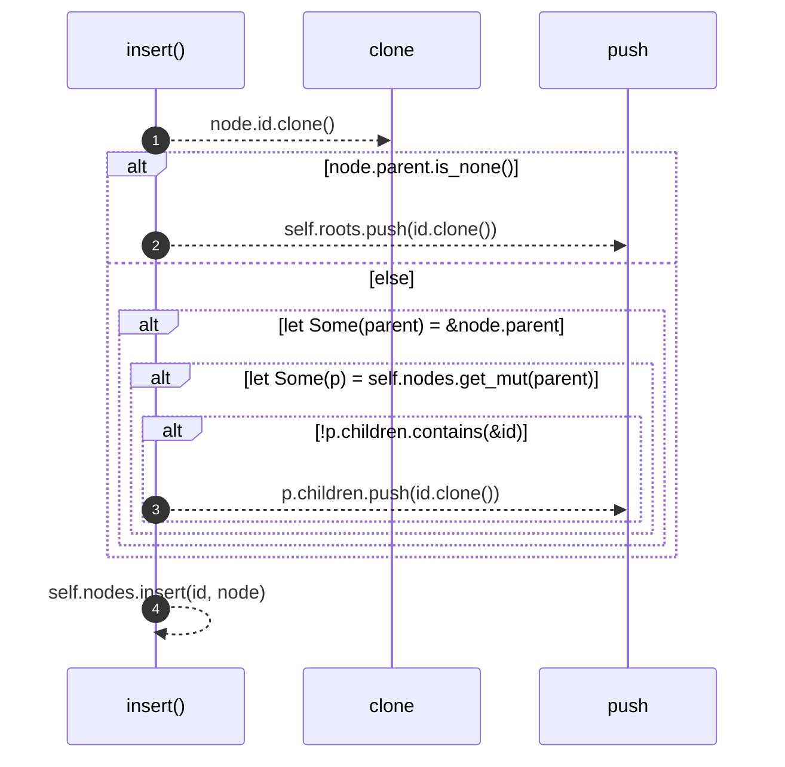
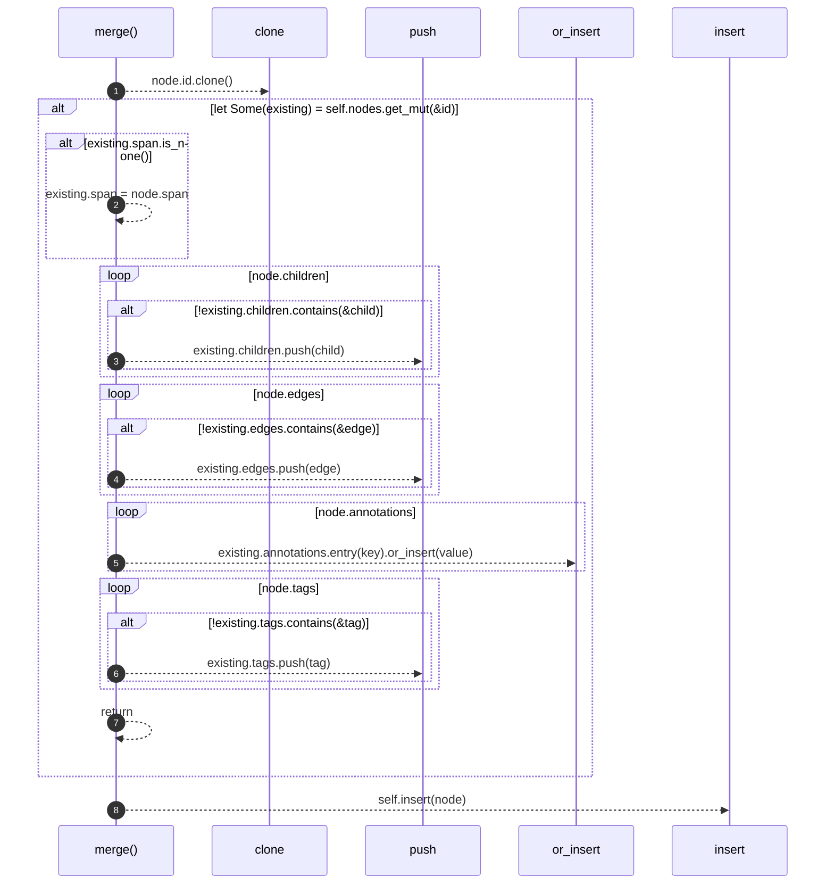
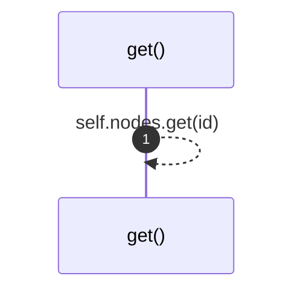
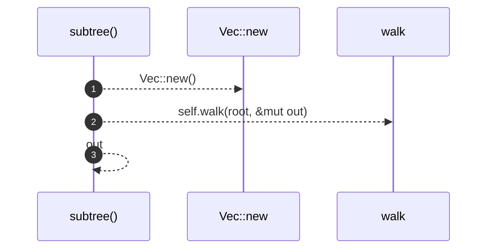
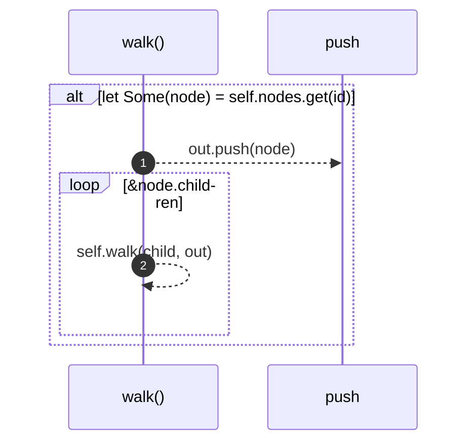

# `robby_ir::model::impl Document`

[Self-model](../../README.md) · [model](index.md)

| | |
|---|---|
| kind | `code.impl` |
| location | [`crates/robby-ir/src/model.rs:282`](../../../../crates/robby-ir/src/model.rs#L282) |
| provenance | extractor · confidence 1.00 |

```rust
impl Document {
    pub fn new(generator: impl Into<String>) -> Self {
        Self {
            schema_version: SCHEMA_VERSION,
            generator: generator.into(),
            nodes: BTreeMap::new(),
            roots: Vec::new(),
            files: Vec::new(),
        }
    }

    /// Record a source file as part of the map.
    pub fn declare_file(&mut self, path: impl Into<String>) {
        let path = path.into();
        if !self.files.contains(&path) {
            self.files.push(path);
            self.files.sort();
        }
    }

    pub fn insert(&mut self, node: Node) {
        let id = node.id.clone();
        if node.parent.is_none() {
            self.roots.push(id.clone());
        } else if let Some(parent) = &node.parent {
            if let Some(p) = self.nodes.get_mut(parent) {
                if !p.children.contains(&id) {
                    p.children.push(id.clone());
                }
            }
        }
        self.nodes.insert(id, node);
    }

    /// Insert, or merge into an existing node with the same id.
    ///
    /// Merging matters for modules: a `mod foo;` declaration and the file
    /// `foo.rs` both describe `crate::foo`. The declaration carries the span,
    /// the file carries the contents, and they must not overwrite each other.
    pub fn merge(&mut self, node: Node) {
        let id = node.id.clone();
        if let Some(existing) = self.nodes.get_mut(&id) {
            if existing.span.is_none() {
                existing.span = node.span;
            }
            for child in node.children {
                if !existing.children.contains(&child) {
                    existing.children.push(child);
                }
            }
            for edge in node.edges {
                if !existing.edges.contains(&edge) {
                    existing.edges.push(edge);
                }
            }
            for (key, value) in node.annotations {
                existing.annotations.entry(key).or_insert(value);
            }
            for tag in node.tags {
                if !existing.tags.contains(&tag) {
                    existing.tags.push(tag);
                }
            }
            return;
        }
        self.insert(node);
    }

    pub fn get(&self, id: &NodeId) -> Option<&Node> {
        self.nodes.get(id)
    }

    /// All nodes under `root`, depth-first, deterministic order.
    pub fn subtree(&self, root: &NodeId) -> Vec<&Node> {
        let mut out = Vec::new();
        self.walk(root, &mut out);
        out
    }

    fn walk<'a>(&'a self, id: &NodeId, out: &mut Vec<&'a Node>) {
        if let Some(node) = self.nodes.get(id) {
            out.push(node);
            for child in &node.children {
                self.walk(child, out);
            }
        }
    }
}
```

### `new`

| | |
|---|---|
| kind | `code.method` |
| signature | `fn new(1)` |
| location | [`crates/robby-ir/src/model.rs:283`](../../../../crates/robby-ir/src/model.rs#L283) |
| provenance | extractor · confidence 1.00 |

```rust
pub fn new(generator: impl Into<String>) -> Self {
        Self {
            schema_version: SCHEMA_VERSION,
            generator: generator.into(),
            nodes: BTreeMap::new(),
            roots: Vec::new(),
            files: Vec::new(),
        }
    }
```



1 steps · 0 observed · 1 possible only

### `declare_file`

| | |
|---|---|
| kind | `code.method` |
| signature | `fn declare_file(2)` |
| location | [`crates/robby-ir/src/model.rs:293`](../../../../crates/robby-ir/src/model.rs#L293) |
| provenance | extractor · confidence 1.00 |

> Record a source file as part of the map.

```rust
/// Record a source file as part of the map.
    pub fn declare_file(&mut self, path: impl Into<String>) {
        let path = path.into();
        if !self.files.contains(&path) {
            self.files.push(path);
            self.files.sort();
        }
    }
```



3 steps · 0 observed · 3 possible only

### `insert`

| | |
|---|---|
| kind | `code.method` |
| signature | `fn insert(2)` |
| location | [`crates/robby-ir/src/model.rs:302`](../../../../crates/robby-ir/src/model.rs#L302) |
| provenance | extractor · confidence 1.00 |

```rust
pub fn insert(&mut self, node: Node) {
        let id = node.id.clone();
        if node.parent.is_none() {
            self.roots.push(id.clone());
        } else if let Some(parent) = &node.parent {
            if let Some(p) = self.nodes.get_mut(parent) {
                if !p.children.contains(&id) {
                    p.children.push(id.clone());
                }
            }
        }
        self.nodes.insert(id, node);
    }
```



4 steps · 0 observed · 4 possible only

**Edges**

- calls → [`robby_ir::model::impl Document::insert`](index.md)

### `merge`

| | |
|---|---|
| kind | `code.method` |
| signature | `fn merge(2)` |
| location | [`crates/robby-ir/src/model.rs:316`](../../../../crates/robby-ir/src/model.rs#L316) |
| provenance | extractor · confidence 1.00 |

> Insert, or merge into an existing node with the same id.
> 
> Merging matters for modules: a `mod foo;` declaration and the file
> `foo.rs` both describe `crate::foo`. The declaration carries the span,
> the file carries the contents, and they must not overwrite each other.

```rust
/// Insert, or merge into an existing node with the same id.
    ///
    /// Merging matters for modules: a `mod foo;` declaration and the file
    /// `foo.rs` both describe `crate::foo`. The declaration carries the span,
    /// the file carries the contents, and they must not overwrite each other.
    pub fn merge(&mut self, node: Node) {
        let id = node.id.clone();
        if let Some(existing) = self.nodes.get_mut(&id) {
            if existing.span.is_none() {
                existing.span = node.span;
            }
            for child in node.children {
                if !existing.children.contains(&child) {
                    existing.children.push(child);
                }
            }
            for edge in node.edges {
                if !existing.edges.contains(&edge) {
                    existing.edges.push(edge);
                }
            }
            for (key, value) in node.annotations {
                existing.annotations.entry(key).or_insert(value);
            }
            for tag in node.tags {
                if !existing.tags.contains(&tag) {
                    existing.tags.push(tag);
                }
            }
            return;
        }
        self.insert(node);
    }
```



8 steps · 0 observed · 8 possible only

**Edges**

- calls → [`robby_ir::model::impl Document::insert`](index.md)

### `get`

| | |
|---|---|
| kind | `code.method` |
| signature | `fn get(2)` |
| location | [`crates/robby-ir/src/model.rs:350`](../../../../crates/robby-ir/src/model.rs#L350) |
| provenance | extractor · confidence 1.00 |

```rust
pub fn get(&self, id: &NodeId) -> Option<&Node> {
        self.nodes.get(id)
    }
```



1 steps · 0 observed · 1 possible only

**Edges**

- calls → [`robby_ir::model::impl Document::get`](index.md)

### `subtree`

| | |
|---|---|
| kind | `code.method` |
| signature | `fn subtree(2)` |
| location | [`crates/robby-ir/src/model.rs:354`](../../../../crates/robby-ir/src/model.rs#L354) |
| provenance | extractor · confidence 1.00 |

> All nodes under `root`, depth-first, deterministic order.

```rust
/// All nodes under `root`, depth-first, deterministic order.
    pub fn subtree(&self, root: &NodeId) -> Vec<&Node> {
        let mut out = Vec::new();
        self.walk(root, &mut out);
        out
    }
```



3 steps · 0 observed · 3 possible only

**Edges**

- calls → [`robby_extract::impl LineIndex::new`](../../robby_extract/index.md)
- calls → [`robby_ir::model::impl Document::walk`](index.md)

### `walk`

| | |
|---|---|
| kind | `code.method` |
| signature | `fn walk(3)` |
| location | [`crates/robby-ir/src/model.rs:361`](../../../../crates/robby-ir/src/model.rs#L361) |
| provenance | extractor · confidence 1.00 |

```rust
fn walk<'a>(&'a self, id: &NodeId, out: &mut Vec<&'a Node>) {
        if let Some(node) = self.nodes.get(id) {
            out.push(node);
            for child in &node.children {
                self.walk(child, out);
            }
        }
    }
```



2 steps · 0 observed · 2 possible only

**Edges**

- calls → [`robby_ir::model::impl Document::walk`](index.md)

