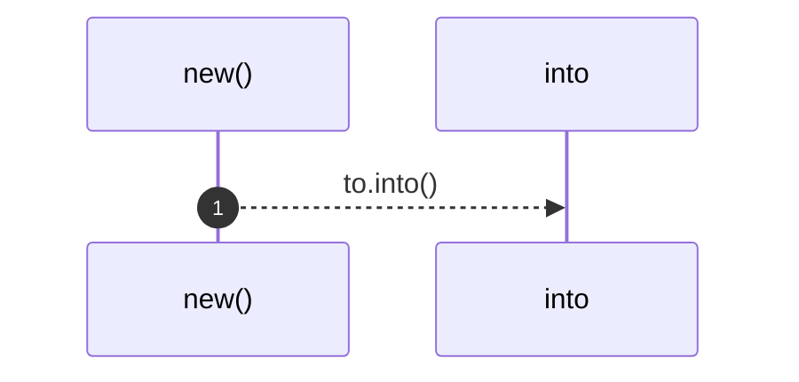

# `robby_ir::model::impl Edge`

[Self-model](../../README.md) · [model](index.md)

| | |
|---|---|
| kind | `code.impl` |
| location | [`crates/robby-ir/src/model.rs:175`](../../../../crates/robby-ir/src/model.rs#L175) |
| provenance | extractor · confidence 1.00 |

```rust
impl Edge {
    pub fn new(to: impl Into<NodeId>, kind: EdgeKind) -> Self {
        Self {
            to: to.into(),
            kind,
            span: None,
            confidence: 1.0,
            resolved: true,
        }
    }
}
```

## Referenced by

- calls ← [`robby_ir::model::child_inserted_before_its_parent_is_linked`](tests/child-inserted-before-its-parent-is-linked.md)
- calls ← [`robby_ir::model::declared_children_set_the_child_parent`](tests/declared-children-set-the-child-parent.md)
- calls ← [`robby_ir::model::impl Default for Provenance::default`](index.md)
- calls ← [`robby_ir::model::parent_pointer_builds_the_child_index`](tests/parent-pointer-builds-the-child-index.md)
- calls ← [`robby_ir::model::validate`](validate.md)

### `new`

| | |
|---|---|
| kind | `code.method` |
| signature | `fn new(2)` |
| location | [`crates/robby-ir/src/model.rs:176`](../../../../crates/robby-ir/src/model.rs#L176) |
| provenance | extractor · confidence 1.00 |

```rust
pub fn new(to: impl Into<NodeId>, kind: EdgeKind) -> Self {
        Self {
            to: to.into(),
            kind,
            span: None,
            confidence: 1.0,
            resolved: true,
        }
    }
```



1 steps · 0 observed · 1 possible only

