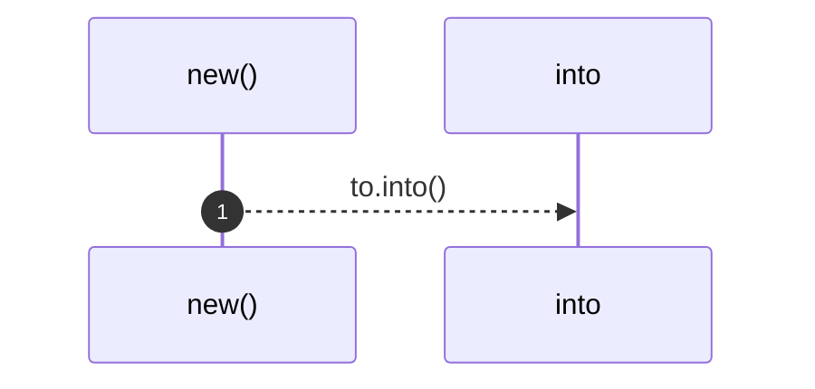

# `robby_ir::model::impl Edge`

[Self-model](../../README.md) · [model](index.md)

| | |
|---|---|
| kind | `code.impl` |
| location | [`crates/robby-ir/src/model.rs:160`](../../../../crates/robby-ir/src/model.rs#L160) |
| provenance | extractor · confidence 1.00 |

```rust
impl Edge {
    pub fn new(to: impl Into<NodeId>, kind: EdgeKind) -> Self {
        Self {
            to: to.into(),
            kind,
            span: None,
            confidence: 1.0,
            resolved: true,
        }
    }
}
```

## Referenced by

- calls ← [`robby_ir::model::impl Default for Provenance::default`](index.md)
- calls ← [`robby_ir::model::validate`](validate.md)

### `new`

| | |
|---|---|
| kind | `code.method` |
| signature | `fn new(2)` |
| location | [`crates/robby-ir/src/model.rs:161`](../../../../crates/robby-ir/src/model.rs#L161) |
| provenance | extractor · confidence 1.00 |

```rust
pub fn new(to: impl Into<NodeId>, kind: EdgeKind) -> Self {
        Self {
            to: to.into(),
            kind,
            span: None,
            confidence: 1.0,
            resolved: true,
        }
    }
```



1 steps · 0 observed · 1 possible only

