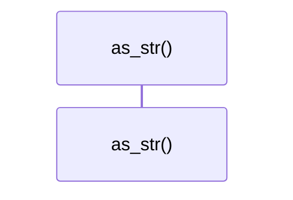

# `robby_ir::model::impl EdgeKind`

[Self-model](../../README.md) · [model](index.md)

| | |
|---|---|
| kind | `code.impl` |
| location | [`crates/robby-ir/src/model.rs:203`](../../../../crates/robby-ir/src/model.rs#L203) |
| provenance | extractor · confidence 1.00 |

```rust
impl EdgeKind {
    /// Serde name (`references`, not the short diagram label).
    pub fn as_str(self) -> &'static str {
        match self {
            Self::Contains => "contains",
            Self::Calls => "calls",
            Self::Uses => "uses",
            Self::Imports => "imports",
            Self::Implements => "implements",
            Self::Extends => "extends",
            Self::Returns => "returns",
            Self::Field => "field",
            Self::References => "references",
        }
    }
}
```

### `as_str`

| | |
|---|---|
| kind | `code.method` |
| signature | `fn as_str(1)` |
| location | [`crates/robby-ir/src/model.rs:204`](../../../../crates/robby-ir/src/model.rs#L204) |
| provenance | extractor · confidence 1.00 |

> Serde name (`references`, not the short diagram label).

```rust
/// Serde name (`references`, not the short diagram label).
    pub fn as_str(self) -> &'static str {
        match self {
            Self::Contains => "contains",
            Self::Calls => "calls",
            Self::Uses => "uses",
            Self::Imports => "imports",
            Self::Implements => "implements",
            Self::Extends => "extends",
            Self::Returns => "returns",
            Self::Field => "field",
            Self::References => "references",
        }
    }
```



0 steps · 0 observed · 0 possible only

