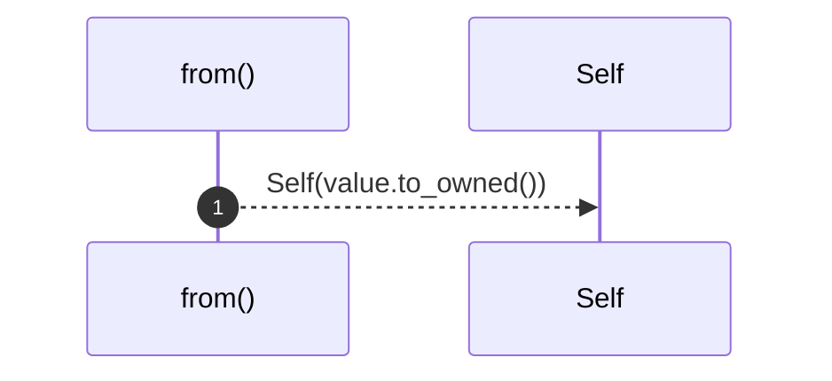

# `robby_ir::model::impl From<&str> for NodeId`

[Self-model](../../README.md) · [model](index.md)

| | |
|---|---|
| kind | `code.impl` |
| location | [`crates/robby-ir/src/model.rs:49`](../../../../crates/robby-ir/src/model.rs#L49) |
| provenance | extractor · confidence 1.00 |

```rust
impl From<&str> for NodeId {
    fn from(value: &str) -> Self {
        Self(value.to_owned())
    }
}
```

### `from`

| | |
|---|---|
| kind | `code.method` |
| signature | `fn from(1)` |
| location | [`crates/robby-ir/src/model.rs:50`](../../../../crates/robby-ir/src/model.rs#L50) |
| provenance | extractor · confidence 1.00 |

```rust
fn from(value: &str) -> Self {
        Self(value.to_owned())
    }
```



1 steps · 0 observed · 1 possible only

