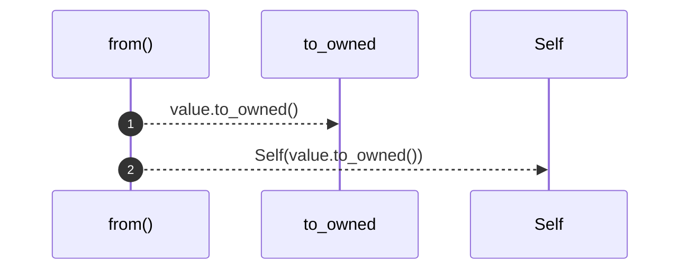

# `robby_ir::model::impl From<&str> for NodeId`

[Self-model](../../README.md) · [model](index.md)

| | |
|---|---|
| kind | `code.impl` |
| location | [`crates/robby-ir/src/model.rs:52`](../../../../crates/robby-ir/src/model.rs#L52) |
| provenance | extractor · confidence 1.00 |

```rust
impl From<&str> for NodeId {
    fn from(value: &str) -> Self {
        Self(value.to_owned())
    }
}
```

## Referenced by

- calls ← [`robby_ir::model::child_inserted_before_its_parent_is_linked`](tests/child-inserted-before-its-parent-is-linked.md)
- calls ← [`robby_ir::model::declared_children_set_the_child_parent`](tests/declared-children-set-the-child-parent.md)
- calls ← [`robby_ir::model::parent_pointer_builds_the_child_index`](tests/parent-pointer-builds-the-child-index.md)

### `from`

| | |
|---|---|
| kind | `code.method` |
| signature | `fn from(1)` |
| location | [`crates/robby-ir/src/model.rs:53`](../../../../crates/robby-ir/src/model.rs#L53) |
| provenance | extractor · confidence 1.00 |

```rust
fn from(value: &str) -> Self {
        Self(value.to_owned())
    }
```



2 steps · 0 observed · 2 possible only

