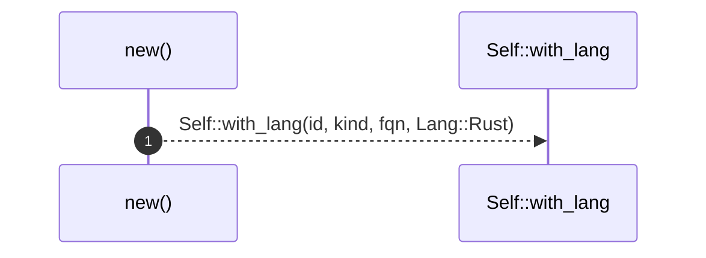
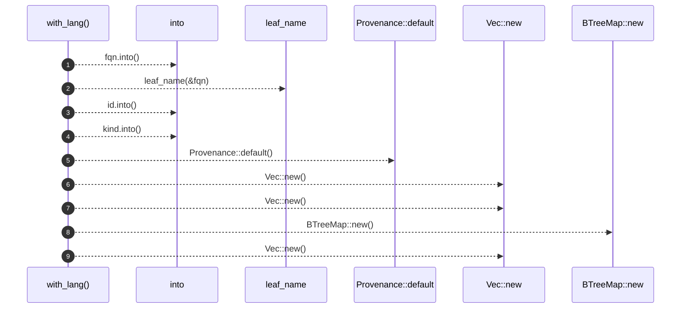
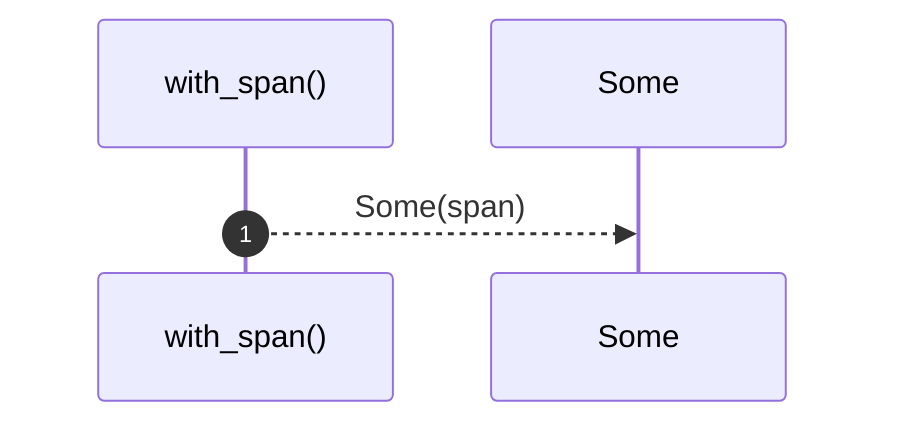
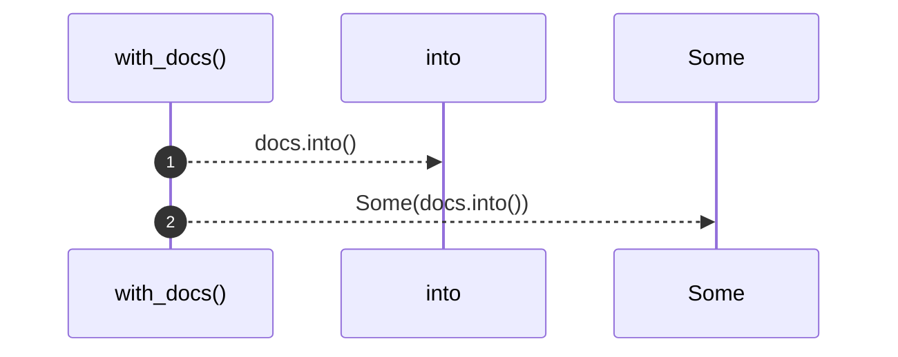
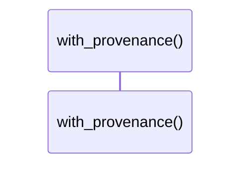
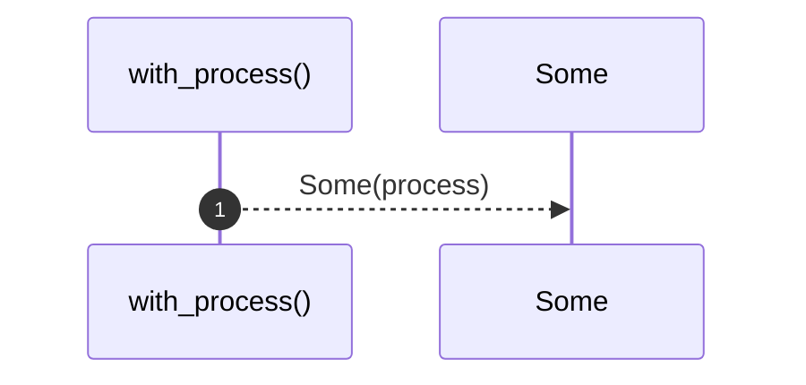
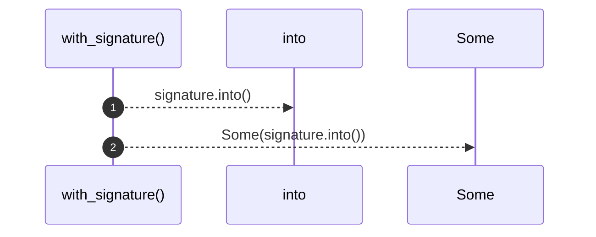
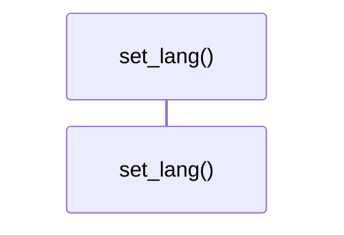

# `robby_ir::model::impl Node`

[Self-model](../../README.md) · [model](index.md)

| | |
|---|---|
| kind | `code.impl` |
| location | [`crates/robby-ir/src/model.rs:253`](../../../../crates/robby-ir/src/model.rs#L253) |
| provenance | extractor · confidence 1.00 |

```rust
impl Node {
    pub fn new(id: impl Into<NodeId>, kind: impl Into<Kind>, fqn: impl Into<String>) -> Self {
        Self::with_lang(id, kind, fqn, Lang::Rust)
    }

    /// Like [`Node::new`], with an explicit language tag.
    pub fn with_lang(
        id: impl Into<NodeId>,
        kind: impl Into<Kind>,
        fqn: impl Into<String>,
        lang: Lang,
    ) -> Self {
        let fqn = fqn.into();
        let name = leaf_name(&fqn);
        Self {
            id: id.into(),
            kind: kind.into(),
            name,
            fqn,
            lang,
            span: None,
            signature: None,
            docs: None,
            provenance: Provenance::default(),
            parent: None,
            children: Vec::new(),
            edges: Vec::new(),
            process: None,
            annotations: BTreeMap::new(),
            tags: Vec::new(),
        }
    }

    pub fn with_span(mut self, span: Span) -> Self {
        self.span = Some(span);
        self
    }

    pub fn with_docs(mut self, docs: impl Into<String>) -> Self {
        self.docs = Some(docs.into());
        self
    }

    pub fn with_provenance(mut self, provenance: Provenance) -> Self {
        self.provenance = provenance;
        self
    }

    pub fn with_process(mut self, process: Process) -> Self {
        self.process = Some(process);
        self
    }

    pub fn with_signature(mut self, signature: impl Into<String>) -> Self {
        self.signature = Some(signature.into());
        self
    }

    pub fn set_lang(mut self, lang: Lang) -> Self {
        self.lang = lang;
        self
    }
}
```

## References

- calls → [`robby_ir::model`](index.md) — default, leaf_name

## Referenced by

- calls ← [`robby_agent::enrich::insert_decision`](../../robby_agent/enrich/insert-decision.md)
- calls ← [`robby_agent::enrich::mini_doc`](../../robby_agent/enrich/tests/mini-doc.md)
- calls ← [`robby_extract::typescript::emit_import`](../../robby_extract/typescript/emit-import.md)
- calls ← [`robby_extract::typescript::extract`](../../robby_extract/typescript/extract.md)
- calls ← [`robby_extract::typescript::extract_file`](../../robby_extract/typescript/extract-file.md)
- calls ← [`robby_extract::typescript::item_node`](../../robby_extract/typescript/item-node.md)
- calls ← [`robby_ir::test_coverage::typescript_node_sets_lang`](../test_coverage/typescript-node-sets-lang.md)

### `new`

| | |
|---|---|
| kind | `code.method` |
| signature | `fn new(3)` |
| location | [`crates/robby-ir/src/model.rs:254`](../../../../crates/robby-ir/src/model.rs#L254) |
| provenance | extractor · confidence 1.00 |

```rust
pub fn new(id: impl Into<NodeId>, kind: impl Into<Kind>, fqn: impl Into<String>) -> Self {
        Self::with_lang(id, kind, fqn, Lang::Rust)
    }
```



1 steps · 0 observed · 1 possible only

**Edges**

- calls → [`robby_ir::model::impl Node::with_lang`](index.md)

### `with_lang`

| | |
|---|---|
| kind | `code.method` |
| signature | `fn with_lang(4)` |
| location | [`crates/robby-ir/src/model.rs:258`](../../../../crates/robby-ir/src/model.rs#L258) |
| provenance | extractor · confidence 1.00 |

> Like [`Node::new`], with an explicit language tag.

```rust
/// Like [`Node::new`], with an explicit language tag.
    pub fn with_lang(
        id: impl Into<NodeId>,
        kind: impl Into<Kind>,
        fqn: impl Into<String>,
        lang: Lang,
    ) -> Self {
        let fqn = fqn.into();
        let name = leaf_name(&fqn);
        Self {
            id: id.into(),
            kind: kind.into(),
            name,
            fqn,
            lang,
            span: None,
            signature: None,
            docs: None,
            provenance: Provenance::default(),
            parent: None,
            children: Vec::new(),
            edges: Vec::new(),
            process: None,
            annotations: BTreeMap::new(),
            tags: Vec::new(),
        }
    }
```



9 steps · 0 observed · 9 possible only

**Edges**

- calls → [`robby_ir::model::leaf_name`](leaf-name.md)
- calls → [`robby_ir::model::impl Default for Provenance::default`](index.md)
- calls → [`robby_ir::model::impl Node::new`](index.md)
- calls → [`robby_ir::model::impl Node::new`](index.md)
- calls → [`robby_ir::model::impl Node::new`](index.md)
- calls → [`robby_ir::model::impl Node::new`](index.md)

### `with_span`

| | |
|---|---|
| kind | `code.method` |
| signature | `fn with_span(2)` |
| location | [`crates/robby-ir/src/model.rs:286`](../../../../crates/robby-ir/src/model.rs#L286) |
| provenance | extractor · confidence 1.00 |

```rust
pub fn with_span(mut self, span: Span) -> Self {
        self.span = Some(span);
        self
    }
```



1 steps · 0 observed · 1 possible only

### `with_docs`

| | |
|---|---|
| kind | `code.method` |
| signature | `fn with_docs(2)` |
| location | [`crates/robby-ir/src/model.rs:291`](../../../../crates/robby-ir/src/model.rs#L291) |
| provenance | extractor · confidence 1.00 |

```rust
pub fn with_docs(mut self, docs: impl Into<String>) -> Self {
        self.docs = Some(docs.into());
        self
    }
```



2 steps · 0 observed · 2 possible only

### `with_provenance`

| | |
|---|---|
| kind | `code.method` |
| signature | `fn with_provenance(2)` |
| location | [`crates/robby-ir/src/model.rs:296`](../../../../crates/robby-ir/src/model.rs#L296) |
| provenance | extractor · confidence 1.00 |

```rust
pub fn with_provenance(mut self, provenance: Provenance) -> Self {
        self.provenance = provenance;
        self
    }
```



0 steps · 0 observed · 0 possible only

### `with_process`

| | |
|---|---|
| kind | `code.method` |
| signature | `fn with_process(2)` |
| location | [`crates/robby-ir/src/model.rs:301`](../../../../crates/robby-ir/src/model.rs#L301) |
| provenance | extractor · confidence 1.00 |

```rust
pub fn with_process(mut self, process: Process) -> Self {
        self.process = Some(process);
        self
    }
```



1 steps · 0 observed · 1 possible only

### `with_signature`

| | |
|---|---|
| kind | `code.method` |
| signature | `fn with_signature(2)` |
| location | [`crates/robby-ir/src/model.rs:306`](../../../../crates/robby-ir/src/model.rs#L306) |
| provenance | extractor · confidence 1.00 |

```rust
pub fn with_signature(mut self, signature: impl Into<String>) -> Self {
        self.signature = Some(signature.into());
        self
    }
```



2 steps · 0 observed · 2 possible only

### `set_lang`

| | |
|---|---|
| kind | `code.method` |
| signature | `fn set_lang(2)` |
| location | [`crates/robby-ir/src/model.rs:311`](../../../../crates/robby-ir/src/model.rs#L311) |
| provenance | extractor · confidence 1.00 |

```rust
pub fn set_lang(mut self, lang: Lang) -> Self {
        self.lang = lang;
        self
    }
```



0 steps · 0 observed · 0 possible only

