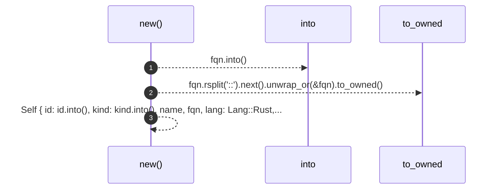
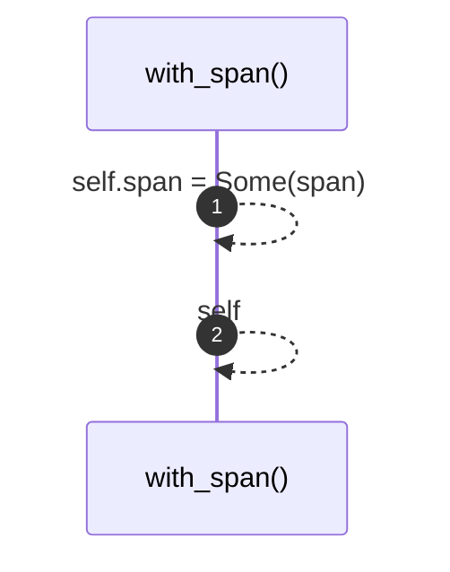
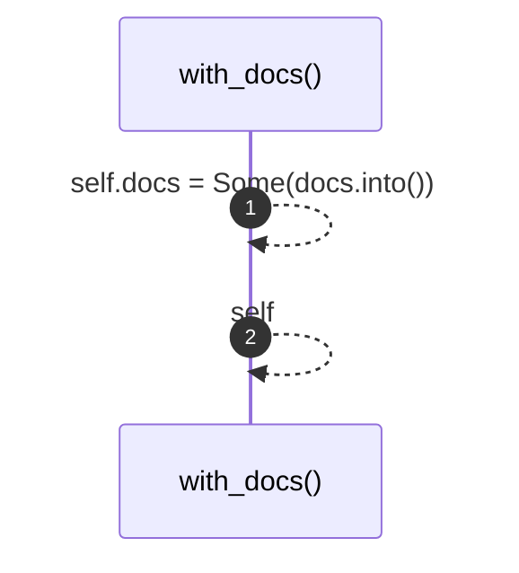
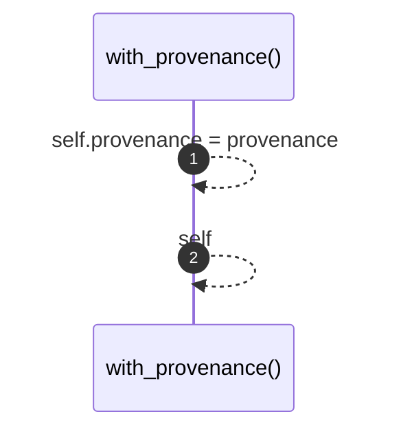
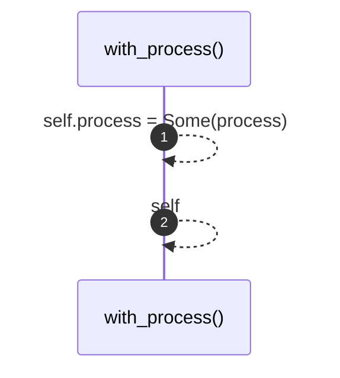
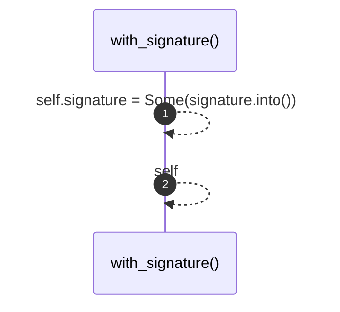

# `robby_ir::model::impl Node`

[Self-model](../../README.md) · [model](index.md)

| | |
|---|---|
| kind | `code.impl` |
| location | [`crates/robby-ir/src/model.rs:215`](../../../../crates/robby-ir/src/model.rs#L215) |
| provenance | extractor · confidence 1.00 |

```rust
impl Node {
    pub fn new(id: impl Into<NodeId>, kind: impl Into<Kind>, fqn: impl Into<String>) -> Self {
        let fqn = fqn.into();
        let name = fqn.rsplit("::").next().unwrap_or(&fqn).to_owned();
        Self {
            id: id.into(),
            kind: kind.into(),
            name,
            fqn,
            lang: Lang::Rust,
            span: None,
            signature: None,
            docs: None,
            provenance: Provenance::default(),
            parent: None,
            children: Vec::new(),
            edges: Vec::new(),
            process: None,
            annotations: BTreeMap::new(),
            tags: Vec::new(),
        }
    }

    pub fn with_span(mut self, span: Span) -> Self {
        self.span = Some(span);
        self
    }

    pub fn with_docs(mut self, docs: impl Into<String>) -> Self {
        self.docs = Some(docs.into());
        self
    }

    pub fn with_provenance(mut self, provenance: Provenance) -> Self {
        self.provenance = provenance;
        self
    }

    pub fn with_process(mut self, process: Process) -> Self {
        self.process = Some(process);
        self
    }

    pub fn with_signature(mut self, signature: impl Into<String>) -> Self {
        self.signature = Some(signature.into());
        self
    }
}
```

### `new`

| | |
|---|---|
| kind | `code.method` |
| signature | `fn new(3)` |
| location | [`crates/robby-ir/src/model.rs:216`](../../../../crates/robby-ir/src/model.rs#L216) |
| provenance | extractor · confidence 1.00 |

```rust
pub fn new(id: impl Into<NodeId>, kind: impl Into<Kind>, fqn: impl Into<String>) -> Self {
        let fqn = fqn.into();
        let name = fqn.rsplit("::").next().unwrap_or(&fqn).to_owned();
        Self {
            id: id.into(),
            kind: kind.into(),
            name,
            fqn,
            lang: Lang::Rust,
            span: None,
            signature: None,
            docs: None,
            provenance: Provenance::default(),
            parent: None,
            children: Vec::new(),
            edges: Vec::new(),
            process: None,
            annotations: BTreeMap::new(),
            tags: Vec::new(),
        }
    }
```



3 steps · 0 observed · 3 possible only

### `with_span`

| | |
|---|---|
| kind | `code.method` |
| signature | `fn with_span(2)` |
| location | [`crates/robby-ir/src/model.rs:238`](../../../../crates/robby-ir/src/model.rs#L238) |
| provenance | extractor · confidence 1.00 |

```rust
pub fn with_span(mut self, span: Span) -> Self {
        self.span = Some(span);
        self
    }
```



2 steps · 0 observed · 2 possible only

### `with_docs`

| | |
|---|---|
| kind | `code.method` |
| signature | `fn with_docs(2)` |
| location | [`crates/robby-ir/src/model.rs:243`](../../../../crates/robby-ir/src/model.rs#L243) |
| provenance | extractor · confidence 1.00 |

```rust
pub fn with_docs(mut self, docs: impl Into<String>) -> Self {
        self.docs = Some(docs.into());
        self
    }
```



2 steps · 0 observed · 2 possible only

### `with_provenance`

| | |
|---|---|
| kind | `code.method` |
| signature | `fn with_provenance(2)` |
| location | [`crates/robby-ir/src/model.rs:248`](../../../../crates/robby-ir/src/model.rs#L248) |
| provenance | extractor · confidence 1.00 |

```rust
pub fn with_provenance(mut self, provenance: Provenance) -> Self {
        self.provenance = provenance;
        self
    }
```



2 steps · 0 observed · 2 possible only

### `with_process`

| | |
|---|---|
| kind | `code.method` |
| signature | `fn with_process(2)` |
| location | [`crates/robby-ir/src/model.rs:253`](../../../../crates/robby-ir/src/model.rs#L253) |
| provenance | extractor · confidence 1.00 |

```rust
pub fn with_process(mut self, process: Process) -> Self {
        self.process = Some(process);
        self
    }
```



2 steps · 0 observed · 2 possible only

### `with_signature`

| | |
|---|---|
| kind | `code.method` |
| signature | `fn with_signature(2)` |
| location | [`crates/robby-ir/src/model.rs:258`](../../../../crates/robby-ir/src/model.rs#L258) |
| provenance | extractor · confidence 1.00 |

```rust
pub fn with_signature(mut self, signature: impl Into<String>) -> Self {
        self.signature = Some(signature.into());
        self
    }
```



2 steps · 0 observed · 2 possible only

