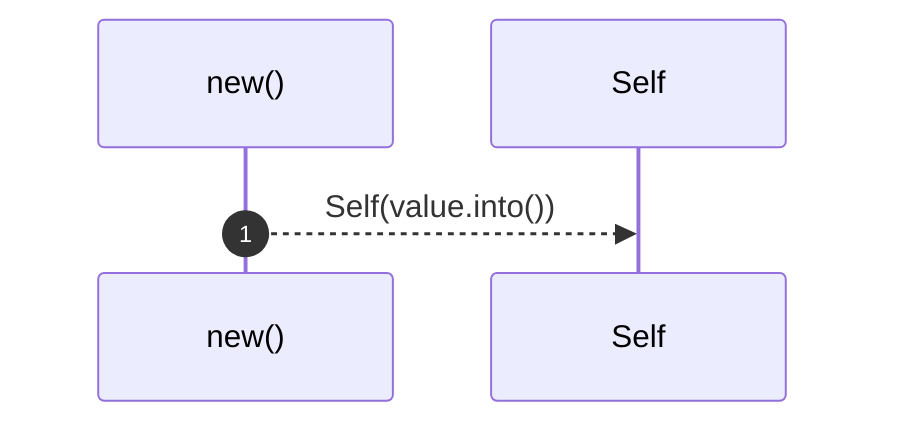
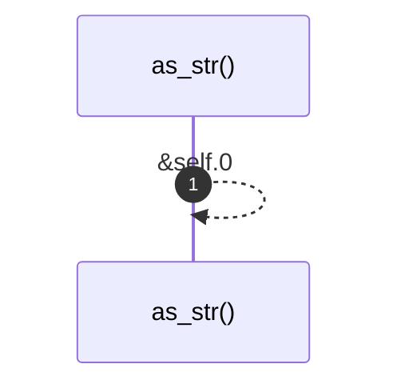
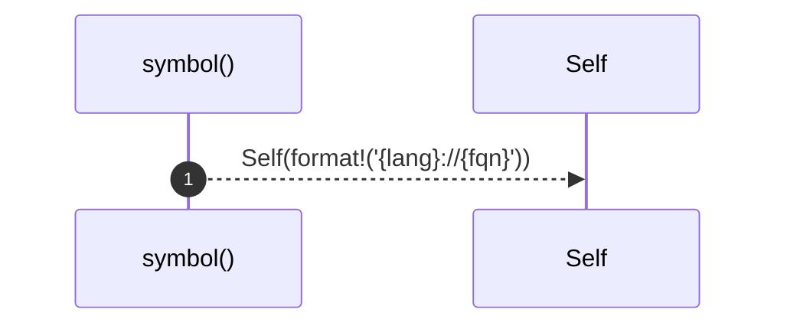
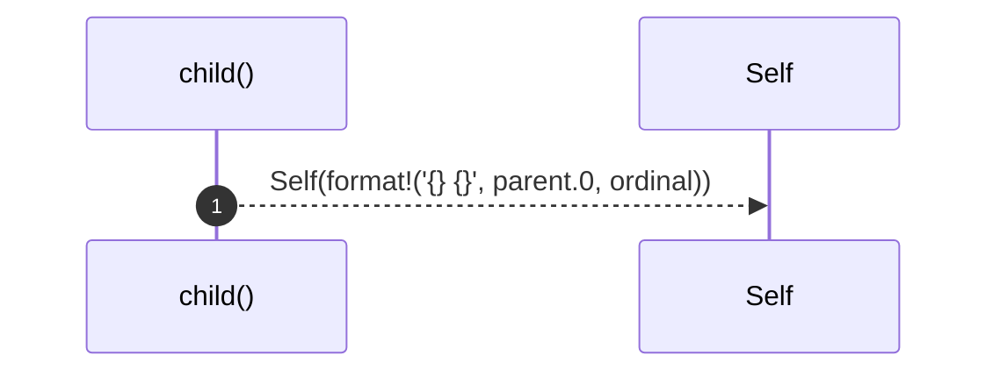

# `robby_ir::model::impl NodeId`

[Self-model](../../README.md) · [model](index.md)

| | |
|---|---|
| kind | `code.impl` |
| location | [`crates/robby-ir/src/model.rs:25`](../../../../crates/robby-ir/src/model.rs#L25) |
| provenance | extractor · confidence 1.00 |

```rust
impl NodeId {
    pub fn new(value: impl Into<String>) -> Self {
        Self(value.into())
    }

    pub fn as_str(&self) -> &str {
        &self.0
    }

    pub fn symbol(lang: &str, fqn: &str) -> Self {
        Self(format!("{lang}://{fqn}"))
    }

    pub fn child(parent: &NodeId, ordinal: usize) -> Self {
        Self(format!("{}#{}", parent.0, ordinal))
    }
}
```

### `new`

| | |
|---|---|
| kind | `code.method` |
| signature | `fn new(1)` |
| location | [`crates/robby-ir/src/model.rs:26`](../../../../crates/robby-ir/src/model.rs#L26) |
| provenance | extractor · confidence 1.00 |

```rust
pub fn new(value: impl Into<String>) -> Self {
        Self(value.into())
    }
```



1 steps · 0 observed · 1 possible only

### `as_str`

| | |
|---|---|
| kind | `code.method` |
| signature | `fn as_str(1)` |
| location | [`crates/robby-ir/src/model.rs:30`](../../../../crates/robby-ir/src/model.rs#L30) |
| provenance | extractor · confidence 1.00 |

```rust
pub fn as_str(&self) -> &str {
        &self.0
    }
```



1 steps · 0 observed · 1 possible only

### `symbol`

| | |
|---|---|
| kind | `code.method` |
| signature | `fn symbol(2)` |
| location | [`crates/robby-ir/src/model.rs:34`](../../../../crates/robby-ir/src/model.rs#L34) |
| provenance | extractor · confidence 1.00 |

```rust
pub fn symbol(lang: &str, fqn: &str) -> Self {
        Self(format!("{lang}://{fqn}"))
    }
```



1 steps · 0 observed · 1 possible only

### `child`

| | |
|---|---|
| kind | `code.method` |
| signature | `fn child(2)` |
| location | [`crates/robby-ir/src/model.rs:38`](../../../../crates/robby-ir/src/model.rs#L38) |
| provenance | extractor · confidence 1.00 |

```rust
pub fn child(parent: &NodeId, ordinal: usize) -> Self {
        Self(format!("{}#{}", parent.0, ordinal))
    }
```



1 steps · 0 observed · 1 possible only

