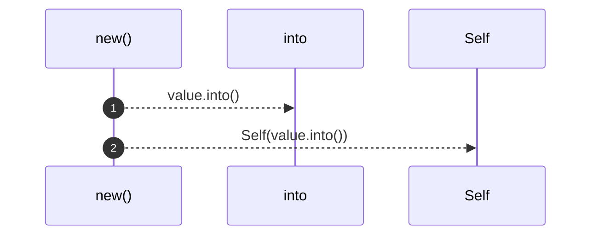
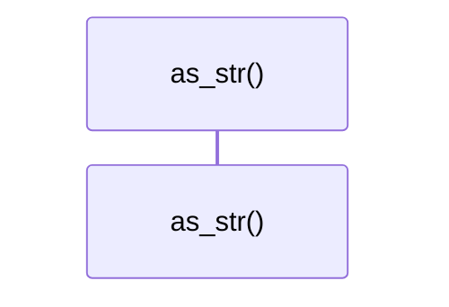
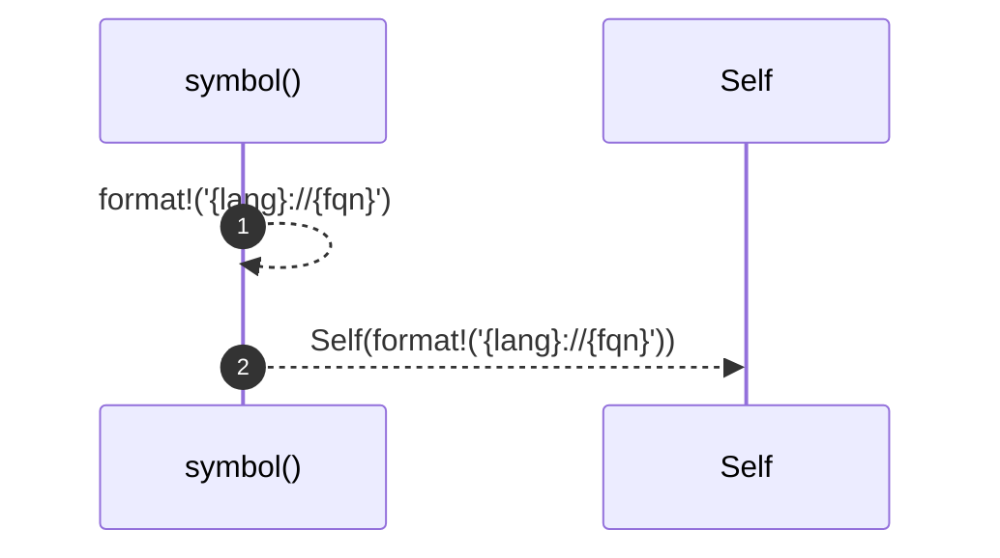
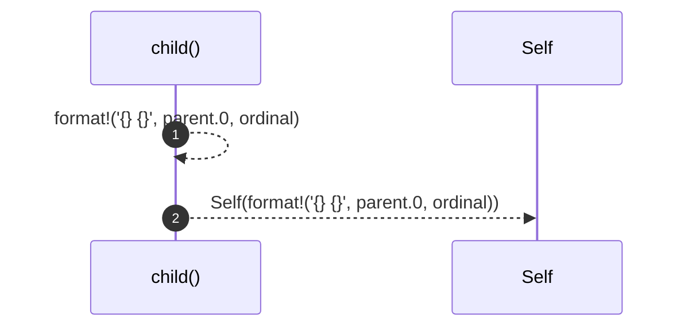

# `robby_ir::model::impl NodeId`

[Self-model](../../README.md) · [model](index.md)

| | |
|---|---|
| kind | `code.impl` |
| location | [`crates/robby-ir/src/model.rs:28`](../../../../crates/robby-ir/src/model.rs#L28) |
| provenance | extractor · confidence 1.00 |

```rust
impl NodeId {
    pub fn new(value: impl Into<String>) -> Self {
        Self(value.into())
    }

    pub fn as_str(&self) -> &str {
        &self.0
    }

    pub fn symbol(lang: &str, fqn: &str) -> Self {
        Self(format!("{lang}://{fqn}"))
    }

    pub fn child(parent: &NodeId, ordinal: usize) -> Self {
        Self(format!("{}#{}", parent.0, ordinal))
    }
}
```

## Referenced by

- calls ← [`robby_agent::enrich::insert_decision`](../../robby_agent/enrich/insert-decision.md)
- calls ← [`robby_agent::enrich::mini_doc`](../../robby_agent/enrich/tests/mini-doc.md)
- calls ← [`robby_extract::rust::extract`](../../robby_extract/rust/extract.md)
- calls ← [`robby_extract::rust::extract_file`](../../robby_extract/rust/extract-file.md)
- calls ← [`robby_extract::rust::item_node`](../../robby_extract/rust/item-node.md)
- calls ← [`robby_extract::rust::walk_expr`](../../robby_extract/rust/walk-expr.md)
- calls ← [`robby_extract::rust::walk_items`](../../robby_extract/rust/walk-items.md)
- calls ← [`robby_extract::typescript::build_function_process`](../../robby_extract/typescript/build-function-process.md)
- calls ← [`robby_extract::typescript::emit_class`](../../robby_extract/typescript/emit-class.md)
- calls ← [`robby_extract::typescript::emit_import`](../../robby_extract/typescript/emit-import.md)
- calls ← [`robby_extract::typescript::emit_interface`](../../robby_extract/typescript/emit-interface.md)
- calls ← [`robby_extract::typescript::emit_variable`](../../robby_extract/typescript/emit-variable.md)
- calls ← [`robby_extract::typescript::extract`](../../robby_extract/typescript/extract.md)
- calls ← [`robby_extract::typescript::extract_file`](../../robby_extract/typescript/extract-file.md)
- calls ← [`robby_extract::typescript::item_node`](../../robby_extract/typescript/item-node.md)
- calls ← [`robby_ir::codepath::respects_max_depth`](../codepath/tests/respects-max-depth.md)
- calls ← [`robby_ir::codepath::sample_doc`](../codepath/tests/sample-doc.md)
- calls ← [`robby_ir::model::wire`](tests/wire.md)
- calls ← [`robby_ir::test_coverage::frontier_spans_exclude_parents_that_have_span_children`](../test_coverage/frontier-spans-exclude-parents-that-have-span-children.md)
- calls ← [`robby_ir::test_coverage::report_orders_worst_files_first`](../test_coverage/report-orders-worst-files-first.md)
- calls ← [`robby_ir::test_coverage::typescript_node_sets_lang`](../test_coverage/typescript-node-sets-lang.md)
- calls ← [`robby_ir::test_coverage::unreferenced_files_appear_fully_uncovered`](../test_coverage/unreferenced-files-appear-fully-uncovered.md)
- calls ← [`robby_render::test_markdown::fixture`](../../robby_render/test_markdown/fixture.md)
- calls ← [`robby_render::test_render::class_diagram_marks_traits_as_interfaces`](../../robby_render/test_render/class-diagram-marks-traits-as-interfaces.md)
- calls ← [`robby_render::test_render::dependencies_emits_package_weighted_and_dsm`](../../robby_render/test_render/dependencies-emits-package-weighted-and-dsm.md)
- calls ← [`robby_render::test_render::externals_and_comments_sections_render`](../../robby_render/test_render/externals-and-comments-sections-render.md)
- calls ← [`robby_render::test_render::flowchart_clusters_modules`](../../robby_render/test_render/flowchart-clusters-modules.md)
- calls ← [`robby_render::test_web::demo_doc`](../../robby_render/test_web/demo-doc.md)
- calls ← [`robby_render::test_web::entrypoints_demo_doc`](../../robby_render/test_web/entrypoints-demo-doc.md)
- calls ← [`robby_render::test_web::frame_detail_includes_execution_mermaid_for_call_path`](../../robby_render/test_web/frame-detail-includes-execution-mermaid-for-call-path.md)
- calls ← [`robby_render::test_web::leaf_payload_includes_source_and_process`](../../robby_render/test_web/leaf-payload-includes-source-and-process.md)
- calls ← [`robby_render::tree::resolve_use_path`](../../robby_render/tree/resolve-use-path.md)
- calls ← [`robby_render::view::entrypoints::doc_with_mains`](../../robby_render/view/entrypoints/tests/doc-with-mains.md)
- calls ← [`robby_render::view::execution::sample`](../../robby_render/view/execution/tests/sample.md)
- calls ← [`robby_render::view::execution::sequence_includes_call_and_type_lifeline`](../../robby_render/view/execution/tests/sequence-includes-call-and-type-lifeline.md)

### `new`

| | |
|---|---|
| kind | `code.method` |
| signature | `fn new(1)` |
| location | [`crates/robby-ir/src/model.rs:29`](../../../../crates/robby-ir/src/model.rs#L29) |
| provenance | extractor · confidence 1.00 |

```rust
pub fn new(value: impl Into<String>) -> Self {
        Self(value.into())
    }
```



2 steps · 0 observed · 2 possible only

### `as_str`

| | |
|---|---|
| kind | `code.method` |
| signature | `fn as_str(1)` |
| location | [`crates/robby-ir/src/model.rs:33`](../../../../crates/robby-ir/src/model.rs#L33) |
| provenance | extractor · confidence 1.00 |

```rust
pub fn as_str(&self) -> &str {
        &self.0
    }
```



0 steps · 0 observed · 0 possible only

### `symbol`

| | |
|---|---|
| kind | `code.method` |
| signature | `fn symbol(2)` |
| location | [`crates/robby-ir/src/model.rs:37`](../../../../crates/robby-ir/src/model.rs#L37) |
| provenance | extractor · confidence 1.00 |

```rust
pub fn symbol(lang: &str, fqn: &str) -> Self {
        Self(format!("{lang}://{fqn}"))
    }
```



2 steps · 0 observed · 2 possible only

### `child`

| | |
|---|---|
| kind | `code.method` |
| signature | `fn child(2)` |
| location | [`crates/robby-ir/src/model.rs:41`](../../../../crates/robby-ir/src/model.rs#L41) |
| provenance | extractor · confidence 1.00 |

```rust
pub fn child(parent: &NodeId, ordinal: usize) -> Self {
        Self(format!("{}#{}", parent.0, ordinal))
    }
```



2 steps · 0 observed · 2 possible only

