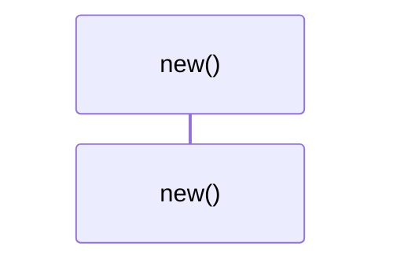
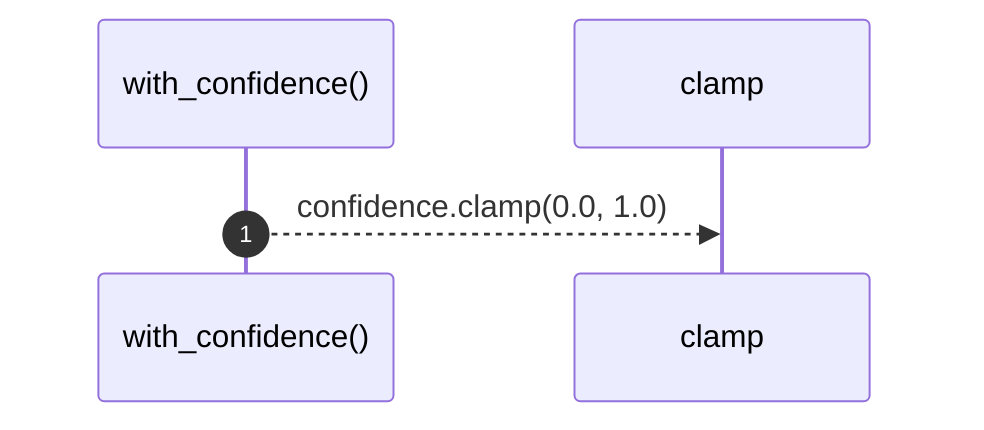

# `robby_ir::model::impl Provenance`

[Self-model](../../README.md) · [model](index.md)

| | |
|---|---|
| kind | `code.impl` |
| location | [`crates/robby-ir/src/model.rs:119`](../../../../crates/robby-ir/src/model.rs#L119) |
| provenance | extractor · confidence 1.00 |

```rust
impl Provenance {
    pub fn new(source: Source) -> Self {
        Self {
            source,
            observed_at: None,
            confidence: 1.0,
        }
    }

    pub fn with_confidence(mut self, confidence: f32) -> Self {
        self.confidence = confidence.clamp(0.0, 1.0);
        self
    }
}
```

### `new`

| | |
|---|---|
| kind | `code.method` |
| signature | `fn new(1)` |
| location | [`crates/robby-ir/src/model.rs:120`](../../../../crates/robby-ir/src/model.rs#L120) |
| provenance | extractor · confidence 1.00 |

```rust
pub fn new(source: Source) -> Self {
        Self {
            source,
            observed_at: None,
            confidence: 1.0,
        }
    }
```



0 steps · 0 observed · 0 possible only

### `with_confidence`

| | |
|---|---|
| kind | `code.method` |
| signature | `fn with_confidence(2)` |
| location | [`crates/robby-ir/src/model.rs:128`](../../../../crates/robby-ir/src/model.rs#L128) |
| provenance | extractor · confidence 1.00 |

```rust
pub fn with_confidence(mut self, confidence: f32) -> Self {
        self.confidence = confidence.clamp(0.0, 1.0);
        self
    }
```



1 steps · 0 observed · 1 possible only

