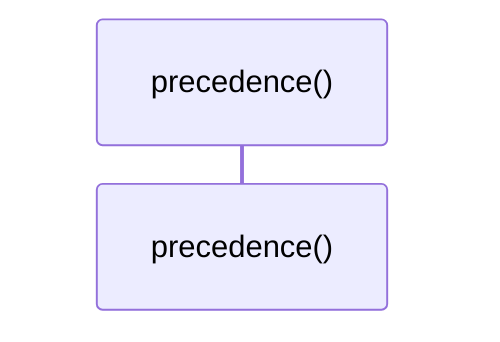
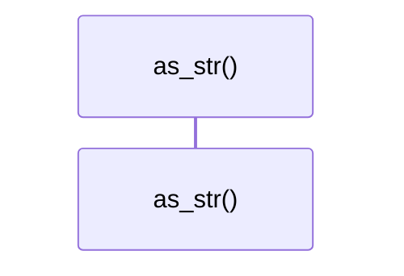

# `robby_ir::model::impl Source`

[Self-model](../../README.md) · [model](index.md)

| | |
|---|---|
| kind | `code.impl` |
| location | [`crates/robby-ir/src/model.rs:80`](../../../../crates/robby-ir/src/model.rs#L80) |
| provenance | extractor · confidence 1.00 |

```rust
impl Source {
    /// Lower numbers win when two producers disagree about the same fact.
    ///
    /// Runtime beats static because observation is ground truth; explicit
    /// annotation beats parsing because it carries intent.
    pub fn precedence(self) -> u8 {
        match self {
            Source::Trace => 0,
            Source::Agent => 1,
            Source::Macro => 2,
            Source::Extractor => 3,
            Source::Hand => 4,
        }
    }

    /// Serde name. Views display this rather than keeping a second match.
    pub fn as_str(self) -> &'static str {
        match self {
            Self::Extractor => "extractor",
            Self::Macro => "macro",
            Self::Trace => "trace",
            Self::Agent => "agent",
            Self::Hand => "hand",
        }
    }
}
```

### `precedence`

| | |
|---|---|
| kind | `code.method` |
| signature | `fn precedence(1)` |
| location | [`crates/robby-ir/src/model.rs:81`](../../../../crates/robby-ir/src/model.rs#L81) |
| provenance | extractor · confidence 1.00 |

> Lower numbers win when two producers disagree about the same fact.
> 
> Runtime beats static because observation is ground truth; explicit
> annotation beats parsing because it carries intent.

```rust
/// Lower numbers win when two producers disagree about the same fact.
    ///
    /// Runtime beats static because observation is ground truth; explicit
    /// annotation beats parsing because it carries intent.
    pub fn precedence(self) -> u8 {
        match self {
            Source::Trace => 0,
            Source::Agent => 1,
            Source::Macro => 2,
            Source::Extractor => 3,
            Source::Hand => 4,
        }
    }
```



0 steps · 0 observed · 0 possible only

### `as_str`

| | |
|---|---|
| kind | `code.method` |
| signature | `fn as_str(1)` |
| location | [`crates/robby-ir/src/model.rs:95`](../../../../crates/robby-ir/src/model.rs#L95) |
| provenance | extractor · confidence 1.00 |

> Serde name. Views display this rather than keeping a second match.

```rust
/// Serde name. Views display this rather than keeping a second match.
    pub fn as_str(self) -> &'static str {
        match self {
            Self::Extractor => "extractor",
            Self::Macro => "macro",
            Self::Trace => "trace",
            Self::Agent => "agent",
            Self::Hand => "hand",
        }
    }
```



0 steps · 0 observed · 0 possible only

