# `robby_ir::model`

[Self-model](../../README.md) · [robby_ir](../index.md)

| | |
|---|---|
| kind | `code.module` |
| declared at | [`crates/robby-ir/src/lib.rs:19`](../../../../crates/robby-ir/src/lib.rs#L19) |
| provenance | extractor · confidence 1.00 |
| nodes | 112 |

```mermaid
flowchart TD
    subgraph n_48c15551e2e91996["model [module]"]
        direction TB
        n_da769e1b4d63b7d2["SCHEMA_VERSION [const]"]
        n_be8db0c536ca2b0b["NodeId [struct]"]
        n_67e7bb90f7e7f947["Source [enum]"]
        n_cfa71c85e76b065d["Provenance [struct]"]
        n_924ca81e70c90c16["Lang [enum]"]
        n_b21a3f66ec2e7493["Edge [struct]"]
        n_6d7e6bf07cf4d081["fn is_one(v: &f32) -> bool [function]"]
        n_9049909fe4eac380["fn default_true() -> bool [function]"]
        n_b899e15e593f01d9["EdgeKind [enum]"]
        n_fd80640d94d15dd6["Node [struct]"]
        n_5af2156f1d9c4d87["Document [struct]"]
        n_63b77f58110fbb05["Severity [enum]"]
        n_91fb470a09da3ff5["Diagnostic [struct]"]
        n_ea6373866a29c8d4["fn validate(doc: &Document) -> Vec<Diagnostic> [function]"]
    end
```

## Items

| Item | Kind | Steps | Location |
|---|---|---:|---|
| [`SCHEMA_VERSION`](schema-version.md) | `code.const` | — | `crates/robby-ir/src/model.rs:12:1` |
| [`NodeId`](nodeid.md) | `code.struct` | — | `crates/robby-ir/src/model.rs:15:1` |
| [`impl NodeId`](impl-nodeid.md) | `code.impl` | — | `crates/robby-ir/src/model.rs:25:1` |
| [`Display for NodeId`](display-for-nodeid.md) | `code.impl` | — | `crates/robby-ir/src/model.rs:43:1` |
| [`impl From<&str> for NodeId`](impl-from-str-for-nodeid.md) | `code.impl` | — | `crates/robby-ir/src/model.rs:49:1` |
| [`impl From<String> for NodeId`](impl-from-string-for-nodeid.md) | `code.impl` | — | `crates/robby-ir/src/model.rs:55:1` |
| [`Source`](source.md) | `code.enum` | — | `crates/robby-ir/src/model.rs:61:1` |
| [`impl Source`](impl-source.md) | `code.impl` | — | `crates/robby-ir/src/model.rs:77:1` |
| [`Provenance`](provenance.md) | `code.struct` | — | `crates/robby-ir/src/model.rs:93:1` |
| [`impl Provenance`](impl-provenance.md) | `code.impl` | — | `crates/robby-ir/src/model.rs:105:1` |
| [`impl Default for Provenance`](impl-default-for-provenance.md) | `code.impl` | — | `crates/robby-ir/src/model.rs:120:1` |
| [`Lang`](lang.md) | `code.enum` | — | `crates/robby-ir/src/model.rs:126:1` |
| [`Edge`](edge.md) | `code.struct` | — | `crates/robby-ir/src/model.rs:134:1` |
| [`is_one`](is-one.md) | `code.function` | 1 | `crates/robby-ir/src/model.rs:151:1` |
| [`default_true`](default-true.md) | `code.function` | 1 | `crates/robby-ir/src/model.rs:155:1` |
| [`impl Edge`](impl-edge.md) | `code.impl` | — | `crates/robby-ir/src/model.rs:159:1` |
| [`EdgeKind`](edgekind.md) | `code.enum` | — | `crates/robby-ir/src/model.rs:171:1` |
| [`Node`](node.md) | `code.struct` | — | `crates/robby-ir/src/model.rs:185:1` |
| [`impl Node`](impl-node.md) | `code.impl` | — | `crates/robby-ir/src/model.rs:215:1` |
| [`Document`](document.md) | `code.struct` | — | `crates/robby-ir/src/model.rs:264:1` |
| [`impl Document`](impl-document.md) | `code.impl` | — | `crates/robby-ir/src/model.rs:282:1` |
| [`Severity`](severity.md) | `code.enum` | — | `crates/robby-ir/src/model.rs:371:1` |
| [`Diagnostic`](diagnostic.md) | `code.struct` | — | `crates/robby-ir/src/model.rs:379:1` |
| [`impl Diagnostic`](impl-diagnostic.md) | `code.impl` | — | `crates/robby-ir/src/model.rs:389:1` |
| [`validate`](validate.md) | `code.function` | 8 | `crates/robby-ir/src/model.rs:414:1` |

## Imports

- `use std::collections::BTreeMap;`
- `use schemars::JsonSchema;`
- `use serde::{Deserialize, Serialize};`
- `use crate::kind::Kind;`
- `use crate::process::Process;`
- `use crate::span::Span;`

