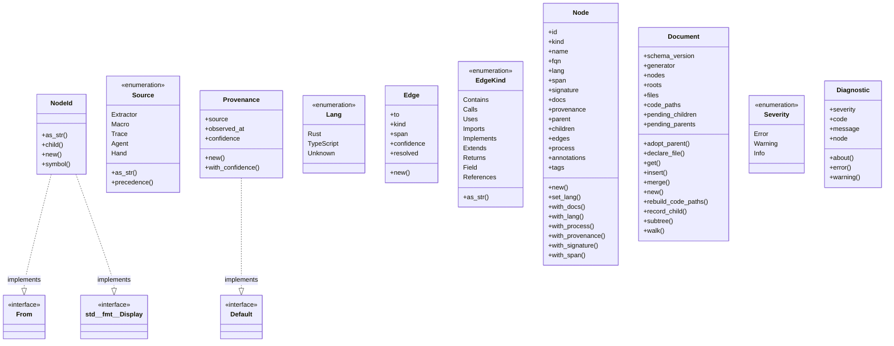
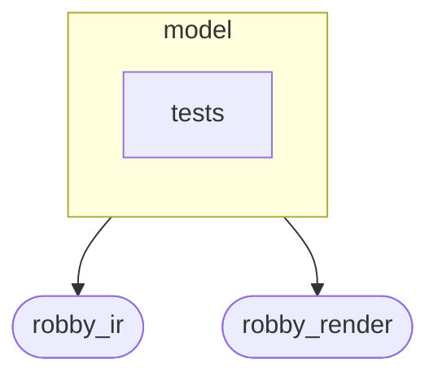
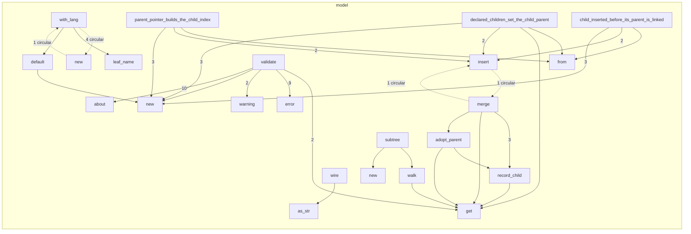

# `robby_ir::model`

[Self-model](../../README.md) · [robby_ir](../index.md)

| | |
|---|---|
| kind | `code.module` |
| declared at | [`crates/robby-ir/src/lib.rs:21`](../../../../crates/robby-ir/src/lib.rs#L21) |
| provenance | extractor · confidence 1.00 |
| nodes | 132 |

## Types



## Package diagram



## Module coupling



## Dependency matrix

| | model | tests | robby_ir | robby_render |
|---|---:|---:|---:|---:|
| **model** | · | | 2 | 24 |
| **tests** | | · | | |
| **robby_ir** | | | · | |
| **robby_render** | | | | · |

## Comments

- `crates/robby-ir/src/model.rs:107:1` (docs, `robby_ir::model::Provenance`): "Where a fact came from and how much to trust it."
  ```
  /// Where a fact came from and how much to trust it.
  #[derive(Debug, Clone, PartialEq, Serialize, Deserialize, JsonSchema)]
  pub struct Provenance {
      pub source: Source,
      /// Unix milliseconds. `None` means the fact is timeless (static analysis).
      #[serde(default, skip_serializing_if = "Option::is_none")]
      pub observed_at: Option<i64>,
      /// `0.0..=1.0`. Static resolution that could not disambiguate a path
      /// records its uncertainty here rather than dropping the edge.
      pub confidence: f32,
  }
  ```
- `crates/robby-ir/src/model.rs:148:1` (docs, `robby_ir::model::Edge`): "A directed relationship between nodes."
  ```
  /// A directed relationship between nodes.
  #[derive(Debug, Clone, PartialEq, Serialize, Deserialize, JsonSchema)]
  pub struct Edge {
      pub to: NodeId,
      pub kind: EdgeKind,
      #[serde(default, skip_serializing_if = "Option::is_none")]
      pub span: Option<Span>,
      #[serde(default, skip_serializing_if = "is_one")]
      pub confidence: f32,
      /// `false` when the target could not be resolved to a node in this graph.
      ///
      /// Unresolved edges are kept, never dropped. Losing edges silently is how
      /// a map stops being trustworthy.
      #[serde(default = "default_true")]
      pub resolved: bool,
  }
  ```
- `crates/robby-ir/src/model.rs:16:1` (docs, `robby_ir::model::NodeId`): "A stable, content-addressed node identifier. Symbols use `lang://fqn`, e.g. `rust://robby_ir::model::Node`. Statements …"
  ```
  /// A stable, content-addressed node identifier.
  ///
  /// Symbols use `lang://fqn`, e.g. `rust://robby_ir::model::Node`. Statements
  /// use `parent#ordinal`. Ordinal-based ids are stable within a run but shift
  /// when earlier siblings change; that is documented and accepted, because
  /// byte-offset ids would shift on every edit above them instead.
  #[derive(
      Debug, Clone, PartialEq, Eq, PartialOrd, Ord, Hash, Serialize, Deserialize, JsonSchema,
  )]
  #[serde(transparent)]
  pub struct NodeId(String);
  ```
- `crates/robby-ir/src/model.rs:204:5` (docs, `robby_ir::model::impl EdgeKind::as_str`): "Serde name (`references`, not the short diagram label)."
  ```
  /// Serde name (`references`, not the short diagram label).
      pub fn as_str(self) -> &'static str {
          match self {
              Self::Contains => "contains",
              Self::Calls => "calls",
              Self::Uses => "uses",
              Self::Imports => "imports",
              Self::Implements => "implements",
              Self::Extends => "extends",
              Self::Returns => "returns",
              Self::Field => "field",
              Self::References => "references",
          }
      }
  ```
- `crates/robby-ir/src/model.rs:220:1` (docs, `robby_ir::model::Node`): "A single described thing: a crate, a function, a statement, an observation."
  ```
  /// A single described thing: a crate, a function, a statement, an observation.
  #[derive(Debug, Clone, PartialEq, Serialize, Deserialize, JsonSchema)]
  pub struct Node {
      pub id: NodeId,
      pub kind: Kind,
      pub name: String,
      /// Fully-qualified, language-native path where one exists.
      pub fqn: String,
      pub lang: Lang,
      #[serde(default, skip_serializing_if = "Option::is_none")]
      pub span: Option<Span>,
      #[serde(default, skip_serializing_if = "Option::is_none")]
      pub signature: Option<String>,
      #[serde(default, skip_serializing_if = "Option::is_none")]
      pub docs: Option<String>,
      pub provenance: Provenance,
      /// Parent in the containment tree. This is the link callers set.
      /// [`Document::merge`] maintains [`Self::children`] from it.
      #[serde(default, skip_serializing_if = "Option::is_none")]
      pub parent: Option<NodeId>,
      /// Child ids in insertion order. Written only by [`Document::merge`].
      #[serde(default, skip_serializing_if = "Vec::is_empty")]
      pub children: Vec<NodeId>,
      #[serde(default, skip_serializing_if = "Vec::is_empty")]
      pub edges: Vec<Edge>,
      #[serde(default, skip_serializing_if = "Option::is_none")]
      pub process: Option<Process>,
      #[serde(default, skip_serializing_if = "BTreeMap::is_empty")]
      pub annotations: BTreeMap<String, String>,
      #[serde(default, skip_serializing_if = "Vec::is_empty")]
      pub tags: Vec<String>,
  }
  ```
- `crates/robby-ir/src/model.rs:258:5` (docs, `robby_ir::model::impl Node::with_lang`): "Like [`Node::new`], with an explicit language tag."
  ```
  /// Like [`Node::new`], with an explicit language tag.
      pub fn with_lang(
          id: impl Into<NodeId>,
          kind: impl Into<Kind>,
          fqn: impl Into<String>,
          lang: Lang,
      ) -> Self {
          let fqn = fqn.into();
          let name = leaf_name(&fqn);
          Self {
              id: id.into(),
              kind: kind.into(),
              name,
              fqn,
              lang,
              span: None,
              signature: None,
              docs: None,
              provenance: Provenance::default(),
              parent: None,
              children: Vec::new(),
              edges: Vec::new(),
              process: None,
              annotations: BTreeMap::new(),
              tags: Vec::new(),
          }
      }
  ```
- `crates/robby-ir/src/model.rs:317:1` (docs, `robby_ir::model::leaf_name`): "Leaf segment of an FQN across Rust (`::`), path (`/`), and dotted TS forms."
  ```
  /// Leaf segment of an FQN across Rust (`::`), path (`/`), and dotted TS forms.
  pub fn leaf_name(fqn: &str) -> String {
      let after_colon = fqn.rsplit("::").next().unwrap_or(fqn);
      let after_slash = after_colon.rsplit('/').next().unwrap_or(after_colon);
      after_slash
          .rsplit('.')
          .next()
          .unwrap_or(after_slash)
          .to_owned()
  }
  ```
- `crates/robby-ir/src/model.rs:328:1` (docs, `robby_ir::model::Document`): "The whole graph for one workspace snapshot."
  ```
  /// The whole graph for one workspace snapshot.
  #[derive(Debug, Clone, PartialEq, Serialize, Deserialize, JsonSchema)]
  pub struct Document {
      pub schema_version: u32,
      /// Tool name and version that produced this document.
      pub generator: String,
      pub nodes: BTreeMap<NodeId, Node>,
      /// Node ids with no parent.
      pub roots: Vec<NodeId>,
      /// Every source file this document claims to describe.
      ///
      /// This is what makes "no file is invisible" checkable: the coverage gate
      /// reads this list, so a file that was never parsed is a failure rather
      /// than an absence.
      #[serde(default, skip_serializing_if = "Vec::is_empty")]
      pub files: Vec<String>,
      /// Entrypoint-rooted call trees derived from resolved `Calls` edges.
      #[serde(default, skip_serializing_if = "Vec::is_empty")]
      pub code_paths: Vec<CodePath>,
      /// Children whose parent node is not in the document yet.
      ///
      /// Not part of the schema. Flushed when the parent is inserted so a child
      /// can be recorded before its parent without a second writer.
      #[serde(skip)]
      #[schemars(skip)]
      pending_children: BTreeMap<NodeId, Vec<NodeId>>,
      /// Parent declared for a child node that has not been inserted yet.
      #[serde(skip)]
      #[schemars(skip)]
      pending_parents: BTreeMap<NodeId, NodeId>,
  }
  ```
- `crates/robby-ir/src/model.rs:374:5` (docs, `robby_ir::model::impl Document::rebuild_code_paths`): "Rebuild [`Self::code_paths`] from current `Calls` edges and `main` entries."
  ```
  /// Rebuild [`Self::code_paths`] from current `Calls` edges and `main` entries.
      pub fn rebuild_code_paths(&mut self) {
          self.code_paths = build_code_paths(self, DEFAULT_MAX_DEPTH);
      }
  ```
- `crates/robby-ir/src/model.rs:379:5` (docs, `robby_ir::model::impl Document::declare_file`): "Record a source file as part of the map."
  ```
  /// Record a source file as part of the map.
      pub fn declare_file(&mut self, path: impl Into<String>) {
          let path = path.into();
          if !self.files.contains(&path) {
              self.files.push(path);
              self.files.sort();
          }
      }
  ```
- `crates/robby-ir/src/model.rs:392:5` (docs, `robby_ir::model::impl Document::merge`): "Insert, or merge into an existing node with the same id. Merging matters for modules: a `mod foo;` declaration and the …"
  ```
  /// Insert, or merge into an existing node with the same id.
      ///
      /// Merging matters for modules: a `mod foo;` declaration and the file
      /// `foo.rs` both describe `crate::foo`. The declaration carries the span,
      /// the file carries the contents, and they must not overwrite each other.
      ///
      /// Containment has one writer: this method. Set [`Node::parent`] on the
      /// child. A `children` list passed in is normalized into that same index,
      /// including when the child node arrives later.
      pub fn merge(&mut self, mut node: Node) {
          let id = node.id.clone();
          let declared_children = std::mem::take(&mut node.children);
          let incoming_parent = node.parent.clone();
  
          let adopted_parent = if let Some(existing) = self.nodes.get_mut(&id) {
              if existing.span.is_none() {
                  existing.span = node.span;
              }
              let adopted = existing.parent.is_none() && incoming_parent.is_some();
              if adopted {
                  existing.parent = incoming_parent;
              }
              for edge in node.edges {
                  if !existing.edges.contains(&edge) {
                      existing.edges.push(edge);
                  }
              }
              for (key, value) in node.annotations {
                  existing.annotations.entry(key).or_insert(value);
              }
              for tag in node.tags {
                  if !existing.tags.contains(&tag) {
                      existing.tags.push(tag);
                  }
              }
              adopted
          } else {
              if node.parent.is_none()
                  && let Some(parent) = self.pending_parents.remove(&id)
              {
                  node.parent = Some(parent);
              }
              if node.parent.is_none() {
                  self.roots.push(id.clone());
              }
              self.nodes.insert(id.clone(), node);
              if let Some(waiting) = self.pending_children.remove(&id) {
                  for child in waiting {
                      self.record_child(&id, &child);
                  }
              }
              false
          };
  
          if let Some(parent) = self.nodes.get(&id).and_then(|n| n.parent.clone()) {
              self.record_child(&parent, &id);
          }
          if adopted_parent {
              self.roots.retain(|root| root != &id);
          }
          for child in declared_children {
              self.record_child(&id, &child);
          }
          // A children list can name a node that is inserted later, with no parent
          // of its own. Point that node back so the two fields cannot diverge.
          self.adopt_parent(&id);
      }
  ```
- `crates/robby-ir/src/model.rs:460:5` (docs, `robby_ir::model::impl Document::adopt_parent`): "If some node already lists `id` and `id` has no parent, adopt that link."
  ```
  /// If some node already lists `id` and `id` has no parent, adopt that link.
      fn adopt_parent(&mut self, id: &NodeId) {
          if self.nodes.get(id).is_some_and(|node| node.parent.is_some()) {
              return;
          }
          let listed = self
              .nodes
              .iter()
              .find(|(parent_id, node)| *parent_id != id && node.children.contains(id))
              .map(|(parent_id, _)| parent_id.clone());
          if let Some(parent) = listed {
              self.record_child(&parent, id);
          }
      }
  ```
- `crates/robby-ir/src/model.rs:475:5` (docs, `robby_ir::model::impl Document::record_child`): "Record `child` under `parent`, and point the child back if it has no parent yet."
  ```
  /// Record `child` under `parent`, and point the child back if it has no parent yet.
      fn record_child(&mut self, parent: &NodeId, child: &NodeId) {
          if parent == child {
              return;
          }
          if let Some(parent_node) = self.nodes.get_mut(parent) {
              if !parent_node.children.contains(child) {
                  parent_node.children.push(child.clone());
              }
          } else {
              let pending = self.pending_children.entry(parent.clone()).or_default();
              if !pending.contains(child) {
                  pending.push(child.clone());
              }
          }
          if !self.nodes.contains_key(child) {
              self.pending_parents
                  .entry(child.clone())
                  .or_insert_with(|| parent.clone());
          }
          let needs_parent = self
              .nodes
              .get(child)
              .is_some_and(|node| node.parent.is_none());
          if needs_parent {
              if let Some(node) = self.nodes.get_mut(child) {
                  node.parent = Some(parent.clone());
              }
              self.roots.retain(|root| root != child);
          }
      }
  ```
- `crates/robby-ir/src/model.rs:511:5` (docs, `robby_ir::model::impl Document::subtree`): "All nodes under `root`, depth-first, deterministic order."
  ```
  /// All nodes under `root`, depth-first, deterministic order.
      pub fn subtree(&self, root: &NodeId) -> Vec<&Node> {
          let mut out = Vec::new();
          self.walk(root, &mut out);
          out
      }
  ```
- `crates/robby-ir/src/model.rs:571:1` (docs, `robby_ir::model::validate`): "Structural checks that do not depend on source text. Returns diagnostics rather than a `Result`: a graph with warnings …"
  ```
  /// Structural checks that do not depend on source text.
  ///
  /// Returns diagnostics rather than a `Result`: a graph with warnings is still
  /// renderable, and hiding soft problems behind a hard error is how they rot.
  pub fn validate(doc: &Document) -> Vec<Diagnostic> {
      let mut out = Vec::new();
  
      if doc.schema_version != SCHEMA_VERSION {
          out.push(Diagnostic::error(
              "schema/version",
              format!(
                  "document schema_version {} does not match tool {}",
                  doc.schema_version, SCHEMA_VERSION
              ),
          ));
      }
  
      for (id, node) in &doc.nodes {
          if let Some(parent) = &node.parent
              && !doc.nodes.contains_key(parent)
          {
              out.push(
                  Diagnostic::error(
                      "node/parent-missing",
                      format!("parent {parent} is not in the document"),
                  )
                  .about(id.clone()),
              );
          }
          if let Some(parent) = &node.parent
              && let Some(parent_node) = doc.nodes.get(parent)
              && !parent_node.children.iter().any(|child| child == id)
          {
              out.push(
                  Diagnostic::error(
                      "node/parent-link",
                      format!("parent {parent} does not list this node"),
                  )
                  .about(id.clone()),
              );
          }
          for child in &node.children {
              if !doc.nodes.contains_key(child) {
                  out.push(
                      Diagnostic::error(
                          "node/child-missing",
                          format!("child {child} is not in the document"),
                      )
                      .about(id.clone()),
                  );
              } else if doc.nodes.get(child).and_then(|n| n.parent.as_ref()) != Some(id) {
                  out.push(
                      Diagnostic::error(
                          "node/child-link",
                          format!("child {child} does not point at this parent"),
                      )
                      .about(id.clone()),
                  );
              }
          }
          for edge in &node.edges {
              if edge.resolved && !doc.nodes.contains_key(&edge.to) {
                  out.push(
                      Diagnostic::error(
                          "edge/target-missing",
                          format!("resolved edge points at missing node {}", edge.to),
                      )
                      .about(id.clone()),
                  );
              }
              if !edge.resolved {
                  out.push(
                      Diagnostic::warning(
                          "edge/unresolved",
                          format!("edge to {} was never resolved", edge.to),
                      )
                      .about(id.clone()),
                  );
              }
          }
          if !crate::kind::is_known(&node.kind) {
              out.push(
                  Diagnostic::warning(
                      "kind/unknown-namespace",
                      format!("kind `{}` has an unknown namespace", node.kind),
                  )
                  .about(id.clone()),
              );
          }
      }
  
      for path in &doc.code_paths {
          if !doc.nodes.contains_key(&path.entry) {
              out.push(
                  Diagnostic::error(
                      "codepath/entry-missing",
                      format!("code path entry {} is not in the document", path.entry),
                  )
                  .about(path.entry.clone()),
              );
          }
          for edge in &path.edges {
              if !doc.nodes.contains_key(&edge.from) {
                  out.push(
                      Diagnostic::error(
                          "codepath/from-missing",
                          format!("code path edge from missing node {}", edge.from),
                      )
                      .about(edge.from.clone()),
                  );
              }
              if !doc.nodes.contains_key(&edge.to) {
                  out.push(
                      Diagnostic::error(
                          "codepath/to-missing",
                          format!("code path edge to missing node {}", edge.to),
                      )
                      .about(edge.to.clone()),
                  );
              }
          }
      }
  
      out
  }
  ```
- `crates/robby-ir/src/model.rs:64:1` (docs, `robby_ir::model::Source`): "Which producer contributed a fact."
  ```
  /// Which producer contributed a fact.
  #[derive(Debug, Clone, Copy, PartialEq, Eq, Serialize, Deserialize, JsonSchema)]
  #[serde(rename_all = "snake_case")]
  pub enum Source {
      /// Parsed from source without annotations.
      Extractor,
      /// Contributed by an explicit macro annotation.
      Macro,
      /// Recorded while the code ran.
      Trace,
      /// Emitted by an agent describing its own process.
      Agent,
      /// Authored by hand (fixtures, bootstrap data).
      Hand,
  }
  ```
- `crates/robby-ir/src/model.rs:81:5` (docs, `robby_ir::model::impl Source::precedence`): "Lower numbers win when two producers disagree about the same fact. Runtime beats static because observation is ground t…"
  ```
  /// Lower numbers win when two producers disagree about the same fact.
      ///
      /// Runtime beats static because observation is ground truth; explicit
      /// annotation beats parsing because it carries intent.
      pub fn precedence(self) -> u8 {
          match self {
              Source::Trace => 0,
              Source::Agent => 1,
              Source::Macro => 2,
              Source::Extractor => 3,
              Source::Hand => 4,
          }
      }
  ```
- `crates/robby-ir/src/model.rs:95:5` (docs, `robby_ir::model::impl Source::as_str`): "Serde name. Views display this rather than keeping a second match."
  ```
  /// Serde name. Views display this rather than keeping a second match.
      pub fn as_str(self) -> &'static str {
          match self {
              Self::Extractor => "extractor",
              Self::Macro => "macro",
              Self::Trace => "trace",
              Self::Agent => "agent",
              Self::Hand => "hand",
          }
      }
  ```
## References

- calls → [`robby_ir::codepath`](../codepath/index.md) — build_code_paths
- calls → [`robby_ir::kind`](../kind/index.md) — is_known
- calls → [`robby_render::report`](../../robby_render/report/index.md) — push
- calls → [`robby_render::view::scene`](../../robby_render/view/scene/index.md) — contains

## Referenced by

- calls ← [`robby_agent::context::has_decision_child`](../../robby_agent/context/has-decision-child.md)
- calls ← [`robby_agent::context::line_window`](../../robby_agent/context/line-window.md)
- calls ← [`robby_agent::context::nearest_following_item`](../../robby_agent/context/nearest-following-item.md)
- calls ← [`robby_agent::context::parent_has_comment_with_text`](../../robby_agent/context/parent-has-comment-with-text.md)
- calls ← [`robby_agent::context::slice_node`](../../robby_agent/context/slice-node.md)
- calls ← [`robby_agent::enrich::insert_decision`](../../robby_agent/enrich/insert-decision.md)
- calls ← [`robby_agent::enrich::mini_doc`](../../robby_agent/enrich/tests/mini-doc.md)
- calls ← [`robby_agent::model::parse_decision`](../../robby_agent/model/parse-decision.md)
- calls ← [`robby_agent::model::parse_note`](../../robby_agent/model/parse-note.md)
- calls ← [`robby_extract::merge_documents`](../../robby_extract/merge-documents.md)
- calls ← [`robby_extract::rust::extract`](../../robby_extract/rust/extract.md)
- calls ← [`robby_extract::rust::extract_file`](../../robby_extract/rust/extract-file.md)
- calls ← [`robby_extract::rust::item_node`](../../robby_extract/rust/item-node.md)
- calls ← [`robby_extract::rust::resolve_calls`](../../robby_extract/rust/resolve-calls.md)
- calls ← [`robby_extract::rust::sanitize`](../../robby_extract/rust/sanitize.md)
- calls ← [`robby_extract::rust::slice`](../../robby_extract/rust/slice.md)
- calls ← [`robby_extract::rust::walk_expr`](../../robby_extract/rust/walk-expr.md)
- calls ← [`robby_extract::rust::walk_items`](../../robby_extract/rust/walk-items.md)
- calls ← [`robby_extract::test_extract::the_workspace_is_fully_covered`](../../robby_extract/test_extract/the-workspace-is-fully-covered.md)
- calls ← [`robby_extract::test_typescript::typescript_fixture_is_fully_covered`](../../robby_extract/test_typescript/typescript-fixture-is-fully-covered.md)
- calls ← [`robby_extract::typescript::attach_leading_docs`](../../robby_extract/typescript/attach-leading-docs.md)
- calls ← [`robby_extract::typescript::build_function_process`](../../robby_extract/typescript/build-function-process.md)
- calls ← [`robby_extract::typescript::emit_class`](../../robby_extract/typescript/emit-class.md)
- calls ← [`robby_extract::typescript::emit_comments`](../../robby_extract/typescript/emit-comments.md)
- calls ← [`robby_extract::typescript::emit_function`](../../robby_extract/typescript/emit-function.md)
- calls ← [`robby_extract::typescript::emit_import`](../../robby_extract/typescript/emit-import.md)
- calls ← [`robby_extract::typescript::emit_interface`](../../robby_extract/typescript/emit-interface.md)
- calls ← [`robby_extract::typescript::emit_method`](../../robby_extract/typescript/emit-method.md)
- calls ← [`robby_extract::typescript::emit_variable`](../../robby_extract/typescript/emit-variable.md)
- calls ← [`robby_extract::typescript::extract`](../../robby_extract/typescript/extract.md)
- calls ← [`robby_extract::typescript::extract_file`](../../robby_extract/typescript/extract-file.md)
- calls ← [`robby_extract::typescript::gap_is_attachable`](../../robby_extract/typescript/gap-is-attachable.md)
- calls ← [`robby_extract::typescript::item_node`](../../robby_extract/typescript/item-node.md)
- calls ← [`robby_extract::typescript::read_package_name`](../../robby_extract/typescript/read-package-name.md)
- calls ← [`robby_extract::typescript::resolve_calls`](../../robby_extract/typescript/resolve-calls.md)
- calls ← [`robby_extract::typescript::sanitize`](../../robby_extract/typescript/sanitize.md)
- calls ← [`robby_extract::typescript::walk_declaration`](../../robby_extract/typescript/walk-declaration.md)
- calls ← [`robby_extract::typescript::walk_statements`](../../robby_extract/typescript/walk-statements.md)
- calls ← [`robby_ir::codepath::impl CodePath::from_entry`](../codepath/index.md)
- calls ← [`robby_ir::codepath::respects_max_depth`](../codepath/tests/respects-max-depth.md)
- calls ← [`robby_ir::codepath::sample_doc`](../codepath/tests/sample-doc.md)
- calls ← [`robby_ir::coverage::document_coverage`](../coverage/document-coverage.md)
- calls ← [`robby_ir::coverage::has_span_descendant`](../coverage/has-span-descendant.md)
- calls ← [`robby_ir::test_coverage::document_coverage_is_union_at_any_depth`](../test_coverage/document-coverage-is-union-at-any-depth.md)
- calls ← [`robby_ir::test_coverage::frontier_spans_exclude_parents_that_have_span_children`](../test_coverage/frontier-spans-exclude-parents-that-have-span-children.md)
- calls ← [`robby_ir::test_coverage::report_orders_worst_files_first`](../test_coverage/report-orders-worst-files-first.md)
- calls ← [`robby_ir::test_coverage::typescript_node_sets_lang`](../test_coverage/typescript-node-sets-lang.md)
- calls ← [`robby_ir::test_coverage::unreferenced_files_appear_fully_uncovered`](../test_coverage/unreferenced-files-appear-fully-uncovered.md)
- calls ← [`robby_render::markdown::heading_depth`](../../robby_render/markdown/heading-depth.md)
- calls ← [`robby_render::markdown::node_section`](../../robby_render/markdown/node-section.md)
- calls ← [`robby_render::markdown::report`](../../robby_render/markdown/report.md)
- calls ← [`robby_render::pipeline::from_document`](../../robby_render/pipeline/from-document.md)
- calls ← [`robby_render::pipeline::load_sources`](../../robby_render/pipeline/load-sources.md)
- calls ← [`robby_render::render::mermaid::dsm_markdown_table`](../../robby_render/render/mermaid/dsm-markdown-table.md)
- calls ← [`robby_render::render::mermaid::emit_coupling_subgraph`](../../robby_render/render/mermaid/emit-coupling-subgraph.md)
- calls ← [`robby_render::render::tui::ascii_coupling`](../../robby_render/render/tui/ascii-coupling.md)
- calls ← [`robby_render::render::tui::ascii_package_structure`](../../robby_render/render/tui/ascii-package-structure.md)
- calls ← [`robby_render::render::tui::impl Renderer for TuiRenderer::process`](../../robby_render/render/tui/index.md)
- calls ← [`robby_render::render::tui::impl Renderer for TuiRenderer::sibling_graph`](../../robby_render/render/tui/index.md)
- calls ← [`robby_render::test_markdown::fixture`](../../robby_render/test_markdown/fixture.md)
- calls ← [`robby_render::test_render::class_diagram_marks_traits_as_interfaces`](../../robby_render/test_render/class-diagram-marks-traits-as-interfaces.md)
- calls ← [`robby_render::test_render::dependencies_emits_package_weighted_and_dsm`](../../robby_render/test_render/dependencies-emits-package-weighted-and-dsm.md)
- calls ← [`robby_render::test_render::externals_and_comments_sections_render`](../../robby_render/test_render/externals-and-comments-sections-render.md)
- calls ← [`robby_render::test_render::flowchart_clusters_modules`](../../robby_render/test_render/flowchart-clusters-modules.md)
- calls ← [`robby_render::test_tree::modules_link_out_and_back`](../../robby_render/test_tree/modules-link-out-and-back.md)
- calls ← [`robby_render::test_web::demo_doc`](../../robby_render/test_web/demo-doc.md)
- calls ← [`robby_render::test_web::entrypoints_demo_doc`](../../robby_render/test_web/entrypoints-demo-doc.md)
- calls ← [`robby_render::test_web::entrypoints_scene_roots_mains_and_nests_callees`](../../robby_render/test_web/entrypoints-scene-roots-mains-and-nests-callees.md)
- calls ← [`robby_render::test_web::frame_detail_includes_execution_mermaid_for_call_path`](../../robby_render/test_web/frame-detail-includes-execution-mermaid-for-call-path.md)
- calls ← [`robby_render::test_web::leaf_payload_includes_source_and_process`](../../robby_render/test_web/leaf-payload-includes-source-and-process.md)
- calls ← [`robby_render::tree::count_modules`](../../robby_render/tree/count-modules.md)
- calls ← [`robby_render::tree::global_index`](../../robby_render/tree/global-index.md)
- calls ← [`robby_render::tree::item_children`](../../robby_render/tree/item-children.md)
- calls ← [`robby_render::tree::item_slug`](../../robby_render/tree/item-slug.md)
- calls ← [`robby_render::tree::item_slugs`](../../robby_render/tree/item-slugs.md)
- calls ← [`robby_render::tree::module_page`](../../robby_render/tree/module-page.md)
- calls ← [`robby_render::tree::module_pages`](../../robby_render/tree/module-pages.md)
- calls ← [`robby_render::tree::module_tree_line`](../../robby_render/tree/module-tree-line.md)
- calls ← [`robby_render::tree::nav`](../../robby_render/tree/nav.md)
- calls ← [`robby_render::tree::page_of_node`](../../robby_render/tree/page-of-node.md)
- calls ← [`robby_render::tree::render_links`](../../robby_render/tree/render-links.md)
- calls ← [`robby_render::tree::render_node`](../../robby_render/tree/render-node.md)
- calls ← [`robby_render::tree::resolve_use_path`](../../robby_render/tree/resolve-use-path.md)
- calls ← [`robby_render::tree::slice`](../../robby_render/tree/slice.md)
- calls ← [`robby_render::util::alias`](../../robby_render/util/alias.md)
- calls ← [`robby_render::view::comments::decision_child`](../../robby_render/view/comments/decision-child.md)
- calls ← [`robby_render::view::comments::enrichment_fields`](../../robby_render/view/comments/enrichment-fields.md)
- calls ← [`robby_render::view::comments::impl CommentsView::from_root`](../../robby_render/view/comments/index.md)
- calls ← [`robby_render::view::comments::line_window`](../../robby_render/view/comments/line-window.md)
- calls ← [`robby_render::view::comments::nearest_following_item`](../../robby_render/view/comments/nearest-following-item.md)
- calls ← [`robby_render::view::comments::parse_verdict`](../../robby_render/view/comments/parse-verdict.md)
- calls ← [`robby_render::view::comments::slice_node`](../../robby_render/view/comments/slice-node.md)
- calls ← [`robby_render::view::deps::best_scope_prefix`](../../robby_render/view/deps/best-scope-prefix.md)
- calls ← [`robby_render::view::deps::container_of`](../../robby_render/view/deps/container-of.md)
- calls ← [`robby_render::view::deps::crate_of`](../../robby_render/view/deps/crate-of.md)
- calls ← [`robby_render::view::deps::finalize_edges`](../../robby_render/view/deps/finalize-edges.md)
- calls ← [`robby_render::view::deps::impl CouplingGraph::from_root`](../../robby_render/view/deps/index.md)
- calls ← [`robby_render::view::deps::impl CouplingGraph::workspace`](../../robby_render/view/deps/index.md)
- calls ← [`robby_render::view::deps::impl PackageStructure::from_root`](../../robby_render/view/deps/index.md)
- calls ← [`robby_render::view::deps::insert_module`](../../robby_render/view/deps/insert-module.md)
- calls ← [`robby_render::view::deps::lift_to_scope`](../../robby_render/view/deps/lift-to-scope.md)
- calls ← [`robby_render::view::deps::owning_in_scope`](../../robby_render/view/deps/owning-in-scope.md)
- calls ← [`robby_render::view::deps::package_edges`](../../robby_render/view/deps/package-edges.md)
- calls ← [`robby_render::view::deps::topological_layers`](../../robby_render/view/deps/topological-layers.md)
- calls ← [`robby_render::view::entrypoints::collect_cross_edges`](../../robby_render/view/entrypoints/collect-cross-edges.md)
- calls ← [`robby_render::view::entrypoints::doc_with_mains`](../../robby_render/view/entrypoints/tests/doc-with-mains.md)
- calls ← [`robby_render::view::entrypoints::impl CallTree::children_of`](../../robby_render/view/entrypoints/index.md)
- calls ← [`robby_render::view::entrypoints::impl CallTree::from_code_paths`](../../robby_render/view/entrypoints/index.md)
- calls ← [`robby_render::view::execution::from_code_path`](../../robby_render/view/execution/from-code-path.md)
- calls ← [`robby_render::view::execution::owning_type_label`](../../robby_render/view/execution/owning-type-label.md)
- calls ← [`robby_render::view::execution::sample`](../../robby_render/view/execution/tests/sample.md)
- calls ← [`robby_render::view::execution::sequence_includes_call_and_type_lifeline`](../../robby_render/view/execution/tests/sequence-includes-call-and-type-lifeline.md)
- calls ← [`robby_render::view::externals::impl ExternalsView::from_root`](../../robby_render/view/externals/index.md)
- calls ← [`robby_render::view::externals::is_external_package`](../../robby_render/view/externals/is-external-package.md)
- calls ← [`robby_render::view::externals::owning_container_fqn`](../../robby_render/view/externals/owning-container-fqn.md)
- calls ← [`robby_render::view::hierarchy::build`](../../robby_render/view/hierarchy/build.md)
- calls ← [`robby_render::view::hierarchy::impl HierarchyView::from_node`](../../robby_render/view/hierarchy/index.md)
- calls ← [`robby_render::view::links::inbound`](../../robby_render/view/links/inbound.md)
- calls ← [`robby_render::view::links::outbound`](../../robby_render/view/links/outbound.md)
- calls ← [`robby_render::view::links::owning_module`](../../robby_render/view/links/owning-module.md)
- calls ← [`robby_render::view::links::subtree_ids`](../../robby_render/view/links/subtree-ids.md)
- calls ← [`robby_render::view::scene::attach_call_portals`](../../robby_render/view/scene/attach-call-portals.md)
- calls ← [`robby_render::view::scene::build_call_frame`](../../robby_render/view/scene/build-call-frame.md)
- calls ← [`robby_render::view::scene::build_frame`](../../robby_render/view/scene/build-frame.md)
- calls ← [`robby_render::view::scene::crate_roots`](../../robby_render/view/scene/crate-roots.md)
- calls ← [`robby_render::view::scene::impl Scene::from_document`](../../robby_render/view/scene/index.md)
- calls ← [`robby_render::view::scene::impl Scene::from_entrypoints`](../../robby_render/view/scene/index.md)
- calls ← [`robby_render::view::scene::portals_for`](../../robby_render/view/scene/portals-for.md)
- calls ← [`robby_render::view::select::collect`](../../robby_render/view/select/collect.md)
- calls ← [`robby_render::view::select::is_binary_module`](../../robby_render/view/select/is-binary-module.md)
- calls ← [`robby_render::view::select::main_process`](../../robby_render/view/select/main-process.md)
- calls ← [`robby_render::view::sibling::impl SiblingGraph::from_root`](../../robby_render/view/sibling/index.md)
- calls ← [`robby_render::view::source::impl SourceSlice::from_node`](../../robby_render/view/source/index.md)
- calls ← [`robby_render::view::types::class_from_node`](../../robby_render/view/types/class-from-node.md)
- calls ← [`robby_render::view::types::impl TypeModel::from_module`](../../robby_render/view/types/index.md)
- calls ← [`robby_render::view::types::impl_methods`](../../robby_render/view/types/impl-methods.md)
- calls ← [`robby_render::web::write_site`](../../robby_render/web/write-site.md)

## Modules

- [`model::tests`](tests/index.md) — 7 nodes

## Items

| Item | Kind | Steps | Location |
|---|---|---:|---|
| [`SCHEMA_VERSION`](schema-version.md) | `code.const` | — | `crates/robby-ir/src/model.rs:13:1` |
| [`NodeId`](nodeid.md) | `code.struct` | — | `crates/robby-ir/src/model.rs:16:1` |
| [`impl NodeId`](impl-nodeid.md) | `code.impl` | — | `crates/robby-ir/src/model.rs:28:1` |
| [`Display for NodeId`](display-for-nodeid.md) | `code.impl` | — | `crates/robby-ir/src/model.rs:46:1` |
| [`impl From<&str> for NodeId`](impl-from-str-for-nodeid.md) | `code.impl` | — | `crates/robby-ir/src/model.rs:52:1` |
| [`impl From<String> for NodeId`](impl-from-string-for-nodeid.md) | `code.impl` | — | `crates/robby-ir/src/model.rs:58:1` |
| [`Source`](source.md) | `code.enum` | — | `crates/robby-ir/src/model.rs:64:1` |
| [`impl Source`](impl-source.md) | `code.impl` | — | `crates/robby-ir/src/model.rs:80:1` |
| [`Provenance`](provenance.md) | `code.struct` | — | `crates/robby-ir/src/model.rs:107:1` |
| [`impl Provenance`](impl-provenance.md) | `code.impl` | — | `crates/robby-ir/src/model.rs:119:1` |
| [`impl Default for Provenance`](impl-default-for-provenance.md) | `code.impl` | — | `crates/robby-ir/src/model.rs:134:1` |
| [`Lang`](lang.md) | `code.enum` | — | `crates/robby-ir/src/model.rs:140:1` |
| [`Edge`](edge.md) | `code.struct` | — | `crates/robby-ir/src/model.rs:148:1` |
| [`is_one`](is-one.md) | `code.function` | 1 | `crates/robby-ir/src/model.rs:166:1` |
| [`default_true`](default-true.md) | `code.function` | 0 | `crates/robby-ir/src/model.rs:171:1` |
| [`impl Edge`](impl-edge.md) | `code.impl` | — | `crates/robby-ir/src/model.rs:175:1` |
| [`EdgeKind`](edgekind.md) | `code.enum` | — | `crates/robby-ir/src/model.rs:187:1` |
| [`impl EdgeKind`](impl-edgekind.md) | `code.impl` | — | `crates/robby-ir/src/model.rs:203:1` |
| [`Node`](node.md) | `code.struct` | — | `crates/robby-ir/src/model.rs:220:1` |
| [`impl Node`](impl-node.md) | `code.impl` | — | `crates/robby-ir/src/model.rs:253:1` |
| [`leaf_name`](leaf-name.md) | `code.function` | 10 | `crates/robby-ir/src/model.rs:317:1` |
| [`Document`](document.md) | `code.struct` | — | `crates/robby-ir/src/model.rs:328:1` |
| [`impl Document`](impl-document.md) | `code.impl` | — | `crates/robby-ir/src/model.rs:360:1` |
| [`Severity`](severity.md) | `code.enum` | — | `crates/robby-ir/src/model.rs:528:1` |
| [`Diagnostic`](diagnostic.md) | `code.struct` | — | `crates/robby-ir/src/model.rs:536:1` |
| [`impl Diagnostic`](impl-diagnostic.md) | `code.impl` | — | `crates/robby-ir/src/model.rs:546:1` |
| [`validate`](validate.md) | `code.function` | 68 | `crates/robby-ir/src/model.rs:571:1` |

## Imports

- `use std::collections::BTreeMap;`
- `use schemars::JsonSchema;`
- `use serde::{Deserialize, Serialize};`
- `use crate::codepath::{CodePath, DEFAULT_MAX_DEPTH, build_code_paths};`
- `use crate::kind::Kind;`
- `use crate::process::Process;`
- `use crate::span::Span;`

