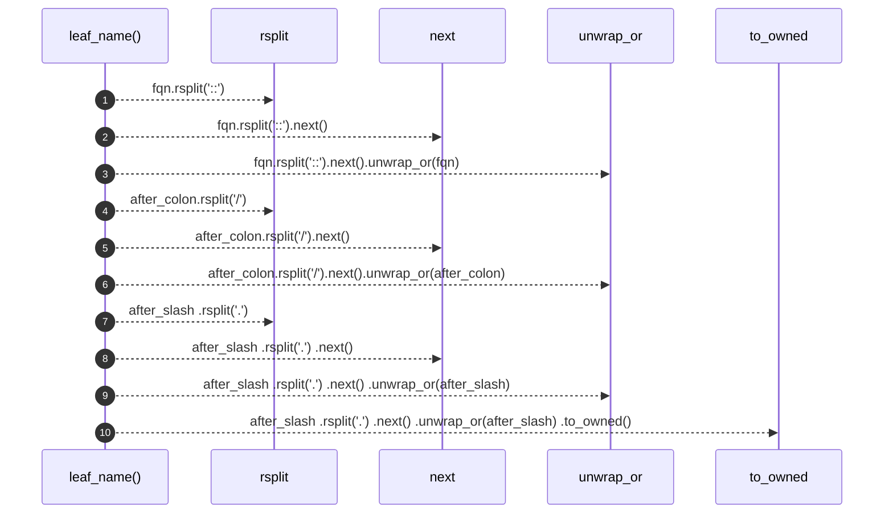

# `robby_ir::model::leaf_name`

[Self-model](../../README.md) · [model](index.md)

| | |
|---|---|
| kind | `code.function` |
| signature | `fn leaf_name(fqn: &str) -> String` |
| location | [`crates/robby-ir/src/model.rs:280`](../../../../crates/robby-ir/src/model.rs#L280) |
| provenance | extractor · confidence 1.00 |

> Leaf segment of an FQN across Rust (`::`), path (`/`), and dotted TS forms.

```rust
/// Leaf segment of an FQN across Rust (`::`), path (`/`), and dotted TS forms.
pub fn leaf_name(fqn: &str) -> String {
    let after_colon = fqn.rsplit("::").next().unwrap_or(fqn);
    let after_slash = after_colon.rsplit('/').next().unwrap_or(after_colon);
    after_slash
        .rsplit('.')
        .next()
        .unwrap_or(after_slash)
        .to_owned()
}
```



10 steps · 0 observed · 10 possible only

## Referenced by

- calls ← [`robby_ir::model::impl Node::with_lang`](index.md)

