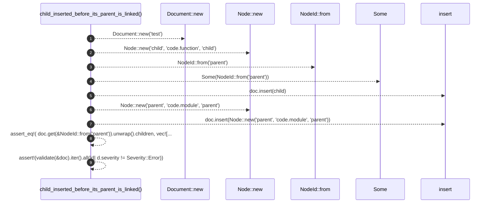

# `robby_ir::model::child_inserted_before_its_parent_is_linked`

[Self-model](../../../README.md) · [model::tests](index.md)

| | |
|---|---|
| kind | `code.function` |
| signature | `fn child_inserted_before_its_parent_is_linked()` |
| location | [`crates/robby-ir/src/model.rs:751`](../../../../../crates/robby-ir/src/model.rs#L751) |
| provenance | extractor · confidence 1.00 |

```rust
#[test]
    fn child_inserted_before_its_parent_is_linked() {
        let mut doc = Document::new("test");
        let mut child = Node::new("child", "code.function", "child");
        child.parent = Some(NodeId::from("parent"));
        doc.insert(child);
        doc.insert(Node::new("parent", "code.module", "parent"));

        assert_eq!(
            doc.get(&NodeId::from("parent")).unwrap().children,
            vec![NodeId::from("child")]
        );
        assert!(validate(&doc).iter().all(|d| d.severity != Severity::Error));
    }
```



9 steps · 0 observed · 9 possible only

**Edges**

- calls → [`robby_ir::model::impl Edge::new`](../index.md)
- calls → [`robby_ir::model::impl Edge::new`](../index.md)
- calls → [`robby_ir::model::impl From<&str> for NodeId::from`](../index.md)
- calls → [`robby_ir::model::impl Document::insert`](../index.md)
- calls → [`robby_ir::model::impl Edge::new`](../index.md)
- calls → [`robby_ir::model::impl Document::insert`](../index.md)

## References

- calls → [`robby_ir::model`](../index.md) — from, insert, new

