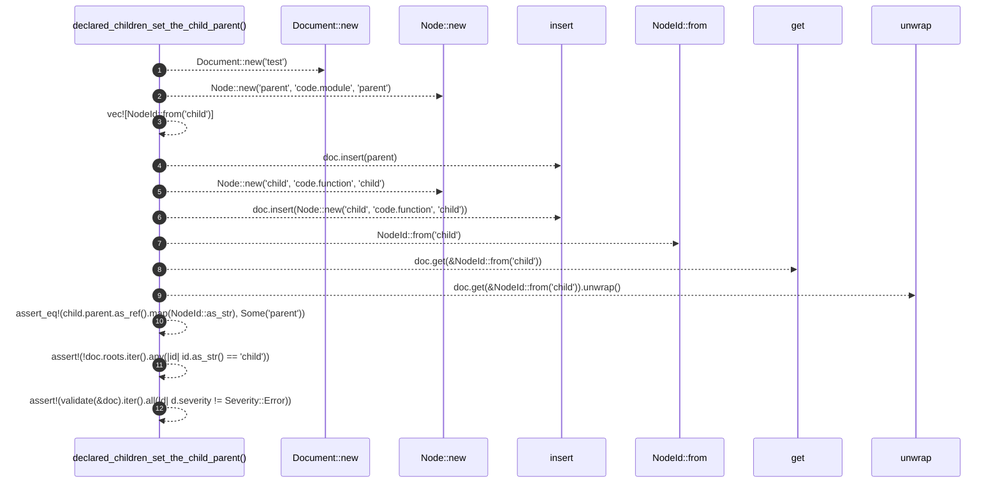

# `robby_ir::model::declared_children_set_the_child_parent`

[Self-model](../../../README.md) · [model::tests](index.md)

| | |
|---|---|
| kind | `code.function` |
| signature | `fn declared_children_set_the_child_parent()` |
| location | [`crates/robby-ir/src/model.rs:766`](../../../../../crates/robby-ir/src/model.rs#L766) |
| provenance | extractor · confidence 1.00 |

```rust
#[test]
    fn declared_children_set_the_child_parent() {
        let mut doc = Document::new("test");
        let mut parent = Node::new("parent", "code.module", "parent");
        parent.children = vec![NodeId::from("child")];
        doc.insert(parent);
        doc.insert(Node::new("child", "code.function", "child"));

        let child = doc.get(&NodeId::from("child")).unwrap();
        assert_eq!(child.parent.as_ref().map(NodeId::as_str), Some("parent"));
        assert!(!doc.roots.iter().any(|id| id.as_str() == "child"));
        assert!(validate(&doc).iter().all(|d| d.severity != Severity::Error));
    }
```



12 steps · 0 observed · 12 possible only

**Edges**

- calls → [`robby_ir::model::impl Edge::new`](../index.md)
- calls → [`robby_ir::model::impl Edge::new`](../index.md)
- calls → [`robby_ir::model::impl Document::insert`](../index.md)
- calls → [`robby_ir::model::impl Edge::new`](../index.md)
- calls → [`robby_ir::model::impl Document::insert`](../index.md)
- calls → [`robby_ir::model::impl From<&str> for NodeId::from`](../index.md)
- calls → [`robby_ir::model::impl Document::get`](../index.md)

## References

- calls → [`robby_ir::model`](../index.md) — from, get, insert, new

