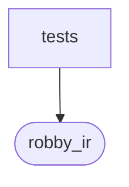

# `robby_ir::model::tests`

[Self-model](../../../README.md) · [model](../index.md)

| | |
|---|---|
| kind | `code.module` |
| declared at | [`crates/robby-ir/src/model.rs:697`](../../../../../crates/robby-ir/src/model.rs#L697) |
| provenance | extractor · confidence 1.00 |
| nodes | 7 |

## Package diagram

## Dependency matrix

| | tests | robby_ir |
|---|---:|---:|
| **tests** | · | 20 |
| **robby_ir** | | · |
## References

- calls → [`robby_ir::model`](../index.md) — 5 items

## Items

| Item | Kind | Steps | Location |
|---|---|---:|---|
| [`wire`](wire.md) | `code.function` | 5 | `crates/robby-ir/src/model.rs:701:5` |
| [`source_and_edge_names_match_serde`](source-and-edge-names-match-serde.md) | `code.function` | 2 | `crates/robby-ir/src/model.rs:709:5` |
| [`parent_pointer_builds_the_child_index`](parent-pointer-builds-the-child-index.md) | `code.function` | 9 | `crates/robby-ir/src/model.rs:735:5` |
| [`child_inserted_before_its_parent_is_linked`](child-inserted-before-its-parent-is-linked.md) | `code.function` | 9 | `crates/robby-ir/src/model.rs:751:5` |
| [`declared_children_set_the_child_parent`](declared-children-set-the-child-parent.md) | `code.function` | 12 | `crates/robby-ir/src/model.rs:766:5` |

## Imports

- `use super::*;`

