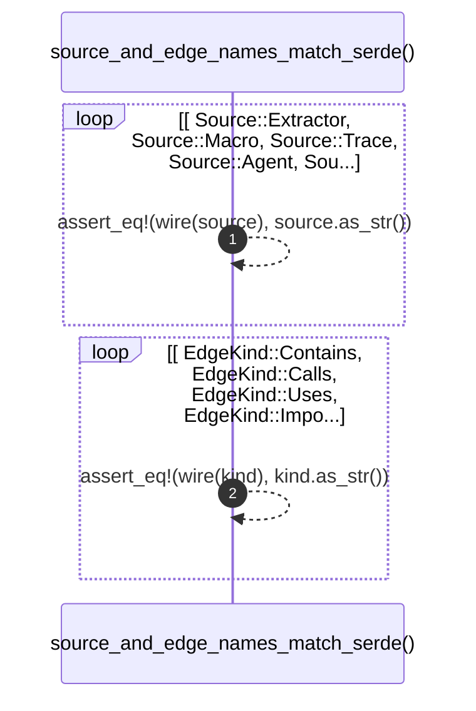

# `robby_ir::model::source_and_edge_names_match_serde`

[Self-model](../../../README.md) · [model::tests](index.md)

| | |
|---|---|
| kind | `code.function` |
| signature | `fn source_and_edge_names_match_serde()` |
| location | [`crates/robby-ir/src/model.rs:709`](../../../../../crates/robby-ir/src/model.rs#L709) |
| provenance | extractor · confidence 1.00 |

```rust
#[test]
    fn source_and_edge_names_match_serde() {
        for source in [
            Source::Extractor,
            Source::Macro,
            Source::Trace,
            Source::Agent,
            Source::Hand,
        ] {
            assert_eq!(wire(source), source.as_str());
        }
        for kind in [
            EdgeKind::Contains,
            EdgeKind::Calls,
            EdgeKind::Uses,
            EdgeKind::Imports,
            EdgeKind::Implements,
            EdgeKind::Extends,
            EdgeKind::Returns,
            EdgeKind::Field,
            EdgeKind::References,
        ] {
            assert_eq!(wire(kind), kind.as_str());
        }
    }
```



2 steps · 0 observed · 2 possible only

