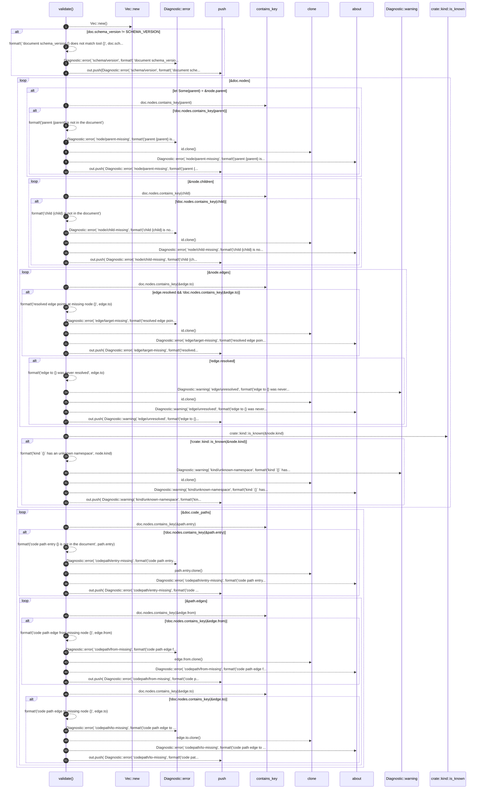

# `robby_ir::model::validate`

[Self-model](../../README.md) · [model](index.md)

| | |
|---|---|
| kind | `code.function` |
| signature | `fn validate(doc: &Document) -> Vec<Diagnostic>` |
| location | [`crates/robby-ir/src/model.rs:450`](../../../../crates/robby-ir/src/model.rs#L450) |
| provenance | extractor · confidence 1.00 |

> Structural checks that do not depend on source text.
> 
> Returns diagnostics rather than a `Result`: a graph with warnings is still
> renderable, and hiding soft problems behind a hard error is how they rot.

```rust
/// Structural checks that do not depend on source text.
///
/// Returns diagnostics rather than a `Result`: a graph with warnings is still
/// renderable, and hiding soft problems behind a hard error is how they rot.
pub fn validate(doc: &Document) -> Vec<Diagnostic> {
    let mut out = Vec::new();

    if doc.schema_version != SCHEMA_VERSION {
        out.push(Diagnostic::error(
            "schema/version",
            format!(
                "document schema_version {} does not match tool {}",
                doc.schema_version, SCHEMA_VERSION
            ),
        ));
    }

    for (id, node) in &doc.nodes {
        if let Some(parent) = &node.parent {
            if !doc.nodes.contains_key(parent) {
                out.push(
                    Diagnostic::error(
                        "node/parent-missing",
                        format!("parent {parent} is not in the document"),
                    )
                    .about(id.clone()),
                );
            }
        }
        for child in &node.children {
            if !doc.nodes.contains_key(child) {
                out.push(
                    Diagnostic::error(
                        "node/child-missing",
                        format!("child {child} is not in the document"),
                    )
                    .about(id.clone()),
                );
            }
        }
        for edge in &node.edges {
            if edge.resolved && !doc.nodes.contains_key(&edge.to) {
                out.push(
                    Diagnostic::error(
                        "edge/target-missing",
                        format!("resolved edge points at missing node {}", edge.to),
                    )
                    .about(id.clone()),
                );
            }
            if !edge.resolved {
                out.push(
                    Diagnostic::warning(
                        "edge/unresolved",
                        format!("edge to {} was never resolved", edge.to),
                    )
                    .about(id.clone()),
                );
            }
        }
        if !crate::kind::is_known(&node.kind) {
            out.push(
                Diagnostic::warning(
                    "kind/unknown-namespace",
                    format!("kind `{}` has an unknown namespace", node.kind),
                )
                .about(id.clone()),
            );
        }
    }

    for path in &doc.code_paths {
        if !doc.nodes.contains_key(&path.entry) {
            out.push(
                Diagnostic::error(
                    "codepath/entry-missing",
                    format!("code path entry {} is not in the document", path.entry),
                )
                .about(path.entry.clone()),
            );
        }
        for edge in &path.edges {
            if !doc.nodes.contains_key(&edge.from) {
                out.push(
                    Diagnostic::error(
                        "codepath/from-missing",
                        format!("code path edge from missing node {}", edge.from),
                    )
                    .about(edge.from.clone()),
                );
            }
            if !doc.nodes.contains_key(&edge.to) {
                out.push(
                    Diagnostic::error(
                        "codepath/to-missing",
                        format!("code path edge to missing node {}", edge.to),
                    )
                    .about(edge.to.clone()),
                );
            }
        }
    }

    out
}
```



51 steps · 0 observed · 51 possible only

**Edges**

- calls → [`robby_ir::model::impl Edge::new`](index.md)
- calls → [`robby_ir::model::impl Diagnostic::error`](index.md)
- calls → [`robby_render::report::impl Report::push`](../../robby_render/report/index.md)
- calls → [`robby_ir::model::impl Diagnostic::error`](index.md)
- calls → [`robby_ir::model::impl Diagnostic::about`](index.md)
- calls → [`robby_render::report::impl Report::push`](../../robby_render/report/index.md)
- calls → [`robby_ir::model::impl Diagnostic::error`](index.md)
- calls → [`robby_ir::model::impl Diagnostic::about`](index.md)
- calls → [`robby_render::report::impl Report::push`](../../robby_render/report/index.md)
- calls → [`robby_ir::model::impl Diagnostic::error`](index.md)
- calls → [`robby_ir::model::impl Diagnostic::about`](index.md)
- calls → [`robby_render::report::impl Report::push`](../../robby_render/report/index.md)
- calls → [`robby_ir::model::impl Diagnostic::warning`](index.md)
- calls → [`robby_ir::model::impl Diagnostic::about`](index.md)
- calls → [`robby_render::report::impl Report::push`](../../robby_render/report/index.md)
- calls → [`robby_ir::kind::is_known`](../kind/is-known.md)
- calls → [`robby_ir::model::impl Diagnostic::warning`](index.md)
- calls → [`robby_ir::model::impl Diagnostic::about`](index.md)
- calls → [`robby_render::report::impl Report::push`](../../robby_render/report/index.md)
- calls → [`robby_ir::model::impl Diagnostic::error`](index.md)
- calls → [`robby_ir::model::impl Diagnostic::about`](index.md)
- calls → [`robby_render::report::impl Report::push`](../../robby_render/report/index.md)
- calls → [`robby_ir::model::impl Diagnostic::error`](index.md)
- calls → [`robby_ir::model::impl Diagnostic::about`](index.md)
- calls → [`robby_render::report::impl Report::push`](../../robby_render/report/index.md)
- calls → [`robby_ir::model::impl Diagnostic::error`](index.md)
- calls → [`robby_ir::model::impl Diagnostic::about`](index.md)
- calls → [`robby_render::report::impl Report::push`](../../robby_render/report/index.md)

## References

- calls → [`robby_ir::kind`](../kind/index.md) — is_known
- calls → [`robby_ir::model`](index.md) — about, error, new, warning
- calls → [`robby_render::report`](../../robby_render/report/index.md) — push

## Referenced by

- calls ← [`robby_render::pipeline::from_document`](../../robby_render/pipeline/from-document.md)

