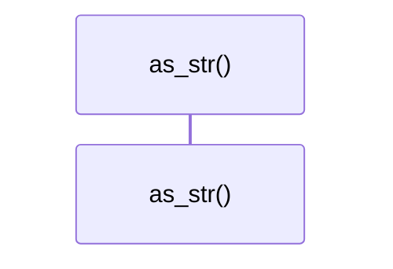

# `robby_ir::process::impl BlockKind`

[Self-model](../../README.md) · [process](index.md)

| | |
|---|---|
| kind | `code.impl` |
| location | [`crates/robby-ir/src/process.rs:79`](../../../../crates/robby-ir/src/process.rs#L79) |
| provenance | extractor · confidence 1.00 |

```rust
impl BlockKind {
    /// Mermaid block keyword. Matches the serde name.
    pub fn as_str(self) -> &'static str {
        match self {
            Self::Alt => "alt",
            Self::Opt => "opt",
            Self::Loop => "loop",
            Self::Par => "par",
            Self::Break => "break",
        }
    }
}
```

### `as_str`

| | |
|---|---|
| kind | `code.method` |
| signature | `fn as_str(1)` |
| location | [`crates/robby-ir/src/process.rs:80`](../../../../crates/robby-ir/src/process.rs#L80) |
| provenance | extractor · confidence 1.00 |

> Mermaid block keyword. Matches the serde name.

```rust
/// Mermaid block keyword. Matches the serde name.
    pub fn as_str(self) -> &'static str {
        match self {
            Self::Alt => "alt",
            Self::Opt => "opt",
            Self::Loop => "loop",
            Self::Par => "par",
            Self::Break => "break",
        }
    }
```



0 steps · 0 observed · 0 possible only

