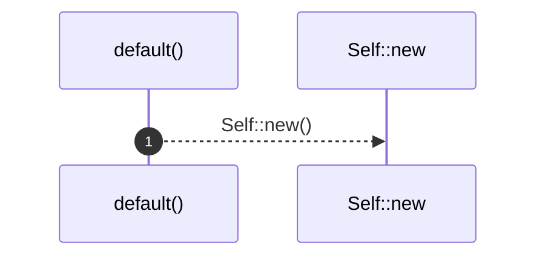

# `robby_ir::process::impl Default for Process`

[Self-model](../../README.md) · [process](index.md)

| | |
|---|---|
| kind | `code.impl` |
| location | [`crates/robby-ir/src/process.rs:148`](../../../../crates/robby-ir/src/process.rs#L148) |
| provenance | extractor · confidence 1.00 |

```rust
impl Default for Process {
    fn default() -> Self {
        Self::new()
    }
}
```

## References

- calls → [`robby_ir::process`](index.md) — new

## Referenced by

- calls ← [`robby_cli::enrich_comments`](../../robby_cli/enrich-comments.md)
- calls ← [`robby_extract::typescript::extract_file`](../../robby_extract/typescript/extract-file.md)
- calls ← [`robby_ir::coverage::scan_trivia`](../coverage/scan-trivia.md)

### `default`

| | |
|---|---|
| kind | `code.method` |
| signature | `fn default(0)` |
| location | [`crates/robby-ir/src/process.rs:149`](../../../../crates/robby-ir/src/process.rs#L149) |
| provenance | extractor · confidence 1.00 |

```rust
fn default() -> Self {
        Self::new()
    }
```



1 steps · 0 observed · 1 possible only

**Edges**

- calls → [`robby_ir::process::impl Process::new`](index.md)

