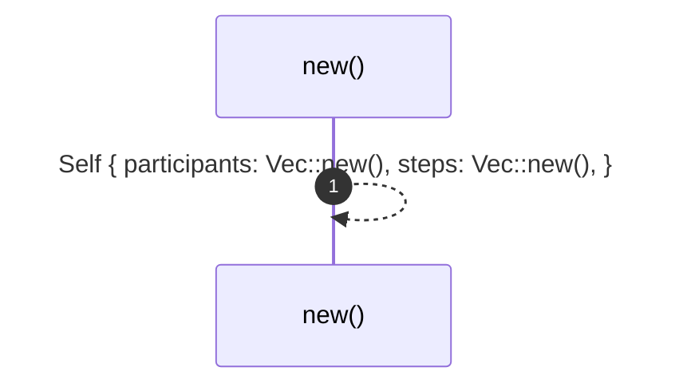
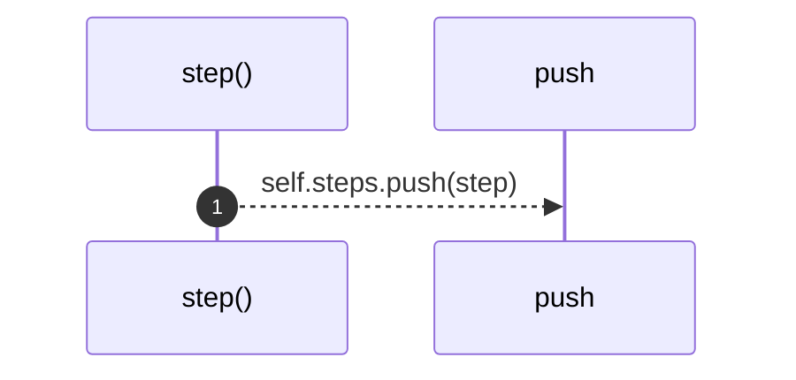
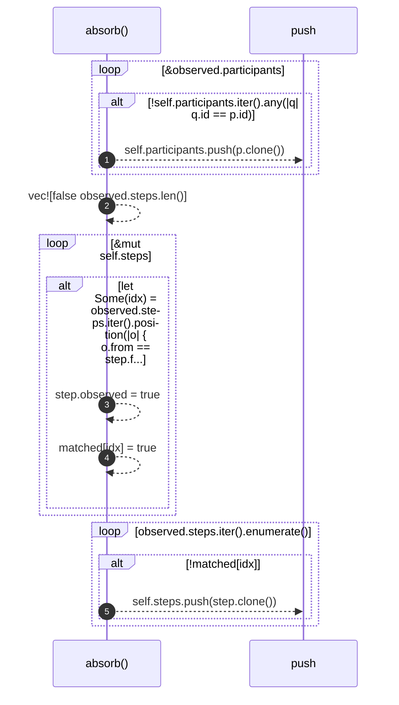

# `robby_ir::process::impl Process`

[Self-model](../../README.md) · [process](index.md)

| | |
|---|---|
| kind | `code.impl` |
| location | [`crates/robby-ir/src/process.rs:92`](../../../../crates/robby-ir/src/process.rs#L92) |
| provenance | extractor · confidence 1.00 |

```rust
impl Process {
    pub fn new() -> Self {
        Self {
            participants: Vec::new(),
            steps: Vec::new(),
        }
    }

    /// Add a participant, returning its index. Duplicate ids are ignored.
    pub fn participant(&mut self, id: impl Into<String>, label: impl Into<String>, kind: Kind) -> usize {
        let id = id.into();
        if let Some(idx) = self.participants.iter().position(|p| p.id == id) {
            return idx;
        }
        self.participants.push(Participant {
            id,
            label: label.into(),
            kind,
        });
        self.participants.len() - 1
    }

    pub fn step(&mut self, step: Step) {
        self.steps.push(step);
    }

    /// Merge an observed process into this (static) one.
    ///
    /// Matching is by `(from, to, label)`. Steps seen at runtime are marked
    /// observed; steps known statically but never seen stay dashed. Observed
    /// steps not present statically are appended, because runtime is the
    /// ground truth for what actually happened.
    pub fn absorb(&mut self, observed: &Process) {
        for p in &observed.participants {
            if !self.participants.iter().any(|q| q.id == p.id) {
                self.participants.push(p.clone());
            }
        }

        let mut matched = vec![false; observed.steps.len()];
        for step in &mut self.steps {
            if let Some(idx) = observed.steps.iter().position(|o| {
                o.from == step.from && o.to == step.to && o.label == step.label
            }) {
                step.observed = true;
                matched[idx] = true;
            }
        }
        for (idx, step) in observed.steps.iter().enumerate() {
            if !matched[idx] {
                self.steps.push(step.clone());
            }
        }
    }
}
```

### `new`

| | |
|---|---|
| kind | `code.method` |
| signature | `fn new(0)` |
| location | [`crates/robby-ir/src/process.rs:93`](../../../../crates/robby-ir/src/process.rs#L93) |
| provenance | extractor · confidence 1.00 |

```rust
pub fn new() -> Self {
        Self {
            participants: Vec::new(),
            steps: Vec::new(),
        }
    }
```



1 steps · 0 observed · 1 possible only

### `participant`

| | |
|---|---|
| kind | `code.method` |
| signature | `fn participant(4)` |
| location | [`crates/robby-ir/src/process.rs:100`](../../../../crates/robby-ir/src/process.rs#L100) |
| provenance | extractor · confidence 1.00 |

> Add a participant, returning its index. Duplicate ids are ignored.

```rust
/// Add a participant, returning its index. Duplicate ids are ignored.
    pub fn participant(&mut self, id: impl Into<String>, label: impl Into<String>, kind: Kind) -> usize {
        let id = id.into();
        if let Some(idx) = self.participants.iter().position(|p| p.id == id) {
            return idx;
        }
        self.participants.push(Participant {
            id,
            label: label.into(),
            kind,
        });
        self.participants.len() - 1
    }
```

```mermaid
sequenceDiagram
    autonumber
    participant participant as participant()
    participant into as into
    participant push as push
    participant-->>into: id.into()
    alt let Some(idx) = self.participants.iter().position(|p| p.id == id)
    participant-->>participant: idx
    participant-->>participant: return
    end
    participant-->>push: self.participants.push(Participant { id, label: label.into(), kind, })
    participant-->>participant: self.participants.len() - 1
```

5 steps · 0 observed · 5 possible only

### `step`

| | |
|---|---|
| kind | `code.method` |
| signature | `fn step(2)` |
| location | [`crates/robby-ir/src/process.rs:114`](../../../../crates/robby-ir/src/process.rs#L114) |
| provenance | extractor · confidence 1.00 |

```rust
pub fn step(&mut self, step: Step) {
        self.steps.push(step);
    }
```



1 steps · 0 observed · 1 possible only

### `absorb`

| | |
|---|---|
| kind | `code.method` |
| signature | `fn absorb(2)` |
| location | [`crates/robby-ir/src/process.rs:118`](../../../../crates/robby-ir/src/process.rs#L118) |
| provenance | extractor · confidence 1.00 |

> Merge an observed process into this (static) one.
> 
> Matching is by `(from, to, label)`. Steps seen at runtime are marked
> observed; steps known statically but never seen stay dashed. Observed
> steps not present statically are appended, because runtime is the
> ground truth for what actually happened.

```rust
/// Merge an observed process into this (static) one.
    ///
    /// Matching is by `(from, to, label)`. Steps seen at runtime are marked
    /// observed; steps known statically but never seen stay dashed. Observed
    /// steps not present statically are appended, because runtime is the
    /// ground truth for what actually happened.
    pub fn absorb(&mut self, observed: &Process) {
        for p in &observed.participants {
            if !self.participants.iter().any(|q| q.id == p.id) {
                self.participants.push(p.clone());
            }
        }

        let mut matched = vec![false; observed.steps.len()];
        for step in &mut self.steps {
            if let Some(idx) = observed.steps.iter().position(|o| {
                o.from == step.from && o.to == step.to && o.label == step.label
            }) {
                step.observed = true;
                matched[idx] = true;
            }
        }
        for (idx, step) in observed.steps.iter().enumerate() {
            if !matched[idx] {
                self.steps.push(step.clone());
            }
        }
    }
```



5 steps · 0 observed · 5 possible only

