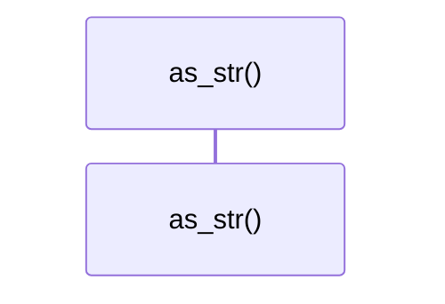

# `robby_ir::process::impl StepKind`

[Self-model](../../README.md) · [process](index.md)

| | |
|---|---|
| kind | `code.impl` |
| location | [`crates/robby-ir/src/process.rs:42`](../../../../crates/robby-ir/src/process.rs#L42) |
| provenance | extractor · confidence 1.00 |

```rust
impl StepKind {
    /// Serde / display name. One mapping, shared by every renderer.
    pub fn as_str(self) -> &'static str {
        match self {
            Self::Call => "call",
            Self::Return => "return",
            Self::Signal => "signal",
            Self::Decision => "decision",
            Self::Note => "note",
        }
    }
}
```

## Referenced by

- calls ← [`robby_ir::process::wire`](tests/wire.md)

### `as_str`

| | |
|---|---|
| kind | `code.method` |
| signature | `fn as_str(1)` |
| location | [`crates/robby-ir/src/process.rs:43`](../../../../crates/robby-ir/src/process.rs#L43) |
| provenance | extractor · confidence 1.00 |

> Serde / display name. One mapping, shared by every renderer.

```rust
/// Serde / display name. One mapping, shared by every renderer.
    pub fn as_str(self) -> &'static str {
        match self {
            Self::Call => "call",
            Self::Return => "return",
            Self::Signal => "signal",
            Self::Decision => "decision",
            Self::Note => "note",
        }
    }
```



0 steps · 0 observed · 0 possible only

