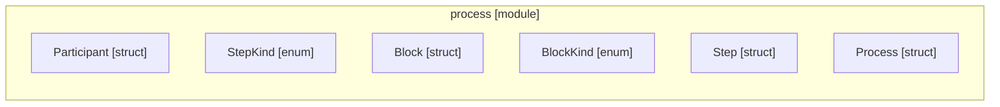

# `robby_ir::process`

[Self-model](../../README.md) · [robby_ir](../index.md)

| | |
|---|---|
| kind | `code.module` |
| declared at | [`crates/robby-ir/src/lib.rs:20`](../../../../crates/robby-ir/src/lib.rs#L20) |
| provenance | extractor · confidence 1.00 |
| nodes | 43 |

## Items

| Item | Kind | Steps | Location |
|---|---|---:|---|
| [`Participant`](participant.md) | `code.struct` | — | `crates/robby-ir/src/process.rs:18:1` |
| [`StepKind`](stepkind.md) | `code.enum` | — | `crates/robby-ir/src/process.rs:32:1` |
| [`Block`](block.md) | `code.struct` | — | `crates/robby-ir/src/process.rs:42:1` |
| [`BlockKind`](blockkind.md) | `code.enum` | — | `crates/robby-ir/src/process.rs:56:1` |
| [`Step`](step.md) | `code.struct` | — | `crates/robby-ir/src/process.rs:66:1` |
| [`Process`](process.md) | `code.struct` | — | `crates/robby-ir/src/process.rs:85:1` |
| [`impl Process`](impl-process.md) | `code.impl` | — | `crates/robby-ir/src/process.rs:92:1` |
| [`impl Default for Process`](impl-default-for-process.md) | `code.impl` | — | `crates/robby-ir/src/process.rs:148:1` |

## Imports

- `use schemars::JsonSchema;`
- `use serde::{Deserialize, Serialize};`
- `use crate::kind::Kind;`
- `use crate::span::Span;`

