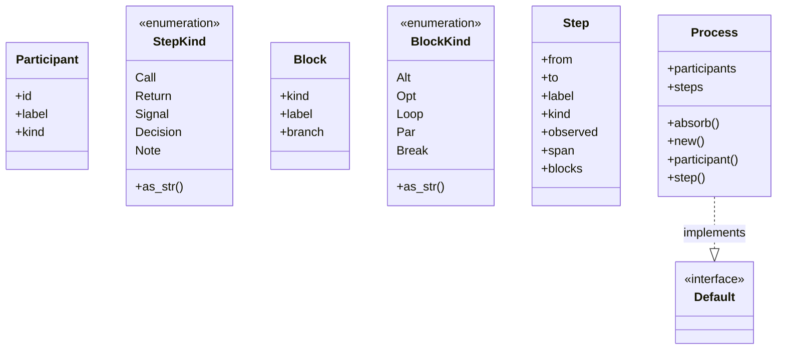
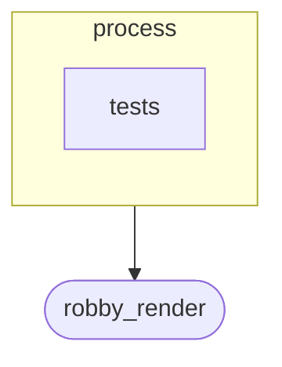
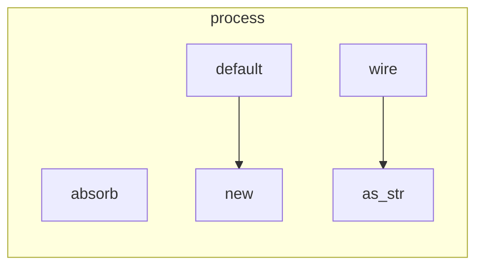

# `robby_ir::process`

[Self-model](../../README.md) · [robby_ir](../index.md)

| | |
|---|---|
| kind | `code.module` |
| declared at | [`crates/robby-ir/src/lib.rs:23`](../../../../crates/robby-ir/src/lib.rs#L23) |
| provenance | extractor · confidence 1.00 |
| nodes | 51 |

## Types



## Package diagram



## Module coupling



## Dependency matrix

| | process | tests | robby_render |
|---|---:|---:|---:|
| **process** | · | | 2 |
| **tests** | | · | |
| **robby_render** | | | · |

## Comments

- `crates/robby-ir/src/process.rs:111:1` (docs, `robby_ir::process::Process`): "The process a node performs, or the process a trace recorded."
  ```
  /// The process a node performs, or the process a trace recorded.
  #[derive(Debug, Clone, PartialEq, Eq, Serialize, Deserialize, JsonSchema)]
  pub struct Process {
      pub participants: Vec<Participant>,
      pub steps: Vec<Step>,
  }
  ```
- `crates/robby-ir/src/process.rs:126:5` (docs, `robby_ir::process::impl Process::participant`): "Add a participant, returning its index. Duplicate ids are ignored."
  ```
  /// Add a participant, returning its index. Duplicate ids are ignored.
      pub fn participant(
          &mut self,
          id: impl Into<String>,
          label: impl Into<String>,
          kind: Kind,
      ) -> usize {
          let id = id.into();
          if let Some(idx) = self.participants.iter().position(|p| p.id == id) {
              return idx;
          }
          self.participants.push(Participant {
              id,
              label: label.into(),
              kind,
          });
          self.participants.len() - 1
      }
  ```
- `crates/robby-ir/src/process.rs:149:5` (docs, `robby_ir::process::impl Process::absorb`): "Merge an observed process into this (static) one. Matching is by `(from, to, label)`. Steps seen at runtime are marked …"
  ```
  /// Merge an observed process into this (static) one.
      ///
      /// Matching is by `(from, to, label)`. Steps seen at runtime are marked
      /// observed; steps known statically but never seen stay dashed. Observed
      /// steps not present statically are appended, because runtime is the
      /// ground truth for what actually happened.
      ///
      /// Canonical implementation: [`crate::contract::Absorb`].
      pub fn absorb(&mut self, observed: &Process) {
          <Self as crate::contract::Absorb>::absorb(self, observed);
      }
  ```
- `crates/robby-ir/src/process.rs:18:1` (docs, `robby_ir::process::Participant`): "One lifeline in a sequence diagram. Today a participant is a module, scope, or type. The field set is deliberately acto…"
  ```
  /// One lifeline in a sequence diagram.
  ///
  /// Today a participant is a module, scope, or type. The field set is
  /// deliberately actor-neutral so that `agent.*` participants can be added
  /// later without touching the renderer.
  #[derive(Debug, Clone, PartialEq, Eq, Serialize, Deserialize, JsonSchema)]
  pub struct Participant {
      /// Local identifier, referenced by [`Step::from`] and [`Step::to`].
      pub id: String,
      /// Human-facing label, e.g. `io::load` or `planner`.
      pub label: String,
      pub kind: Kind,
  }
  ```
- `crates/robby-ir/src/process.rs:43:5` (docs, `robby_ir::process::impl StepKind::as_str`): "Serde / display name. One mapping, shared by every renderer."
  ```
  /// Serde / display name. One mapping, shared by every renderer.
      pub fn as_str(self) -> &'static str {
          match self {
              Self::Call => "call",
              Self::Return => "return",
              Self::Signal => "signal",
              Self::Decision => "decision",
              Self::Note => "note",
          }
      }
  ```
- `crates/robby-ir/src/process.rs:55:1` (docs, `robby_ir::process::Block`): "A control-flow frame enclosing a step. Frames form a stack per step. The renderer diffs consecutive stacks and emits `a…"
  ```
  /// A control-flow frame enclosing a step.
  ///
  /// Frames form a stack per step. The renderer diffs consecutive stacks and
  /// emits `alt` / `else` / `opt` / `loop` / `end` accordingly, which keeps the
  /// IR flat and diff-friendly while still expressing nesting.
  #[derive(Debug, Clone, PartialEq, Eq, Serialize, Deserialize, JsonSchema)]
  pub struct Block {
      pub kind: BlockKind,
      pub label: String,
      /// For `alt`: which branch this step belongs to. Rendered as `else`.
      #[serde(default, skip_serializing_if = "Option::is_none")]
      pub branch: Option<String>,
  }
  ```
- `crates/robby-ir/src/process.rs:80:5` (docs, `robby_ir::process::impl BlockKind::as_str`): "Mermaid block keyword. Matches the serde name."
  ```
  /// Mermaid block keyword. Matches the serde name.
      pub fn as_str(self) -> &'static str {
          match self {
              Self::Alt => "alt",
              Self::Opt => "opt",
              Self::Loop => "loop",
              Self::Par => "par",
              Self::Break => "break",
          }
      }
  ```
- `crates/robby-ir/src/process.rs:92:1` (docs, `robby_ir::process::Step`): "A single ordered interaction."
  ```
  /// A single ordered interaction.
  #[derive(Debug, Clone, PartialEq, Eq, Serialize, Deserialize, JsonSchema)]
  pub struct Step {
      pub from: String,
      pub to: String,
      pub label: String,
      pub kind: StepKind,
      /// `true` when a runtime trace observed this step.
      ///
      /// `false` means "possible per static analysis". The renderer draws
      /// observed steps solid and possible steps dashed, which is how the
      /// static/runtime merge is expressed visually.
      pub observed: bool,
      #[serde(default, skip_serializing_if = "Option::is_none")]
      pub span: Option<Span>,
      #[serde(default, skip_serializing_if = "Vec::is_empty")]
      pub blocks: Vec<Block>,
  }
  ```
## References

- calls → [`robby_render::report`](../../robby_render/report/index.md) — push

## Referenced by

- calls ← [`robby_cli::enrich_comments`](../../robby_cli/enrich-comments.md)
- calls ← [`robby_extract::rust::build_process_sig`](../../robby_extract/rust/build-process-sig.md)
- calls ← [`robby_extract::rust::impl ProcBuilder<'_, '_>::emit`](../../robby_extract/rust/index.md)
- calls ← [`robby_extract::typescript::build_function_process`](../../robby_extract/typescript/build-function-process.md)
- calls ← [`robby_extract::typescript::emit_variable`](../../robby_extract/typescript/emit-variable.md)
- calls ← [`robby_extract::typescript::ensure_participant`](../../robby_extract/typescript/ensure-participant.md)
- calls ← [`robby_extract::typescript::extract_file`](../../robby_extract/typescript/extract-file.md)
- calls ← [`robby_ir::contract::absorb_trait_marks_matching_steps_observed`](../contract/tests/absorb-trait-marks-matching-steps-observed.md)
- calls ← [`robby_ir::coverage::scan_trivia`](../coverage/scan-trivia.md)
- calls ← [`robby_render::test_markdown::fixture`](../../robby_render/test_markdown/fixture.md)
- calls ← [`robby_render::test_render::process`](../../robby_render/test_render/process.md)
- calls ← [`robby_render::test_web::demo_doc`](../../robby_render/test_web/demo-doc.md)
- calls ← [`robby_render::view::execution::add_callable`](../../robby_render/view/execution/add-callable.md)
- calls ← [`robby_render::view::execution::from_code_path`](../../robby_render/view/execution/from-code-path.md)

## Modules

- [`process::tests`](tests/index.md) — 4 nodes

## Items

| Item | Kind | Steps | Location |
|---|---|---:|---|
| [`Participant`](participant.md) | `code.struct` | — | `crates/robby-ir/src/process.rs:18:1` |
| [`StepKind`](stepkind.md) | `code.enum` | — | `crates/robby-ir/src/process.rs:32:1` |
| [`impl StepKind`](impl-stepkind.md) | `code.impl` | — | `crates/robby-ir/src/process.rs:42:1` |
| [`Block`](block.md) | `code.struct` | — | `crates/robby-ir/src/process.rs:55:1` |
| [`BlockKind`](blockkind.md) | `code.enum` | — | `crates/robby-ir/src/process.rs:69:1` |
| [`impl BlockKind`](impl-blockkind.md) | `code.impl` | — | `crates/robby-ir/src/process.rs:79:1` |
| [`Step`](step.md) | `code.struct` | — | `crates/robby-ir/src/process.rs:92:1` |
| [`Process`](process.md) | `code.struct` | — | `crates/robby-ir/src/process.rs:111:1` |
| [`impl Process`](impl-process.md) | `code.impl` | — | `crates/robby-ir/src/process.rs:118:1` |
| [`impl Default for Process`](impl-default-for-process.md) | `code.impl` | — | `crates/robby-ir/src/process.rs:162:1` |

## Imports

- `use schemars::JsonSchema;`
- `use serde::{Deserialize, Serialize};`
- `use crate::kind::Kind;`
- `use crate::span::Span;`

