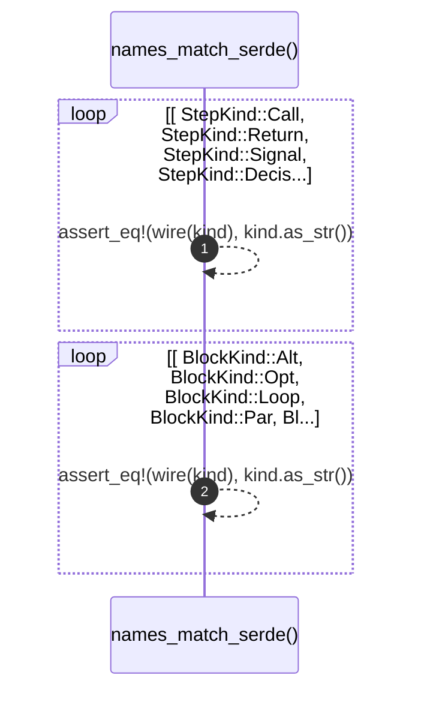

# `robby_ir::process::names_match_serde`

[Self-model](../../../README.md) · [process::tests](index.md)

| | |
|---|---|
| kind | `code.function` |
| signature | `fn names_match_serde()` |
| location | [`crates/robby-ir/src/process.rs:180`](../../../../../crates/robby-ir/src/process.rs#L180) |
| provenance | extractor · confidence 1.00 |

```rust
#[test]
    fn names_match_serde() {
        for kind in [
            StepKind::Call,
            StepKind::Return,
            StepKind::Signal,
            StepKind::Decision,
            StepKind::Note,
        ] {
            assert_eq!(wire(kind), kind.as_str());
        }
        for kind in [
            BlockKind::Alt,
            BlockKind::Opt,
            BlockKind::Loop,
            BlockKind::Par,
            BlockKind::Break,
        ] {
            assert_eq!(wire(kind), kind.as_str());
        }
    }
```



2 steps · 0 observed · 2 possible only

