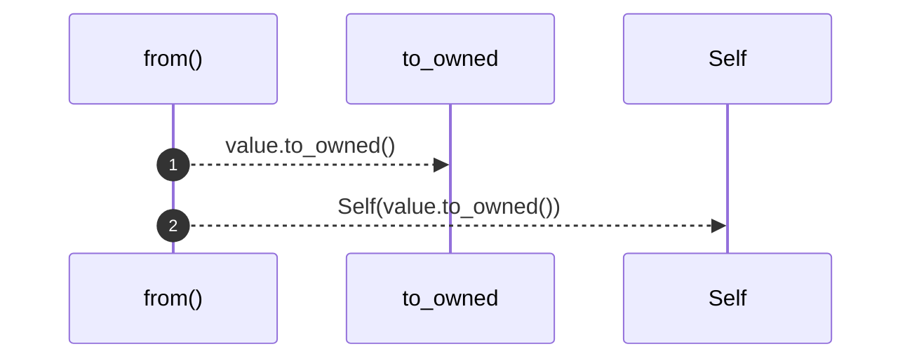

# `robby_ir::run::impl From<&str> for RecipeId`

[Self-model](../../README.md) · [run](index.md)

| | |
|---|---|
| kind | `code.impl` |
| location | [`crates/robby-ir/src/run.rs:36`](../../../../crates/robby-ir/src/run.rs#L36) |
| provenance | extractor · confidence 1.00 |

```rust
impl From<&str> for RecipeId {
    fn from(value: &str) -> Self {
        Self(value.to_owned())
    }
}
```

### `from`

| | |
|---|---|
| kind | `code.method` |
| signature | `fn from(1)` |
| location | [`crates/robby-ir/src/run.rs:37`](../../../../crates/robby-ir/src/run.rs#L37) |
| provenance | extractor · confidence 1.00 |

```rust
fn from(value: &str) -> Self {
        Self(value.to_owned())
    }
```



2 steps · 0 observed · 2 possible only

