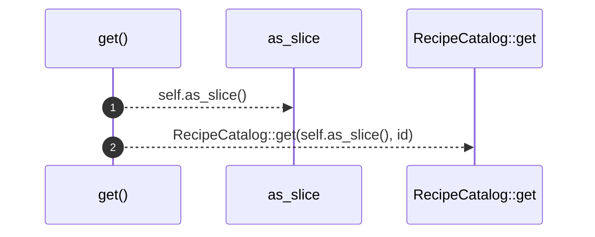

# `robby_ir::run::impl RecipeCatalog for Vec<Recipe>`

[Self-model](../../README.md) · [run](index.md)

| | |
|---|---|
| kind | `code.impl` |
| location | [`crates/robby-ir/src/run.rs:186`](../../../../crates/robby-ir/src/run.rs#L186) |
| provenance | extractor · confidence 1.00 |

```rust
impl RecipeCatalog for Vec<Recipe> {
    fn get(&self, id: &RecipeId) -> Option<&Recipe> {
        RecipeCatalog::get(self.as_slice(), id)
    }
}
```

### `get`

| | |
|---|---|
| kind | `code.method` |
| signature | `fn get(2)` |
| location | [`crates/robby-ir/src/run.rs:187`](../../../../crates/robby-ir/src/run.rs#L187) |
| provenance | extractor · confidence 1.00 |

```rust
fn get(&self, id: &RecipeId) -> Option<&Recipe> {
        RecipeCatalog::get(self.as_slice(), id)
    }
```



2 steps · 0 observed · 2 possible only

**Edges**

- calls → [`robby_ir::run::impl RecipeCatalog for Vec<Recipe>::get`](index.md)

