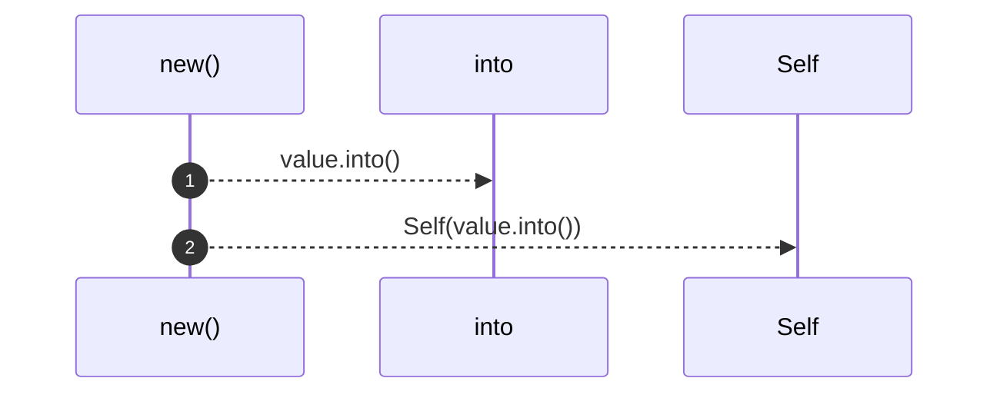
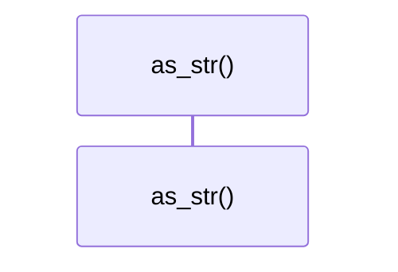

# `robby_ir::run::impl RecipeId`

[Self-model](../../README.md) · [run](index.md)

| | |
|---|---|
| kind | `code.impl` |
| location | [`crates/robby-ir/src/run.rs:20`](../../../../crates/robby-ir/src/run.rs#L20) |
| provenance | extractor · confidence 1.00 |

```rust
impl RecipeId {
    pub fn new(value: impl Into<String>) -> Self {
        Self(value.into())
    }

    pub fn as_str(&self) -> &str {
        &self.0
    }
}
```

## Referenced by

- calls ← [`robby_ir::run::run_record_serializes_recipe_string`](tests/run-record-serializes-recipe-string.md)

### `new`

| | |
|---|---|
| kind | `code.method` |
| signature | `fn new(1)` |
| location | [`crates/robby-ir/src/run.rs:21`](../../../../crates/robby-ir/src/run.rs#L21) |
| provenance | extractor · confidence 1.00 |

```rust
pub fn new(value: impl Into<String>) -> Self {
        Self(value.into())
    }
```



2 steps · 0 observed · 2 possible only

### `as_str`

| | |
|---|---|
| kind | `code.method` |
| signature | `fn as_str(1)` |
| location | [`crates/robby-ir/src/run.rs:25`](../../../../crates/robby-ir/src/run.rs#L25) |
| provenance | extractor · confidence 1.00 |

```rust
pub fn as_str(&self) -> &str {
        &self.0
    }
```



0 steps · 0 observed · 0 possible only

