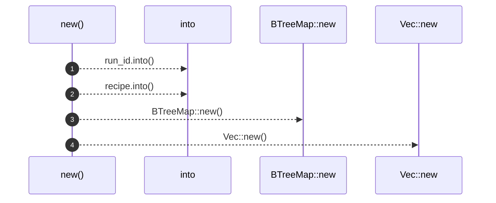
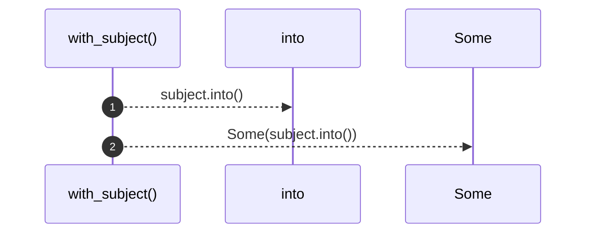
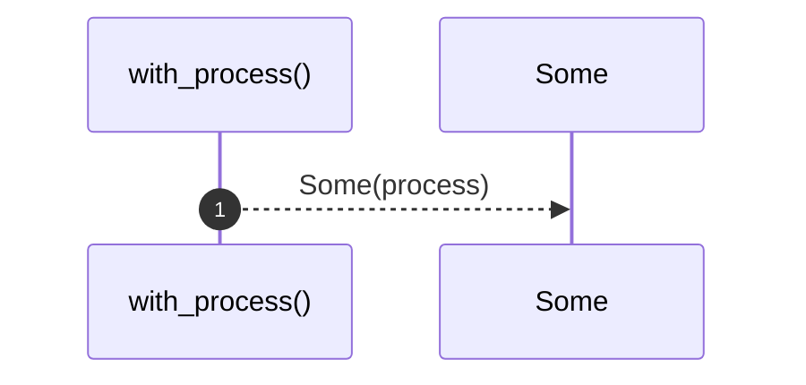

# `robby_ir::run::impl RunRecord`

[Self-model](../../README.md) · [run](index.md)

| | |
|---|---|
| kind | `code.impl` |
| location | [`crates/robby-ir/src/run.rs:137`](../../../../crates/robby-ir/src/run.rs#L137) |
| provenance | extractor · confidence 1.00 |

```rust
impl RunRecord {
    pub fn new(run_id: impl Into<String>, recipe: impl Into<RecipeId>, status: RunStatus) -> Self {
        Self {
            run_id: run_id.into(),
            recipe: recipe.into(),
            subject: None,
            status,
            started_at: None,
            finished_at: None,
            exit_code: None,
            stdout_tail: None,
            stats: BTreeMap::new(),
            products: Vec::new(),
            process: None,
        }
    }

    pub fn with_subject(mut self, subject: impl Into<String>) -> Self {
        self.subject = Some(subject.into());
        self
    }

    pub fn with_process(mut self, process: Process) -> Self {
        self.process = Some(process);
        self
    }
}
```

## Referenced by

- calls ← [`robby_ir::run::run_record_serializes_recipe_string`](tests/run-record-serializes-recipe-string.md)

### `new`

| | |
|---|---|
| kind | `code.method` |
| signature | `fn new(3)` |
| location | [`crates/robby-ir/src/run.rs:138`](../../../../crates/robby-ir/src/run.rs#L138) |
| provenance | extractor · confidence 1.00 |

```rust
pub fn new(run_id: impl Into<String>, recipe: impl Into<RecipeId>, status: RunStatus) -> Self {
        Self {
            run_id: run_id.into(),
            recipe: recipe.into(),
            subject: None,
            status,
            started_at: None,
            finished_at: None,
            exit_code: None,
            stdout_tail: None,
            stats: BTreeMap::new(),
            products: Vec::new(),
            process: None,
        }
    }
```



4 steps · 0 observed · 4 possible only

**Edges**

- calls → [`robby_ir::run::impl RunRecord::new`](index.md)
- calls → [`robby_ir::run::impl RunRecord::new`](index.md)

### `with_subject`

| | |
|---|---|
| kind | `code.method` |
| signature | `fn with_subject(2)` |
| location | [`crates/robby-ir/src/run.rs:154`](../../../../crates/robby-ir/src/run.rs#L154) |
| provenance | extractor · confidence 1.00 |

```rust
pub fn with_subject(mut self, subject: impl Into<String>) -> Self {
        self.subject = Some(subject.into());
        self
    }
```



2 steps · 0 observed · 2 possible only

### `with_process`

| | |
|---|---|
| kind | `code.method` |
| signature | `fn with_process(2)` |
| location | [`crates/robby-ir/src/run.rs:159`](../../../../crates/robby-ir/src/run.rs#L159) |
| provenance | extractor · confidence 1.00 |

```rust
pub fn with_process(mut self, process: Process) -> Self {
        self.process = Some(process);
        self
    }
```



1 steps · 0 observed · 1 possible only

